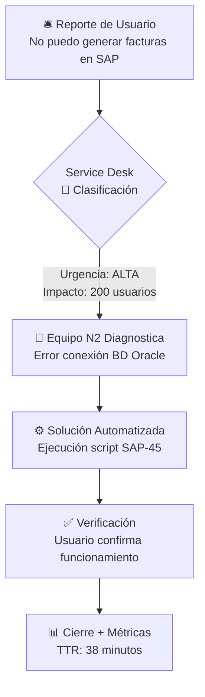
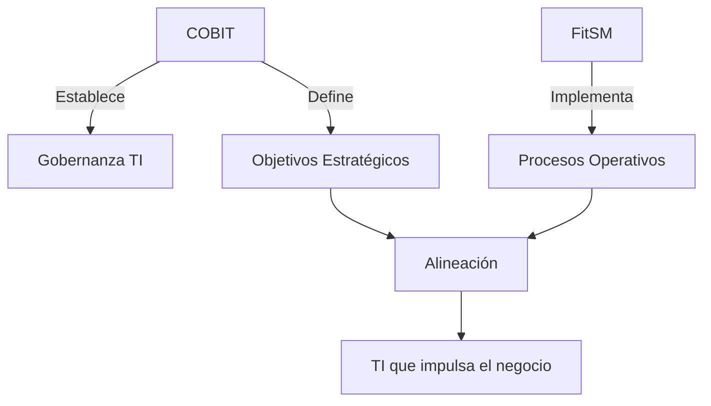
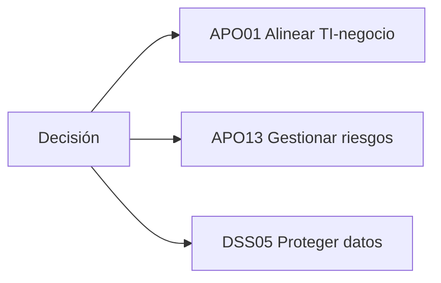

# Ejercicios

# 📚 Ejercicios sobre FitSM y COBIT  
**Respuestas estructuradas y formateadas para mejor legibilidad**  

---

## 1. ¿Por qué FitSM se considera un marco accesible? Ventajas  
✅ **FitSM es accesible porque:**  
- 🚀 **Ligero y sencillo**: Menos burocracia vs. ITIL.  
- 💰 **Bajo costo**: Sin certificaciones caras (documentación gratuita).Ideal para organizaciones sin estructura formal.  
- 📄 **Desarrollado en la simplisidad, claridad y agilidad.**
- 🏢 **Promueve la mejora continua sin burocracia excesiva.**
---
## 2. Procesos principales de FitSM con ejemplos prácticos

**📋 Lista de procesos con casos reales:**  

1. **Gestión de Incidentes**  
   > *Ejemplo:* Caída del correo empresarial → El Service Desk registra el caso, clasifica como "Alta Prioridad", y el equipo restaura el servicio en 30 minutos usando protocolos predefinidos.  

2. **Gestión de Problemas**  
   > *Ejemplo:* Fallos recurrentes en el servidor → Se analiza la causa raíz (ej: sobrecalentamiento) y se implementa una solución permanente (mejora del sistema de refrigeración).  

3. **Gestión de Cambios**  
   > *Ejemplo:* Actualización de un ERP → Se evalúa el impacto, se aprueba en un comité de cambio, y se ejecuta en horario no laboral con rollback planificado.  

4. **Gestión de Configuraciones**  
   > *Ejemplo:* Base de datos de activos TI → Se documenta que el servidor X tiene 32GB RAM, SO Linux, y está conectado al switch Y para rastreo rápido de dependencias.  

5. **Gestión de Niveles de Servicio**  
   > *Ejemplo:* Acuerdo con el área de ventas: "El CRM tendrá 99.5% disponibilidad en horario comercial, con penalizaciones por incumplimiento".  

6. **Gestión de la Continuidad**  
   > *Ejemplo:* Plan para ataques ransomware → Copias de seguridad offline diarias + simulacro de recuperación cada 3 meses.  

7. **Gestión de Proveedores**  
   > *Ejemplo:* Contrato con ISP → Cláusulas de compensación si el ancho de banda es inferior al 95% del acordado, con revisiones trimestrales.  

### 🔍 **Ejemplo Destacado: Gestión de Incidentes en Acción**  
**Caso Práctico:** *"Caída crítica en sistema SAP afectando área de facturación"*  

---

## 3. Contextos institucionales para FitSM  

| Contexto Institucional          | Ejemplos                              | Razón de Aplicación                                                                 | Beneficios Específicos                          |
|---------------------------------|---------------------------------------|-------------------------------------------------------------------------------------|-------------------------------------------------|
| **🏛️ Organizaciones Públicas**  | Ministerios, municipalidades          | Estandarizar TI con recursos limitados, evitando burocracia compleja                | Alineación con normativas públicas              |
| **🎓 Instituciones Educativas** | Universidades, colegios               | Gestionar servicios educativos (aulas virtuales, redes) con equipos multidisciplina | Adaptabilidad a entornos académicos variables   |
| **🏢 PYMES y Startups**         | Empresas emergentes, equipos TI pequeños | Implementar procesos esenciales sin inversión inicial elevada                     | Escalabilidad progresiva                        |
| **❤️ ONGs**                     | Organizaciones humanitarias           | Mantener servicios críticos (plataformas de donaciones) con bajo presupuesto        | Enfoque en impacto social sobre procesos       |
| **⚕️ Sectores no-Tecnológicos** | Hospitales, retail, agricultura       | TI como soporte (no core), priorizando eficiencia operativa                         | Integración con procesos sectoriales específicos|
| **🇪🇺 Proyectos Europeos**      | Consorcios Horizon Europe             | Cumplimiento con estándares promovidos por la UE                                    | Armonización en proyectos transnacionales      |

## 🔑 Beneficios Transversales de FitSM
- ✅ **Implementación ágil** (6-12 semanas vs. marcos complejos)
- 📊 **Enfoque en métricas prácticas** (SLAs, disponibilidad)
- 🌍 **Compatibilidad con otros estándares** (ISO 20000, ITIL)

> *Tabla 1. FitSM aplicado a contextos institucionales según necesidades operativas y presupuesto.*
---

## 4. Rol de *Service Owner* en FitSM  
🔧 **Responsabilidades clave:**  
- ✔️ Garantizar cumplimiento de SLAs.  
- ✔️ Punto de contacto principal del servicio.  
- ✔️ Coordinar equipos (ej. Service Desk).  

---

## 5. FitSM vs. ITIL: Facilidad de aplicación  
| **Criterio**       | FitSM 🟢                | ITIL 🔵                |  
|--------------------|------------------------|------------------------|  
| **Complejidad**    | Procesos simplificados | Alto detalle/burocracia |  
| **Costo**          | Gratuito/bajo costo    | Certificaciones caras  |  
| **Enfoque**        | PYMES/equipos pequeños | Grandes organizaciones |  

---

## 6. Enfoque de COBIT vs. FitSM  

| **Aspecto**       | **COBIT** 🎯                          | **FitSM** ⚙️                     |
|-------------------|--------------------------------------|----------------------------------|
| **Enfoque**       | *Gobernanza estratégica "nos ayuda a DECIDIR"* | *Gestión operativa ligera " nos ayuda a OPERAR MEJOR"*       |
| **Objetivo**      | Alinear TI con el negocio, gestionar riesgos y cumplimiento normativo. | Optimizar la entrega diaria de servicios TI con agilidad. |
| **Alcance**       | Cubre toda la organización (TI, procesos, gobierno). | Se centra en servicios TI (procesos operativos). |
| **Complejidad**   | Marco robusto (herramientas detalladas, KPI, roles). | Ligero y adaptable (ideal para entornos ágiles o pequeños). |
| **Certificación** | Orientado a altos ejecutivos (CISA, CGEIT). | Certificaciones prácticas para equipos técnicos. |
| **Flexibilidad**  | Requiere adaptación estructurada.    | Fácil de implementar (menos burocracia). |
| **Mejor uso**     | Empresas reguladas (banca, salud).   | Startups, PYMEs o proyectos ágiles. |

## Conclusión  
- **COBIT** es ideal para gobernanza integral (ej.: cumplir *SOX* o *GDPR*).  
- **FitSM** es ágil y pragmático (ej.: gestionar un *helpdesk* o servicios cloud).  

---
### ¿Quieres integrarlo con otros marcos?  
- **COBIT + ITIL**: Estrategia + Mejores prácticas en servicios.  
- **FitSM + ISO 20000**: Operaciones ligeras + Certificación internacional.  
---

## 7. Gobernanza según COBIT  
> *"Sistema de dirección que asegura que los recursos TI apoyen los objetivos del negocio, gestionando riesgos, recursos y regulaciones."*  

---

## 8. Habilitadores en COBIT  
🔌 **Qué son:** Elementos clave para implementar gobernanza (ejemplos):  
- **Procesos**: Gestión de riesgos.  
- **Estructuras**: Roles y responsabilidades.  
- **Información**: Métricas/Reportes.  

**📌 Objetivo:** Alinear TI con el negocio y medir eficacia.  

---

## 9. Complementar FitSM + COBIT

### 🏦 Ejemplo práctico: Banco

**COBIT (Nivel estratégico):**  
- Define el objetivo: *Reducir riesgos de ciberseguridad en un 30%*  
- Establece KPI: *0 brechas de datos en 2024*

**FitSM (Nivel operativo):**  
Implementa procesos clave:
- ✓ Gestión de Incidentes para ataques DDoS  
- ✓ Gestión de Cambios con validaciones de seguridad  
- ✓ Continuidad con backups cifrados

**🎯 Beneficios combinados:**
- ✔ **COBIT** da el **qué** (estrategia)  
- ✔ **FitSM** provee el **cómo** (ejecución)  
- ✔ Sinergia completa desde el gobierno hasta las operaciones

---

## 10. Ejemplo concreto de COBIT en decisiones estratégicas

### 🏥 Caso: Migración a la nube en una cadena hospitalaria

**Aporte de COBIT en distintos dominios:**

### ⚙️ Acciones clave

**Evaluación de riesgos (Dominio APO13):**  
- Análisis de compliance con *HIPAA / GDPR*  
- Matriz de riesgos para datos sensibles

**Selección de proveedor (Dominio APO10):**  
- Criterios: *Encriptación end-to-end*, *ubicación geográfica de datacenters*

**Métricas post-implementación (Dominio MEA03):**  
- Tiempo de acceso a historias clínicas: *reducido de 8s a 1.2s*  
- Costo operativo anual: *35% menos vs. on-premise*

---

### ✅ Resultado

- Migración aprobada con garantías de seguridad  
- Reducción del *40% en incidentes de disponibilidad*  
- Cumplimiento demostrable ante auditorías

---

### 🗂 Artefactos generados

- ◾ Reporte de alineación con objetivos corporativos  
- ◾ Análisis costo-beneficio con horizonte a 5 años  
- ◾ Plan de respuesta a brechas (requisito legal)

---

## Comparativo visual: Niveles de actuación

| Capa        | COBIT aporta...        | FitSM ejecuta...                   |
|-------------|-------------------------|-------------------------------------|
| Estratégica | Marco de gobierno       | -                                   |
| Táctica     | Estándares y controles  | Adaptación de procesos              |
| Operativa   | -                       | Gestión día a día de servicios      |

**Figura 1. Modelo de capas combinadas**

---

💡 **Resumen:** Ambos marcos juntos crean un ciclo completo:  
`COBIT ← Retroalimentación → FitSM → Datos operativos → COBIT`
