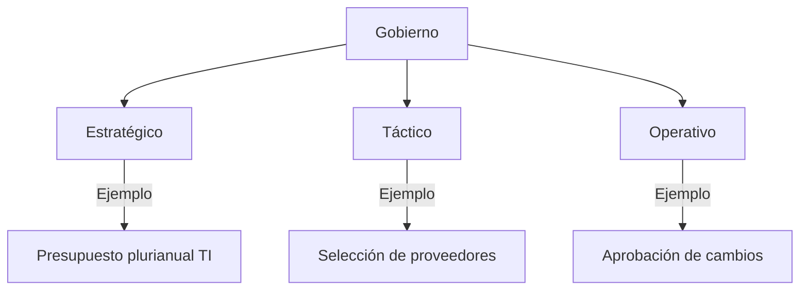
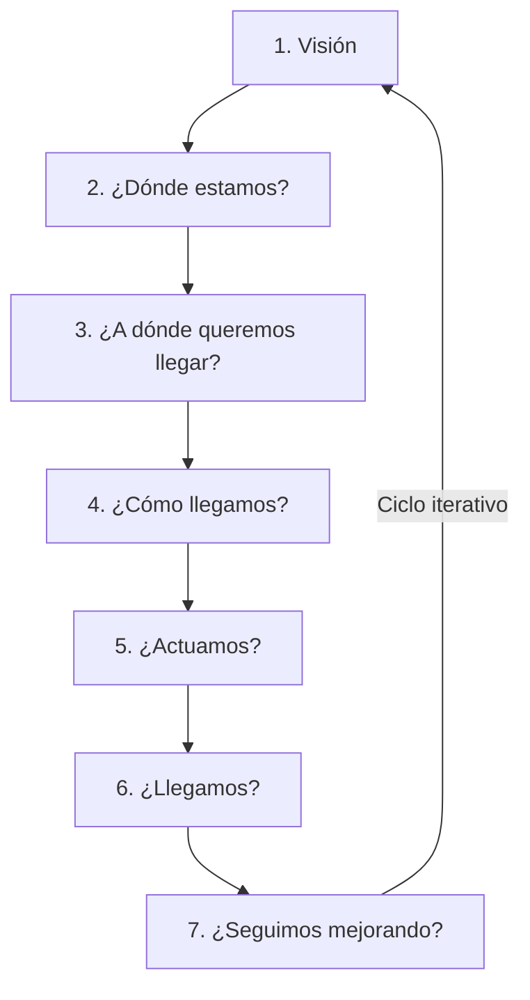

# Gestión de Servicios de Información (GSI)  
**Licenciatura en Ciberdefensa – Universidad de la Defensa Nacional**  
**Docentes:** Alejandro Fioretti - Flavio Alfano  
**Clase 4:** Fundamentos y principios de las metodologías de gestión  

---

## Objetivos de la clase  
- Presentar el concepto general de ITIL y su origen.  
- Explicar la finalidad de ITIL: alinear TI con el negocio y entregar valor.  
- Comprender la evolución y relevancia actual de ITIL.  
- Exponer las bases metodológicas de ITIL.  
- Mostrar cómo ITIL se complementa con otros marcos modernos.  

---

## ¿Qué es ITIL?  
**Definición:**  
- Marco de buenas prácticas para gestionar servicios de TI.  
- **Origen:** Creado por la CCTA (Reino Unido), gestionado actualmente por AXELOS.  
- **Objetivo principal:** Alinear servicios de TI con necesidades del negocio y maximizar valor al cliente.  

**Características clave:**  
- No es prescriptivo: flexible y adaptable.  
- Valor total = Utilidad + Garantía (perspectiva del cliente).  

---

## Evolución de ITIL  
| Versión | Año | Principales Cambios |  
|---------|-----|---------------------|  
| ITIL V1 | 1980s | 30+ libros de buenas prácticas. |  
| ITIL V2 | 2001 | Procesos consolidados (Soporte y Entrega). |  
| ITIL V3 | 2007/2011 | Introdujo el ciclo de vida del servicio (Estrategia, Diseño, Transición, Operación, Mejora). |  
| ITIL 4 | 2019 - Actualidad | Modelo flexible y ágil con Sistema de Valor del Servicio (SVS). |  

---
## ¿Qué significa que ITIL no sea prescriptivo?
### ITIL no es un manual que se sigue al pie de la letra. Es un conjunto de mejores prácticas que las organizaciones pueden adaptar y aplicar según sus necesidades, cultura, tamaño y madurez
- Flexible: no exige cumplir cada proceso al 100%. Se puede adoptar de forma gradual o parcial.
- Adaptable: se ajusta a distintas industrias, tipos de organización y marcos como Agile, DevOps, Lean.
- No impone herramientas específicas ni estructuras rígidas.
- Permite la combinación con otras prácticas o metodologías (Scrum, Kanban, COBIT, etc.)

---


## Pilares Fundamentales de ITIL  
### ¿Cuales fueron los principios base que le dieron forma a ITIL?: 
1. **Enfoque basado en procesos.**  
2. **Orientación al cliente y al valor.**  
3. **Ciclo de vida del servicio.**  
4. **Mejora continua.**  
5. **Gobierno y control.**  

### Son los conceptos estructurales sobre los que ITIL está construido.
- Si el servicio de TI falla, el proceso de negocio se ve afectado.
- La gestión de servicios busca alinear TI con las necesidades del negocio.

---

## Componentes Principales del SVS (Sistema de Valor del Servicio)  
- **Cadena de Valor del Servicio (SVC):** Modelo operativo central (actividades interconectadas).  
- **Prácticas:** 34 prácticas agrupadas en Gestión General, de Servicios y Técnica.  
- **Principios Guía:** 7 reglas prácticas (ej: "Enfocarse en el valor").  
- **Gobierno:** Marco de toma de decisiones alineado con objetivos.  
- **Mejora Continua:** 7 pasos iterativos (ej: "¿Dónde estamos?" → "¿Cómo llegamos?").  

---

## Conceptos Esenciales  
- **Servicio:** Medio para entregar valor sin gestionar riesgos/costos por el cliente.  
- **Cliente vs. Usuario:** Cliente pide/negocia; usuario consume el servicio.  
- **Dimensiones clave:**  
  1. Organizaciones y Personas.  
  2. Información y Tecnología.  
  3. Socios y Proveedores.  
  4. Flujos de Valor y Procesos.  

---
## ITIL - La cadena de valor del servicio (SVC)
- Es el modelo operativo central de ITIL 4.
- Representa  cómo  una  organización  transforma  la  demanda  en  valor,  mediante  un  conjunto  de  actividades interconectadas.
- No es un proceso lineal, sino un modelo flexible: las actividades se combinan según cada servicio, necesidad o situación.
- Su propósito es coordinar todas las capacidades de una organización para entregar, mejorar y mantener servicios. 
#### Actividades: Planificar, Mejorar, Involucrar, Diseñar y Transicionar, Obtener/Crear, Entregar y Brindar Soporte
---
## ITIL - Prácticas
#### ¿Qué son las prácticas?
Son conjuntos organizados de recursos (personas, procesos, tecnología, información) diseñados para realizar tareas o cumplir objetivos específicos.
- Reemplazan el concepto de “procesos” de versiones anteriores.
- Son más flexibles y adaptables.ITIL presenta 34 prácticas agrupadas en tres categorías:
    - Gestión General
    - Gestión de Servicios
    - Gestión Técnica
Ej: “La práctica de Gestión de Incidentes ayuda a restaurar servicios rápidamente cuando algo falla.”

---
## ITIL - Principios Guías
Son reglas prácticas y universales que ayudan a aplicar ITIL de forma efectiva. Están pensados para ser usados en la toma de decisiones diarias.
- Enfocarse en el valor. Todo lo que se hace debe generar valor para el cliente y la organización.
- Aprovechar lo que ya funciona. No reinventar la rueda.
- Progresar iterativamente con retroalimentación
- Colaborar y promover la visibilidad
- Pensar y trabajar de forma integral
- Mantenerlo simple y práctico
“Los principios guía de ITIL son como una brújula: te orientan siempre, incluso cuando cambia el camino.
---

## Ejemplo de Práctica: Gestión de Incidentes  
- **Proceso:** Atención escalonada (agentes → técnicos).  
- **Herramientas:** Sistema de tickets, base de conocimiento.  
- **Políticas:** "Tickets de alta prioridad resueltos en <30 min."  

---
# ITIL 4 - Los 7 Principios Guía  

Los principios guía de ITIL son reglas universales que orientan la toma de decisiones y la implementación de la gestión de servicios. Son aplicables en cualquier contexto organizacional.  

---

## 1. **Enfocarse en el valor**  
   - Todo servicio, proceso o acción debe generar valor tangible para el cliente y la organización.  
   - **Ejemplo:** Priorizar proyectos basados en su impacto en la experiencia del usuario.  

## 2. **Comenzar donde se está**  
   - Evitar reiniciar desde cero; evaluar y aprovechar recursos, procesos y capacidades existentes.  
   - **Ejemplo:** Mejorar un portal de autoservicio TI iterando sobre su versión actual en lugar de rediseñarlo completamente.  

## 3. **Progresar iterativamente con retroalimentación**  
   - Implementar cambios en pequeños incrementos, midiendo resultados y ajustando según feedback.  
   - **Ejemplo:** Lanzar mejoras de software en fases, validando cada una con usuarios.  

## 4. **Colaborar y promover visibilidad**  
   - Fomentar trabajo transversal entre equipos y transparentar información relevante.  
   - **Ejemplo:** Involucrar a desarrollo, operaciones y seguridad en la automatización de aprobaciones de cambios.  

## 5. **Pensar y trabajar de forma holística**  
   - Considerar todas las dimensiones del servicio (personas, procesos, tecnología, socios).  
   - **Ejemplo:** Al diseñar un servicio, evaluar su impacto en cumplimiento, seguridad y costos.  

## 6. **Mantenerlo simple y práctico**  
   - Eliminar complejidad innecesaria; optimizar procesos con soluciones eficientes.  
   - **Ejemplo:** Simplificar flujos de aprobación para cambios de bajo riesgo.  

## 7. **Optimizar y automatizar**  
   - Automatizar solo lo que está estandarizado y aporta eficiencia.  
   - **Ejemplo:** Usar chatbots para resolver incidentes frecuentes (ej: restablecer contraseñas).  

---

### Frase clave:  
*"Los principios guía son como una brújula: te orientan incluso cuando el camino cambia."*  

---

**Relación con otros componentes de ITIL:**  
- Se integran con la **Cadena de Valor del Servicio (SVC)** y las **34 prácticas**.  
- Son la base para la **Mejora Continua** (ej: retroalimentación iterativa).  

---
# ITIL - Principios Guía: Casos Prácticos

## 🔍 Caso 1: Rediseño de Portal de Autoservicio TI
**Decisión:** ¿Rediseño completo o mejora iterativa?

### Principios aplicados:
1. **Comenzar donde estás**  
   - Se auditó el portal existente identificando:  
     ✅ Funcionalidades bien valoradas por usuarios  
     ❌ Módulos con baja usabilidad  

2. **Progresar iterativamente**  
   - Implementación por fases:  
     ```mermaid
     graph LR
     A[Módulo de tickets] --> B[Feedback usuarios]
     B --> C[Ajustes]
     C --> D[Módulo de KB]
     ```
   - Métricas clave: % de resolución autónoma, tiempo promedio por ticket

3. **Enfocarse en el valor**  
   - Priorización basada en:  
     - Encuestas de satisfacción (60% peso)  
     - Impacto en volumen de llamadas al helpdesk (40% peso)  

**Resultado:**  
↑ 35% en adopción del portal  
↓ 20% en tickets de soporte básico  

---

## ⚙️ Caso 2: Automatización de Aprobaciones de Cambios  
**Decisión:** ¿Automatización total o parcial?  

### Principios aplicados:  
1. **Optimizar y automatizar**  
   - Criterios para automatizar:  
     ```mermaid
     flowchart TD
     A[Cambio] --> B{Riesgo?}
     B -->|Bajo| C[Automatizado]
     B -->|Medio/Alto| D[Revisión manual]
     ```

2. **Mantenerlo simple**  
   - Flujo para cambios de bajo riesgo:  
     `Solicitud → Validación automática (checklist) → Implementación`  
   - Eliminación de 3 pasos burocráticos redundantes  

3. **Pensar holísticamente**  
   - Equipos involucrados:  
     - **Seguridad:** Validación de políticas  
     - **Operaciones:** Definición de criterios técnicos  
     - **Desarrollo:** Integración con CI/CD  

**Resultado:**  
⏱️ Tiempo de aprobación reducido de 48h → 2h para cambios rutinarios  
🛡️ 0 incidencias por cambios mal clasificados  

---

## 📌 Lecciones Clave  
| Principio             | Beneficio Demostrado                     | Riesgo Mitigado               |
|-----------------------|------------------------------------------|--------------------------------|
| Iterar con feedback   | Evita costos de rediseños innecesarios   | Resistencia al cambio         |
| Automatizar selectivo | Maximiza ROI de herramientas             | Sobre-automatización          |
| Enfoque multidisciplinar | Alinea TI con necesidades del negocio | Silos organizacionales        |

---
# ITIL 4 - Gobierno de Servicios de TI

## 🏛️ Definición de Gobierno en ITIL
El gobierno establece el marco para:
- **Alinear** decisiones con objetivos organizacionales
- **Controlar** el cumplimiento de políticas y regulaciones
- **Evaluar** riesgos y desempeño mediante auditorías
- **Definir** claramente roles y responsabilidades

## 🔍 Características Clave
| Dimensión          | Descripción                                  | Ejemplo                          |
|--------------------|----------------------------------------------|----------------------------------|
| **Políticas**      | Reglas formales para la toma de decisiones   | Política de adopción de cloud    |
| **Controles**      | Mecanismos para garantizar cumplimiento     | Revisión trimestral de SLAs      |
| **Auditorías**     | Evaluaciones independientes de procesos     | Auditoría ISO 27001 anual        |
| **Roles**          | Asignación clara de responsabilidades       | Dueño de procesos vs. Ejecutores |

## 🌐 Niveles de Aplicación

---
# ITIL 4 - Mejora Continua del Servicio

## 🔄 Visión General
La mejora continua (CSI - Continual Service Improvement) es un **principio fundamental** en ITIL que:
- Se aplica a **todos los niveles** (estratégico, táctico, operativo)
- Cubre **todas las áreas** (procesos, servicios, tecnología)
- Sigue un enfoque **basado en datos y métricas**

## 🛠️ Modelo de 7 Pasos para la Mejora


---
## ITIL - Conceptos esenciales
### Servicio
Es  un  medio  para  entregar  valor  al  cliente  facilitando  los  resultados  deseados  sin  que  el  cliente  tenga  que gestionar todos los riesgos y costos asociados.
### Cliente
Es quien define los requisitos del servicio y paga por él. Tiene la autoridad de negociación con el proveedor del servicio.
### Usuario
Persona que utiliza el servicio día a día, pero que puede no haberlo contratado ni definido.
### Valor
Es la percepción del beneficio obtenido por el cliente o usuario, considerando:
- Utilidad (lo que el servicio hace)
- Garantía (cómo lo hace: disponibilidad, continuidad, seguridad, etc.)
---
# ITIL - Dimensiones Esenciales de Gestión de Servicios

## 🌐 Las 4 Dimensiones Clave

¿Cuáles son y que son?

- "Organizaciones y Personas"
- "Información y Tecnología"
- "Socios y Proveedores"
- "Flujos de Valor y Procesos"

Todas  estas  dimensiones  deben  ser  equilibradas  para que el servicio sea exitoso.

---
# ITIL - Conceptos esenciales

## Dimensiones

### Organizaciones y Personas
**¿Qué incluye esta dimensión?**
- Los roles y responsabilidades
- La estructura organizacional y la cultura
- El personal y las competencias requeridas por el servicio.

**Personas comprometidas, capacitadas y empoderadas son claves para entregar valor.**

### Información y Tecnología
**¿Qué incluye esta dimensión?**

- **Tecnologías de soporte al servicio**
  - Sistemas de gestión de flujo de trabajo
  - Bases de conocimiento
  - Sistemas de inventario
  - Sistemas de comunicación
  - Herramientas analíticas

- **Gestión de la Información**
  - Información debe ser precisa, accesible y segura.
  - Se gestiona todo el ciclo de vida de la información: creación, procesamiento, almacenamiento, transmisión y destrucción.

> La gestión del servicio está respaldada por tecnologías relacionadas con los sistemas de gestión del flujo de trabajo, bases de conocimiento, sistemas de inventario, sistemas de comunicación y herramientas analíticas.

---

### Socios y Proveedores
**Definiciones:**
- **Socios:** Organizaciones que colaboran de manera estratégica (ej.: alianzas, acuerdos de cooperación).
- **Proveedores:** Entidades que suministran bienes o servicios necesarios para el funcionamiento de los servicios.

**Qué debemos tener en cuenta:**
- Contratos
- Relaciones
- Niveles de servicio (SLAs)

---

### Flujos de Valor y Procesos
**Definiciones importantes:**
- **Flujos de Valor:** Secuencia de actividades que transforma insumos en resultados valiosos para el cliente.
- **Procesos:** Conjuntos estructurados de actividades diseñadas para lograr un objetivo específico.

**¿Para qué los necesitamos?**
- Eliminar desperdicios
- Mejorar la eficiencia
- Aumentar la entrega de valor

---

## Prácticas

### Definiciones-Complemento
- Una práctica es una forma organizada de trabajar para lograr un objetivo relacionado con la gestión de servicios.
- Combina personas, procesos, herramientas, habilidades y conocimientos.
- Las prácticas ayudan a asegurar calidad, eficiencia y valor en los servicios que ofrecemos.

**Componentes de cada práctica:**
- Procesos definidos (lo que se hace y cómo se hace).
- Personas y roles asignados.
- Tecnologías y herramientas de apoyo.
- Políticas y normas que guían su uso.
- *Las prácticas están vivas:* evolucionan a medida que cambia la organización o el entorno.

**Relación con el Sistema de Valor del Servicio (SVS):**
- Las prácticas forman parte del Sistema de Valor del Servicio (SVS).
- Se combinan según las necesidades de cada servicio o flujo de trabajo.
- Cada flujo de valor puede utilizar distintas prácticas en diferentes momentos.
- No hay recetas fijas: cada organización adapta cómo aplica las prácticas.

**Prácticas → Mejores servicios:**
- Comprender las prácticas es el primer paso para diseñar mejores servicios.
- Cada práctica representa una capacidad que puede mejorarse con el tiempo.
- El éxito depende de aplicar prácticas de forma inteligente y adaptativa.

---

### Ejemplo: Práctica de Gestión de Incidentes
- **Proceso definido:** Flujo de atención de tickets.
- **Personas involucradas:**
  - Agentes de soporte.
  - Técnicos de segundo nivel.
  - Supervisores de servicio.
- **Herramientas:**
  - Sistema de gestión de tickets.
  - Base de conocimiento para soluciones rápidas.
- **Políticas:**  
  > *"Todos los tickets de alta prioridad deben ser atendidos en menos de 30 minutos"*.

---

## Beneficios de su implementación
- Mejora la calidad del servicio entregado al cliente.
- Aumenta la eficiencia operativa al optimizar procesos.
- Facilita una mejor gestión de recursos y costos.
- Mejora la colaboración entre diferentes áreas y equipos.
- Ayuda a cumplir con los requisitos de negocio y aumentar la satisfacción del cliente
- Fomenta la agilidad organizativa y adaptabilidad al cambio.

---

## Implementación - Inicio: Evaluación Inicial y Compromiso Organizacional
> Implementar  ITIL  v4  en  una  empresa  es un  proceso  estructurado  que  requiere  planificación, compromiso organizacional y un enfoque gradual para asegurar que las prácticas se adopten con éxito
Implementar ITIL v4 requiere:
1. Realizar una evaluación de los servicios existentes.
2. Identificar áreas clave donde ITIL puede agregar valor.
3. Obtener el compromiso de la alta dirección.
4. Definir objetivos y alcance.

---

## Complementos con otros marcos modernos
- **Agile:** ITIL 4 adopta pensamiento ágil (adaptabilidad, iteración).
- **DevOps:** Apoya automatización y colaboración entre desarrollo y operaciones.
- **COBIT:** ITIL se alinea con controles de alto nivel definidos por COBIT.

---

## Cierre de la clase
- **Recursos adicionales:**  
  - *"ITIL Foundation ITIL 4 Edition (Spanish PDF)"* en el repositorio.
  - Posible certificación **ITIL Foundations** para acreditar conocimientos básicos.
- **Próximos pasos:** Introducción a estándares ligeros de gestión.
**FADENA | FACULTAD DE DEFENSA NACIONAL**  