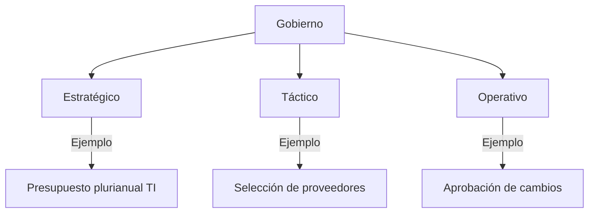
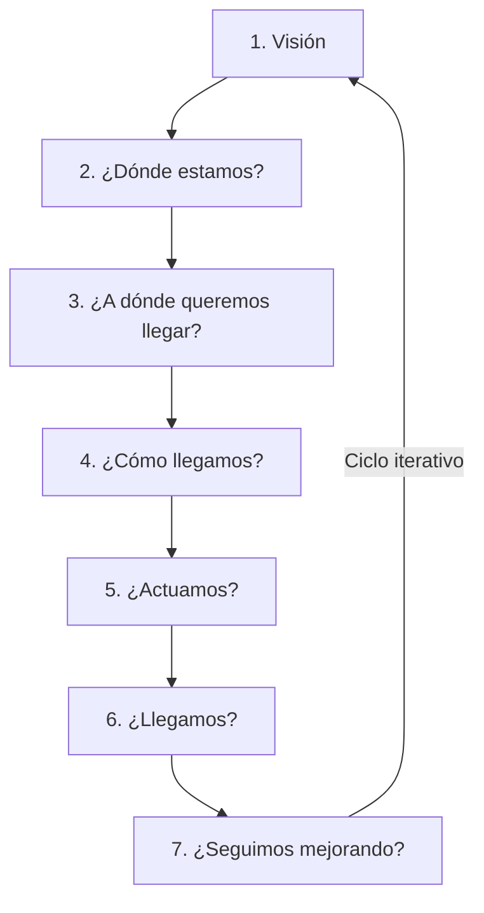

# Gestión de Servicios de Información (GSI)  
**Licenciatura en Ciberdefensa – Universidad de la Defensa Nacional**  
**Docentes:** Alejandro Fioretti - Flavio Alfano  
**Clase 2:** Fundamentos y principios de las metodologías de gestión (Parte 1)  

---

## **Objetivos de la clase**  
- Comprender qué es un servicio de información y su valor para el negocio.  
- Entender por qué nació la gestión de servicios y qué problemas resuelve.  
- Presentar los principios base que guían la gestión efectiva de servicios.  
- Mostrar cómo TI puede ser un aliado clave del negocio a través de una buena gestión de servicios.  

---

## **¿Qué es un servicio en general?**  
- **Actividad intangible** que satisface una necesidad.  
- Se consume al mismo tiempo que se entrega.  
- Involucra interacción entre proveedor y consumidor.  
- **No genera propiedad** (a diferencia de un producto).  

**Ejemplos cotidianos:**  
- Servicio de transporte (Uber, bus).  
- Servicio de streaming (Netflix).  
- Servicio de restaurante (experiencia vs. producto).  

---

## **¿Qué es un servicio de TI?**  
- Resultado entregado por un proveedor de TI para facilitar resultados de negocio.  
- **No se limita a software/hardware:** incluye soporte, mantenimiento, disponibilidad.  
- **Enfoque en el valor para el usuario**, no solo en la tecnología.  

**Ejemplos:**  
- Correo corporativo (Outlook Exchange).  
- Acceso a red e Internet.  
- ERP (SAP, Oracle).  
- Service Desk / Soporte técnico.  

---

## **Características clave de un servicio**  
1. **Intangible:** No se puede tocar, pero se experimenta (ej. conectividad).  
2. **Orientado al cliente:** Mide satisfacción y valor entregado.  
3. **Medible:** KPIs (tiempo de respuesta, disponibilidad).  
4. **Basado en procesos:** Flujos estandarizados, no improvisados.  
5. **Interno o externo:** Para usuarios dentro/fuera de la organización.  

---

## **Relación entre servicios de TI y procesos de negocio**  
- Los procesos de negocio dependen de servicios de TI eficientes.  
  - **Ejemplo:** Proceso de ventas → requiere CRM, red, dispositivos.  
  - **Logística** → necesita ERP y conectividad con proveedores.
  - **Recursos Humanos** → usa sistemas de nómina, gestión de talento.
  
- **Si el servicio de TI falla, el proceso de negocio se ve afectado.**  
- **Objetivo:** Alinear TI con las necesidades del negocio.  

---

## **Ejemplos de GSI fuera del ámbito TI**  
1. **Servicio de turnos en un hospital:**  
   - Gestión de citas, disponibilidad de profesionales, atención al paciente y retroalimentación.  
   -Aplicar GSI implica definir tiempos de atención, experiencia del usuario, gestión de quejas, etc.
   
2. **Entrega de productos en e-commerce:**  
   - Seguimiento, atención postventa, métricas de entrega.  
   - Desde que el cliente compra hasta que recibe el producto: seguimiento, atención 
     postventa, devoluciones.
   - GSI aquí sería establecer métricas de entrega (tiempo, calidad), puntos de contacto y 
     mejora continua.

---

## **Valor entregado: Utilidad vs. Garantía**  
| **Utilidad ("Fit for purpose")**       | **Garantía ("Fit for use")**            |  
|----------------------------------------|-----------------------------------------|  
| ¿Cumple con lo que necesito?           | ¿Está disponible, es confiable, seguro?|  
| Ej.: Correo permite enviar/recibir.    | Ej.: Disponibilidad 99.9%, velocidad.  |  

**Ambos son necesarios para un servicio valioso.**  

---

## **¿Por qué nació la GSI?**  
- TI creció rápidamente, pero sin un enfoque estructurado.
- Las áreas técnicas se centraban en infraestructura, no en el usuario.
- El negocio necesitaba servicios confiables, medibles y alineados a sus objetivos.
- Emergió la necesidad de gestionar TI como un servicio, no como un conjunto de recursos.
  

---
## Evolución de GSI -  Costo a socio estratégico - TI a GSI
- En los inicios, TI era un área de soporte técnico (hardware, redes, servidores, dc, cableado).
- Las decisiones eran técnicas, no orientadas al negocio.
- TI se veía como un centro de costos, no como generador de valor.
- Con el tiempo, el negocio empezó a depender más de TI (ERP, web, movilidad, cloud).
- Hoy, TI es un habilitador del negocio, clave en innovación, eficiencia y competitividad.

---
## Evolución GSI - Pasamos a ver a TI como proveedor de Servicios
 - Enfoque antiguo: “TI sabe lo que hay que hacer” → baja visibilidad para el negocio.
 - Enfoque moderno: “TI entrega servicios que el negocio necesita”.
 - Se pasa de una lógica de “infraestructura y sistemas” → a una lógica de servicios entregados con calidad y valor.
 - Se define claramente quién es el cliente, qué necesita y qué espera.
 - Empezamos a escuchar de  acuerdos de nivel de servicio (SLA ”son acuardos de nivel de servicio”), métricas, catálogos de servicios.
 
---

## **Procesos Claves en GSI**  
1. **Gestión de incidentes:** Eventos fuera de lo normal.  
2. **Gestión de cambios:** Nuevas funcionalidades o procesos.  
3. **Gestión de problemas:** Análisis de causa raíz.  
4. **Gestión de la configuración:** Control de componentes críticos.  

---

## **¿Qué problemas resuelve la GSI?**  
- Define procesos **claros y repetibles** para gestionar servicios. 
- Introduce **mediciones y métricas** (SLAs “Acuerdos de medicion de servicios”, KPIs) para mejorar calidad. 
- Fomenta la **mejora continua y la orientación** al cliente.
- Mejora la **comunicación** entre TI y las áreas de negocio.
- Permite **alinear tecnología con los objetivos estratégicos** de la organización..
 

---
## GSI - **Que son las metodologías**
### Conjuntos estructurados de pasos, procesos y roles que indican **cómo hacer algo** para alcanzar un objetivo.
- Ofrecen una guía paso a paso con actividades y **responsabilidades definidas**.
- Suelen ser **adaptables** según el contexto.
- Ayudan a **organizar** el trabajo y **mejorar** la eficiencia.
- Ejemplos:
        1. ITIL: metodología para la gestión de servicios de TI.
        2. PMBOK o PRINCE2: metodologías de gestión de proyectos.
        3. SCRUM: metodología ágil para desarrollo de software.

---
## GSI - ¿Que son las normas?
### **Documentos formales que establecen requisitos obligatorios** o recomendados para garantizar calidad, seguridad o cumplimiento. (no es opcional)
- Son desarrolladas por organismos oficiales o reconocidos (ISO, IEEE, etc.).
- Tienen versiones controladas y aplican a certificaciones.
- En muchos casos, su implementación puede ser auditada y certificada.
- Ejemplos:
    ISO/IEC 20000: norma internacional de gestión de servicios de TI.
    ISO 27001: norma de gestión de seguridad de la información.
    ISO 9001: gestión de calidad.

---
## GSI - ¿Que son las buenas prácticas?
### Conjunto de recomendaciones o aprendizajes reconocidos como eficaces, derivados de la experiencia.
- Son flexibles y no obligatorias, pero basadas en lo que ha funcionado bien en la práctica.
- Pueden ser adoptadas parcialmente y adaptadas al contexto.
- A menudo, forman la base de metodologías o normas más formales.
### Ejemplos:
- Documentar soluciones repetitivas (base de conocimiento).
- Crear canales únicos de atención al usuario.
- Realizar post-mortem luego de incidentes críticos.. (¿que ocurrio?)

---
## **Metodologías, Normas y Buenas Prácticas**  
| **Concepto**       | **Definición**                                                                 | **Ejemplos**                          |  
|--------------------|-------------------------------------------------------------------------------|---------------------------------------|  
| **Metodologías**   | Pasos estructurados para alcanzar objetivos (adaptables).                     | ITIL, PMBOK, SCRUM.                   |  
| **Normas**         | Requisitos formales (obligatorios o recomendados).                            | ISO/IEC 20000, ISO 27001, ISO 9001.  |  
| **Buenas Prácticas** | Recomendaciones basadas en experiencia (flexibles).                          | Bases de conocimiento, post-mortem.   |  

---

## **Gestión Centrada en el Cliente**  
- **Enfoque:** Satisfacer necesidades del cliente, no solo tecnología.  
- **Importa:** Experiencia del usuario (UX), percepción de valor. 
    - Importa tanto el resultado como el “cómo” se entrega el servicio.
    - Lo que no se mide no se puede mejorar.”
    - Se definen indicadores clave de desempeño (KPIs “indicadores de la performans”) para     
     monitorear calidad y eficacia.
- **Métricas clave:**  
  - Técnicas (disponibilidad, tiempo de respuesta).  
  - Percepción (encuestas de satisfacción).  

---

## **Cultura de Servicio en la Organización**  
- **Empatía, comunicación clara, mejora constante.**  
- **Ejemplo:** Capacitar usuarios en ciberseguridad refuerza el rol de TI como socio estratégico.  
### ¿Como el usuario mide el servicio?
- Experiencia del usuario en servicios de información (UX)
- UX se refiere a cómo el usuario vive e interpreta el servicio
- Involucra:
    - Claridad y simplicidad.
    - Accesibilidad y disponibilidad.
    - Sensación de confianza y atención.
- Un buen servicio no solo resuelve, también se percibe como útil, amigable y humano.
---
## GSI - Cultura de servicio en la organización
### GSI va mas alla del área de TI, es una actitud cross a toda la organización e incluye conceptos como :
- Empatía con el cliente.
- Comunicación clara.
- Responsabilidad compartida
- Mejora constante.
- Requiere liderazgo, formación y reconocimiento..
#### Un área de TI que capacita a usuarios no técnicos en ciberseguridad ayuda a prevenir incidentes, y refuerza su rol como socio estratégico.

---

## **Avances Tecnológicos en GSI**  
- **Automatización:** Bots, scripts.  
- **Autoservicio:** Portales con FAQs.  
- **IA y analítica:** Predicción de fallas.  
- **Reto:** Mantener el enfoque humano.  

---

## **Cierre de la clase**  
- Recapitulación de conceptos clave.  
- Próximo tema: **COBIT**.  

# Resumen de la Primera Clase

[Enlace al video](https://www.youtube.com/watch?v=D0ENg2etmGw&t=13s)

## Introducción
La materia de gestión de servicios de información, impartida por Alejandro Fioreti y Flavio Alfano, abordará temas clave sobre cómo las organizaciones utilizan la tecnología para operar y tomar decisiones. Se combinarán teoría y práctica, explorando metodologías, planificación, gestión de riesgos y mejora continua, con un enfoque en ejemplos reales y herramientas aplicables.

---

## Presentación

**[00:00:01](https://www.youtube.com/watch?v=D0ENg2etmGw&t=1s)** La gestión de servicios de información es crucial para el funcionamiento de las organizaciones actuales. Este curso busca proporcionar herramientas prácticas para entender y mejorar estos servicios.

 **[00:01:17](https://www.youtube.com/watch?v=D0ENg2etmGw&t=77s)** La importancia de combinar teoría y práctica en la gestión de servicios. Se busca que los estudiantes apliquen lo aprendido en situaciones reales y en sus futuros roles.

---
### Objetivos generales

- **[00:02:20](https://www.youtube.com/watch?v=D0ENg2etmGw&t=140s)** El curso abordará metodologías y normativas que son esenciales para gestionar tecnología. Esto permitirá a los estudiantes entender el marco necesario para operar efectivamente.
- **[00:03:10](https://www.youtube.com/watch?v=D0ENg2etmGw&t=190s)** Se enfatiza el valor de la toma de decisiones y la planificación en tecnología. Las decisiones deben estar alineadas con los objetivos del negocio y su funcionamiento diario.

- **[00:04:07](https://www.youtube.com/watch?v=D0ENg2etmGw&t=247s)** La gestión de servicios de información es esencial para asegurar la disponibilidad y calidad en las plataformas. Se explorarán metodologías y marcos de referencia que apoyan esta gestión eficaz.

- **[00:04:09](https://www.youtube.com/watch?v=D0ENg2etmGw&t=249s)** La importancia de la redundancia en los servicios garantiza que siempre haya soporte disponible cuando una plataforma falla. Esto es clave para mantener la continuidad del negocio.
---
### UNIDAD 1

- **[00:05:49](https://www.youtube.com/watch?v=D0ENg2etmGw&t=349s)** Se abordarán metodologías como *COBIT* y *FITS*, que ayudan a alinear tecnologías con los objetivos estratégicos de las organizaciones.

### UNIDAD 2

- **[00:07:26](https://www.youtube.com/watch?v=D0ENg2etmGw&t=446s)** La segunda unidad se enfocará en el marco *ITIL*, que abarca mejores prácticas para la gestión de servicios de TI.

- **[00:08:10](https://www.youtube.com/watch?v=D0ENg2etmGw&t=490s)** El framework de *ITIL* es crucial para la gestión de servicios, ya que proporciona mejores prácticas que evolucionan constantemente y ayudan a entregar valor en las organizaciones.

### UNIDAD 3

- **[00:09:41](https://www.youtube.com/watch?v=D0ENg2etmGw&t=581s)** La unidad tres se enfocará en el diseño y planificación de servicios de información, alineándolos con la estrategia del negocio.
- **[00:10:36](https://www.youtube.com/watch?v=D0ENg2etmGw&t=636s)** Se explorarán herramientas como la gestión del portafolio de servicios y la planificación de la demanda.
- **[00:11:36](https://www.youtube.com/watch?v=D0ENg2etmGw&t=696s)** Se introducirá el concepto de madurez organizacional y cómo evaluar servicios utilizando modelos como *ETOM*.

### UNIDAD 4

- **[00:12:28](https://www.youtube.com/watch?v=D0ENg2etmGw&t=748s)** La unidad cuatro aborda la agilidad en TI, centrándose en la implementación de modelos ágiles y la cultura *DevOps*.

- **[00:13:10](https://www.youtube.com/watch?v=D0ENg2etmGw&t=790s)** Es crucial entender cómo organizar los equipos para lograr una verdadera agilidad en la organización.
- **[00:13:42](https://www.youtube.com/watch?v=D0ENg2etmGw&t=822s)** La unidad también ofrece herramientas para implementar modelos ágiles en el área de TI.
### UNIDAD 5
- **[00:15:19](https://www.youtube.com/watch?v=D0ENg2etmGw&t=859s)** Se discutirá la interacción entre diferentes roles como desarrolladores y analistas.

- **[00:16:16](https://www.youtube.com/watch?v=D0ENg2etmGw&t=976s)** La gestión de requerimientos y cambios es esencial para evitar disrupciones en los servicios.

- **[00:16:46](https://www.youtube.com/watch?v=D0ENg2etmGw&t=1006s)** El uso de diagramas de *Ishikawa* y técnicas como los cinco porqués ayuda a identificar las causas raíz de las fallas.
- **[00:17:16](https://www.youtube.com/watch?v=D0ENg2etmGw&t=1036s)** La automatización y la entrega continua facilitan la gestión de los servicios en tiempo real.
- **[00:17:48](https://www.youtube.com/watch?v=D0ENg2etmGw&t=1068s)** Uso de métricas como *KPIs* y *dashboards* para mantener la trazabilidad de los procesos.

### UNIDAD 6

- **[00:19:00](https://www.youtube.com/watch?v=D0ENg2etmGw&t=1220s)** La mejora continua es fundamental para evaluar y optimizar procesos.

- **[00:21:17](https://www.youtube.com/watch?v=D0ENg2etmGw&t=1277s)** La agilidad y la mejora continua permiten aprender lecciones al finalizar cada ciclo.
- **[00:22:17](https://www.youtube.com/watch?v=D0ENg2etmGw&t=1337s)** Normativas que guían la implementación de controles en las organizaciones.
- **[00:22:39](https://www.youtube.com/watch?v=D0ENg2etmGw&t=1359s)** Identificación de procesos críticos para el cumplimiento normativo y la seguridad operativa.
---
### CALENDARIO PROPUESTO

- **[00:24:24](https://www.youtube.com/watch?v=D0ENg2etmGw&t=1464s)** La clase se enfocará en una combinación de teoría y práctica.

- **[00:24:40](https://www.youtube.com/watch?v=D0ENg2etmGw&t=1480s)** Las clases se dividirán en sesiones teóricas y prácticas con ejemplos reales.
- **[00:25:06](https://www.youtube.com/watch?v=D0ENg2etmGw&t=1506s)** Fechas tentativas para parciales y entregas de trabajos prácticos.
---
### BIOGRAFIA

- **[00:26:30](https://www.youtube.com/watch?v=D0ENg2etmGw&t=1590s)** Se recomienda revisar bibliografía relacionada con normativas y metodologías, como *ITIL*.

- **[Fundamentos de Sistemas Operativos - Abraham Silberschatz](/Licenciatura%20en%20CiberDefensa/Gestion%20de%20servicios%20de%20informacion/Biografia/Fundamentos%20de%20Sistemas%20Operativos%20-%20Abraham%20Silberschatz.pdf)**

- **[Sistemas Operativos (Aspectos internos y principios de diseno 5ed.) - William Stallings](/Licenciatura%20en%20CiberDefensa/Gestion%20de%20servicios%20de%20informacion/Biografia/Sistemas%20Operativos%20(Aspectos%20internos%20y%20principios%20de%20diseno%205ed.)%20-%20William%20Stallings.pdf)**

- **[Sistemas Operativos 2da - W. Stallings](/Licenciatura%20en%20CiberDefensa/Gestion%20de%20servicios%20de%20informacion/Biografia/Sistemas%20Operativos%202da%20-%20W.%20Stallings.pdf)**

- **[Sistemas Operativos 3 ed. Andrew Tanenbaum](/Licenciatura%20en%20CiberDefensa/Gestion%20de%20servicios%20de%20informacion/Biografia//Sistemas%20Operativos%203%20ed.%20Andrew%20Tanenbaum.pdf)**

- **[Sistemas operativos_ diseno e implementacion - Andrew S. Tanenbaum & Albert S. Woodhull](/Licenciatura%20en%20CiberDefensa/Gestion%20de%20servicios%20de%20informacion/Biografia/Sistemas%20operativos_%20diseno%20e%20implementacion%20-%20Andrew%20S.%20Tanenbaum%20&%20Albert%20S.%20Woodhull.pdf)**

- **[Libros_Sist.Operativos](/Licenciatura%20en%20CiberDefensa/Gestion%20de%20servicios%20de%20informacion/Biografia/Libros_Sist.Operativos.pdf)**
---
# Gestión de Servicios de Información  
**Licenciatura en Ciberdefensa – Universidad de la Defensa Nacional**  
**Docentes:** Alejandro Fioretti - Flavio Alfano  

---

## Clase 2: Fundamentos y principios de las metodologías de gestión (Parte 2)  

### Objetivos de la clase  
- Comprender los marcos FitSM y COBIT como herramientas de gestión.  
- Analizar sus diferencias, alcances y puntos en común.  
- Aplicar ejemplos prácticos que muestren cuándo y cómo utilizar cada uno.  
- Relacionar estos marcos con contextos reales de TI y ciberdefensa.  

---

### ¿Por Qué comenzamos con FitSM y COBIT?  
- Representan dos planos complementarios:  
  - **FitSM:** gestión operativa.  
  - **COBIT:** gobierno estratégico.  
- Ambos son accesibles, prácticos y ampliamente aplicables.  
- Permiten establecer una base sólida para luego profundizar en marcos más complejos como ITIL o ISO.  
- FitSM puede actuar como paso previo hacia certificaciones formales.  

---

### ¿Qué es FitSM?  
- Marco ligero de gestión de servicios de TI.  
- Desarrollado con apoyo de la Comisión Europea.  
- Enfocado en la simplicidad, claridad y agilidad.  
- Ideal para organizaciones sin estructura formal o con recursos limitados.  
- Promueve la mejora continua sin burocracia excesiva.  

---

### Componentes y estructura de FitSM  
![Mi Imagen][def]

# 📚 Documentación Estándar de FitSM (FitSM-0 a FitSM-6)

| **Código**  | **Nombre**                                  | **Contenido Principal**                                                                 |
|-------------|---------------------------------------------|----------------------------------------------------------------------------------------|
| 🔵 **FitSM-0**  | *Vocabulary (Vocabulario)*                 | Glosario de términos y definiciones clave                                              |
| 🟢 **FitSM-1**  | *Requirements (Requisitos)*                | Criterios mínimos para implementar gestión de servicios TI                             |
| 🔶 **FitSM-2**  | *Implementation Guide (Guía de Implementación)* | Pasos prácticos para adoptar FitSM                                                 |
| 🟣 **FitSM-3**  |  *Role & Process Model*    | Diagramas de roles + interacciones entre procesos.                              |
| 🟠 **FitSM-4**  |  *Templates & Examples*    | Plantillas de SLAs, formularios de incidentes, etc.                             |
| ⚫ **FitSM-5**  | *Guía de implementacion Auditoría*         | Cómo verificar el cumplimiento de FitSM-1.                                    |
| 🔴 **FitSM-6**  | *Evaluación de Madurez*              | Checklist para medir progreso (niveles 0-4).                                      |                                             |


---

### Roles y herramientas en FitSM  
- **Roles principales:**  
  - *Service Owner* – Responsable funcional del servicio.  (Responsable estrategico de un servicio)
  - *Process Owner* – Responsable de cada proceso.  (Define y mejora un proceso especifico) 
  - *Service Manager* – Supervisa cumplimiento transversal.  (supervisa la entrega de todos los servicios)

  - *Process Manager* - Es quien ejecuta y controla el proceso dia a dia
- **Herramientas listas para usar:**  
  - Catálogos de servicios, Acuerdos de nivel de servicio (SLA), Modelos de madurez, Plantillas operativas.  

---

### Cuándo aplicar FitSM  
- Soporte técnico sin procesos definidos.  
- Migraciones sin documentación ni trazabilidad.  
- Equipos reducidos que necesitan orden rápido.  
- Entornos de defensa donde no hay un gobierno corporativo formal.  

---

### Ventajas de FitSM  
- Bajo costo y rápida adopción.  
- No requiere herramientas ni plataformas específicas.  
- Fácil comunicación al equipo.  
- Modular: se puede implementar por etapas.  
- Compatible con ISO/IEC 20000.  

---

### Introducción a COBIT  
- Marco de gobierno de TI desarrollado por ISACA.  
- Enfocado en alinear TI con los objetivos del negocio.  
- Aporta control, trazabilidad y evaluación de madurez.  
- Trabaja sobre la dirección estratégica, no la operación diaria.  

---

### Principios clave de COBIT  
- Satisfacer necesidades de los stakeholders.  
- Cubrir toda la organización, no solo TI.  
- Integrar marcos existentes (ITIL, ISO, DevOps).  
- Enfoque holístico: procesos, estructuras, cultura, habilidades.  
- Separación clara entre gobernanza y gestión.  

---

### Componentes de COBIT  
- Objetivos de gobierno y gestión (más de 40).  
- Habilitadores (procesos, estructuras, comportamiento, información).  
- Modelo de madurez: niveles de capacidad del 0 al 5.  (Evaluar la capacidad y mejora de procesos)
- Útil en auditorías, planes de mejora y toma de decisiones.  

---

### Cuándo aplicar COBIT  
- Organismos públicos o empresas grandes que requieren trazabilidad.  
- Necesidad de justificar inversiones tecnológicas.  
- Entornos con cumplimiento normativo, riesgos y múltiples marcos coexistentes.  

---

### Caso práctico: FitSM vs COBIT  
**Empresa de logística con 100 empleados.**  
- **Con FitSM:**  *ORDENA*
  - Define incidentes, roles, plantillas.  
  - Mejora la operación.  
- **Con COBIT:**  *DIRIJE*
  - Evalúa madurez, alinea TI con el negocio.  
  - Define políticas y controles.  
**Conclusión:** FitSM organiza. COBIT dirige.  

---

### Reflexión final  
- No son excluyentes, se complementan.  
- FitSM permite ordenar y controlar el día a día.  
- COBIT garantiza alineación, gobierno y continuidad estratégica.  
- Juntos, forman una base sólida para una gestión profesional de servicios.  

---

### Lo que viene  
- **ITIL y ISO/IEC 20000:**  
  - *ITIL:* prácticas operativas para la gestión de servicios.  
  - *ISO 20000:* norma certificable de buenas prácticas.  
- Seguimos construyendo una mirada integral de la gestión de servicios de información.  

[def]: /Licenciatura%20en%20CiberDefensa/Gestion%20de%20servicios%20de%20informacion/Clase%201%20y%202/Clase%202/foto.jpg

# Gestión de Servicios de Información (GSI)  
**Licenciatura en Ciberdefensa – Universidad de la Defensa Nacional**  
**Docentes:** Alejandro Fioretti - Flavio Alfano  
**Clase 4:** Fundamentos y principios de las metodologías de gestión  

---

## Objetivos de la clase  
- Presentar el concepto general de ITIL y su origen.  
- Explicar la finalidad de ITIL: alinear TI con el negocio y entregar valor.  
- Comprender la evolución y relevancia actual de ITIL.  
- Exponer las bases metodológicas de ITIL.  
- Mostrar cómo ITIL se complementa con otros marcos modernos.  

---

## ¿Qué es ITIL?  
**Definición:**  
- Marco de buenas prácticas para gestionar servicios de TI.  
- **Origen:** Creado por la CCTA (Reino Unido), gestionado actualmente por AXELOS.  
- **Objetivo principal:** Alinear servicios de TI con necesidades del negocio y maximizar valor al cliente.  

**Características clave:**  
- No es prescriptivo: flexible y adaptable.  
- Valor total = Utilidad + Garantía (perspectiva del cliente).  

---

## Evolución de ITIL  
| Versión | Año | Principales Cambios |  
|---------|-----|---------------------|  
| ITIL V1 | 1980s | 30+ libros de buenas prácticas. |  
| ITIL V2 | 2001 | Procesos consolidados (Soporte y Entrega). |  
| ITIL V3 | 2007/2011 | Introdujo el ciclo de vida del servicio (Estrategia, Diseño, Transición, Operación, Mejora). |  
| ITIL 4 | 2019 - Actualidad | Modelo flexible y ágil con Sistema de Valor del Servicio (SVS). |  

---
## ¿Qué significa que ITIL no sea prescriptivo?
### ITIL no es un manual que se sigue al pie de la letra. Es un conjunto de mejores prácticas que las organizaciones pueden adaptar y aplicar según sus necesidades, cultura, tamaño y madurez
- Flexible: no exige cumplir cada proceso al 100%. Se puede adoptar de forma gradual o parcial.
- Adaptable: se ajusta a distintas industrias, tipos de organización y marcos como Agile, DevOps, Lean.
- No impone herramientas específicas ni estructuras rígidas.
- Permite la combinación con otras prácticas o metodologías (Scrum, Kanban, COBIT, etc.)

---


## Pilares Fundamentales de ITIL  
### ¿Cuales fueron los principios base que le dieron forma a ITIL?: 
1. **Enfoque basado en procesos.**  
2. **Orientación al cliente y al valor.**  
3. **Ciclo de vida del servicio.**  
4. **Mejora continua.**  
5. **Gobierno y control.**  

### Son los conceptos estructurales sobre los que ITIL está construido.
- Si el servicio de TI falla, el proceso de negocio se ve afectado.
- La gestión de servicios busca alinear TI con las necesidades del negocio.

---

## Componentes Principales del SVS (Sistema de Valor del Servicio)  
- **Cadena de Valor del Servicio (SVC):** Modelo operativo central (actividades interconectadas).  
- **Prácticas:** 34 prácticas agrupadas en Gestión General, de Servicios y Técnica.  
- **Principios Guía:** 7 reglas prácticas (ej: "Enfocarse en el valor").  
- **Gobierno:** Marco de toma de decisiones alineado con objetivos.  
- **Mejora Continua:** 7 pasos iterativos (ej: "¿Dónde estamos?" → "¿Cómo llegamos?").  

---

## Conceptos Esenciales  
- **Servicio:** Medio para entregar valor sin gestionar riesgos/costos por el cliente.  
- **Cliente vs. Usuario:** Cliente pide/negocia; usuario consume el servicio.  
- **Dimensiones clave:**  
  1. Organizaciones y Personas.  
  2. Información y Tecnología.  
  3. Socios y Proveedores.  
  4. Flujos de Valor y Procesos.  

---
## ITIL - La cadena de valor del servicio (SVC)
- Es el modelo operativo central de ITIL 4.
- Representa  cómo  una  organización  transforma  la  demanda  en  valor,  mediante  un  conjunto  de  actividades interconectadas.
- No es un proceso lineal, sino un modelo flexible: las actividades se combinan según cada servicio, necesidad o situación.
- Su propósito es coordinar todas las capacidades de una organización para entregar, mejorar y mantener servicios. 
#### Actividades: Planificar, Mejorar, Involucrar, Diseñar y Transicionar, Obtener/Crear, Entregar y Brindar Soporte
---
## ITIL - Prácticas
#### ¿Qué son las prácticas?
Son conjuntos organizados de recursos (personas, procesos, tecnología, información) diseñados para realizar tareas o cumplir objetivos específicos.
- Reemplazan el concepto de “procesos” de versiones anteriores.
- Son más flexibles y adaptables.ITIL presenta 34 prácticas agrupadas en tres categorías:
    - Gestión General
    - Gestión de Servicios
    - Gestión Técnica
Ej: “La práctica de Gestión de Incidentes ayuda a restaurar servicios rápidamente cuando algo falla.”

---
## ITIL - Principios Guías
Son reglas prácticas y universales que ayudan a aplicar ITIL de forma efectiva. Están pensados para ser usados en la toma de decisiones diarias.
- Enfocarse en el valor. Todo lo que se hace debe generar valor para el cliente y la organización.
- Aprovechar lo que ya funciona. No reinventar la rueda.
- Progresar iterativamente con retroalimentación
- Colaborar y promover la visibilidad
- Pensar y trabajar de forma integral
- Mantenerlo simple y práctico
“Los principios guía de ITIL son como una brújula: te orientan siempre, incluso cuando cambia el camino.
---

## Ejemplo de Práctica: Gestión de Incidentes  
- **Proceso:** Atención escalonada (agentes → técnicos).  
- **Herramientas:** Sistema de tickets, base de conocimiento.  
- **Políticas:** "Tickets de alta prioridad resueltos en <30 min."  

---
# ITIL 4 - Los 7 Principios Guía  

Los principios guía de ITIL son reglas universales que orientan la toma de decisiones y la implementación de la gestión de servicios. Son aplicables en cualquier contexto organizacional.  

---

## 1. **Enfocarse en el valor**  
   - Todo servicio, proceso o acción debe generar valor tangible para el cliente y la organización.  
   - **Ejemplo:** Priorizar proyectos basados en su impacto en la experiencia del usuario.  

## 2. **Comenzar donde se está**  
   - Evitar reiniciar desde cero; evaluar y aprovechar recursos, procesos y capacidades existentes.  
   - **Ejemplo:** Mejorar un portal de autoservicio TI iterando sobre su versión actual en lugar de rediseñarlo completamente.  

## 3. **Progresar iterativamente con retroalimentación**  
   - Implementar cambios en pequeños incrementos, midiendo resultados y ajustando según feedback.  
   - **Ejemplo:** Lanzar mejoras de software en fases, validando cada una con usuarios.  

## 4. **Colaborar y promover visibilidad**  
   - Fomentar trabajo transversal entre equipos y transparentar información relevante.  
   - **Ejemplo:** Involucrar a desarrollo, operaciones y seguridad en la automatización de aprobaciones de cambios.  

## 5. **Pensar y trabajar de forma holística**  
   - Considerar todas las dimensiones del servicio (personas, procesos, tecnología, socios).  
   - **Ejemplo:** Al diseñar un servicio, evaluar su impacto en cumplimiento, seguridad y costos.  

## 6. **Mantenerlo simple y práctico**  
   - Eliminar complejidad innecesaria; optimizar procesos con soluciones eficientes.  
   - **Ejemplo:** Simplificar flujos de aprobación para cambios de bajo riesgo.  

## 7. **Optimizar y automatizar**  
   - Automatizar solo lo que está estandarizado y aporta eficiencia.  
   - **Ejemplo:** Usar chatbots para resolver incidentes frecuentes (ej: restablecer contraseñas).  

---

### Frase clave:  
*"Los principios guía son como una brújula: te orientan incluso cuando el camino cambia."*  

---

**Relación con otros componentes de ITIL:**  
- Se integran con la **Cadena de Valor del Servicio (SVC)** y las **34 prácticas**.  
- Son la base para la **Mejora Continua** (ej: retroalimentación iterativa).  

---
# ITIL - Principios Guía: Casos Prácticos

## 🔍 Caso 1: Rediseño de Portal de Autoservicio TI
**Decisión:** ¿Rediseño completo o mejora iterativa?

### Principios aplicados:
1. **Comenzar donde estás**  
   - Se auditó el portal existente identificando:  
     ✅ Funcionalidades bien valoradas por usuarios  
     ❌ Módulos con baja usabilidad  

2. **Progresar iterativamente**  
   - Implementación por fases:  
     ```mermaid
     graph LR
     A[Módulo de tickets] --> B[Feedback usuarios]
     B --> C[Ajustes]
     C --> D[Módulo de KB]
     ```
   - Métricas clave: % de resolución autónoma, tiempo promedio por ticket

3. **Enfocarse en el valor**  
   - Priorización basada en:  
     - Encuestas de satisfacción (60% peso)  
     - Impacto en volumen de llamadas al helpdesk (40% peso)  

**Resultado:**  
↑ 35% en adopción del portal  
↓ 20% en tickets de soporte básico  

---

## ⚙️ Caso 2: Automatización de Aprobaciones de Cambios  
**Decisión:** ¿Automatización total o parcial?  

### Principios aplicados:  
1. **Optimizar y automatizar**  
   - Criterios para automatizar:  
     ```mermaid
     flowchart TD
     A[Cambio] --> B{Riesgo?}
     B -->|Bajo| C[Automatizado]
     B -->|Medio/Alto| D[Revisión manual]
     ```

2. **Mantenerlo simple**  
   - Flujo para cambios de bajo riesgo:  
     `Solicitud → Validación automática (checklist) → Implementación`  
   - Eliminación de 3 pasos burocráticos redundantes  

3. **Pensar holísticamente**  
   - Equipos involucrados:  
     - **Seguridad:** Validación de políticas  
     - **Operaciones:** Definición de criterios técnicos  
     - **Desarrollo:** Integración con CI/CD  

**Resultado:**  
⏱️ Tiempo de aprobación reducido de 48h → 2h para cambios rutinarios  
🛡️ 0 incidencias por cambios mal clasificados  

---

## 📌 Lecciones Clave  
| Principio             | Beneficio Demostrado                     | Riesgo Mitigado               |
|-----------------------|------------------------------------------|--------------------------------|
| Iterar con feedback   | Evita costos de rediseños innecesarios   | Resistencia al cambio         |
| Automatizar selectivo | Maximiza ROI de herramientas             | Sobre-automatización          |
| Enfoque multidisciplinar | Alinea TI con necesidades del negocio | Silos organizacionales        |

---
# ITIL 4 - Gobierno de Servicios de TI

## 🏛️ Definición de Gobierno en ITIL
El gobierno establece el marco para:
- **Alinear** decisiones con objetivos organizacionales
- **Controlar** el cumplimiento de políticas y regulaciones
- **Evaluar** riesgos y desempeño mediante auditorías
- **Definir** claramente roles y responsabilidades

## 🔍 Características Clave
| Dimensión          | Descripción                                  | Ejemplo                          |
|--------------------|----------------------------------------------|----------------------------------|
| **Políticas**      | Reglas formales para la toma de decisiones   | Política de adopción de cloud    |
| **Controles**      | Mecanismos para garantizar cumplimiento     | Revisión trimestral de SLAs      |
| **Auditorías**     | Evaluaciones independientes de procesos     | Auditoría ISO 27001 anual        |
| **Roles**          | Asignación clara de responsabilidades       | Dueño de procesos vs. Ejecutores |

## 🌐 Niveles de Aplicación

---
# ITIL 4 - Mejora Continua del Servicio

## 🔄 Visión General
La mejora continua (CSI - Continual Service Improvement) es un **principio fundamental** en ITIL que:
- Se aplica a **todos los niveles** (estratégico, táctico, operativo)
- Cubre **todas las áreas** (procesos, servicios, tecnología)
- Sigue un enfoque **basado en datos y métricas**

## 🛠️ Modelo de 7 Pasos para la Mejora


---
## ITIL - Conceptos esenciales
### Servicio
Es  un  medio  para  entregar  valor  al  cliente  facilitando  los  resultados  deseados  sin  que  el  cliente  tenga  que gestionar todos los riesgos y costos asociados.
### Cliente
Es quien define los requisitos del servicio y paga por él. Tiene la autoridad de negociación con el proveedor del servicio.
### Usuario
Persona que utiliza el servicio día a día, pero que puede no haberlo contratado ni definido.
### Valor
Es la percepción del beneficio obtenido por el cliente o usuario, considerando:
- Utilidad (lo que el servicio hace)
- Garantía (cómo lo hace: disponibilidad, continuidad, seguridad, etc.)
---
# ITIL - Dimensiones Esenciales de Gestión de Servicios

## 🌐 Las 4 Dimensiones Clave

¿Cuáles son y que son?

- "Organizaciones y Personas"
- "Información y Tecnología"
- "Socios y Proveedores"
- "Flujos de Valor y Procesos"

Todas  estas  dimensiones  deben  ser  equilibradas  para que el servicio sea exitoso.

---
# ITIL - Conceptos esenciales

## Dimensiones

### Organizaciones y Personas
**¿Qué incluye esta dimensión?**
- Los roles y responsabilidades
- La estructura organizacional y la cultura
- El personal y las competencias requeridas por el servicio.

**Personas comprometidas, capacitadas y empoderadas son claves para entregar valor.**

### Información y Tecnología
**¿Qué incluye esta dimensión?**

- **Tecnologías de soporte al servicio**
  - Sistemas de gestión de flujo de trabajo
  - Bases de conocimiento
  - Sistemas de inventario
  - Sistemas de comunicación
  - Herramientas analíticas

- **Gestión de la Información**
  - Información debe ser precisa, accesible y segura.
  - Se gestiona todo el ciclo de vida de la información: creación, procesamiento, almacenamiento, transmisión y destrucción.

> La gestión del servicio está respaldada por tecnologías relacionadas con los sistemas de gestión del flujo de trabajo, bases de conocimiento, sistemas de inventario, sistemas de comunicación y herramientas analíticas.

---

### Socios y Proveedores
**Definiciones:**
- **Socios:** Organizaciones que colaboran de manera estratégica (ej.: alianzas, acuerdos de cooperación).
- **Proveedores:** Entidades que suministran bienes o servicios necesarios para el funcionamiento de los servicios.

**Qué debemos tener en cuenta:**
- Contratos
- Relaciones
- Niveles de servicio (SLAs)

---

### Flujos de Valor y Procesos
**Definiciones importantes:**
- **Flujos de Valor:** Secuencia de actividades que transforma insumos en resultados valiosos para el cliente.
- **Procesos:** Conjuntos estructurados de actividades diseñadas para lograr un objetivo específico.

**¿Para qué los necesitamos?**
- Eliminar desperdicios
- Mejorar la eficiencia
- Aumentar la entrega de valor

---

## Prácticas

### Definiciones-Complemento
- Una práctica es una forma organizada de trabajar para lograr un objetivo relacionado con la gestión de servicios.
- Combina personas, procesos, herramientas, habilidades y conocimientos.
- Las prácticas ayudan a asegurar calidad, eficiencia y valor en los servicios que ofrecemos.

**Componentes de cada práctica:**
- Procesos definidos (lo que se hace y cómo se hace).
- Personas y roles asignados.
- Tecnologías y herramientas de apoyo.
- Políticas y normas que guían su uso.
- *Las prácticas están vivas:* evolucionan a medida que cambia la organización o el entorno.

**Relación con el Sistema de Valor del Servicio (SVS):**
- Las prácticas forman parte del Sistema de Valor del Servicio (SVS).
- Se combinan según las necesidades de cada servicio o flujo de trabajo.
- Cada flujo de valor puede utilizar distintas prácticas en diferentes momentos.
- No hay recetas fijas: cada organización adapta cómo aplica las prácticas.

**Prácticas → Mejores servicios:**
- Comprender las prácticas es el primer paso para diseñar mejores servicios.
- Cada práctica representa una capacidad que puede mejorarse con el tiempo.
- El éxito depende de aplicar prácticas de forma inteligente y adaptativa.

---

### Ejemplo: Práctica de Gestión de Incidentes
- **Proceso definido:** Flujo de atención de tickets.
- **Personas involucradas:**
  - Agentes de soporte.
  - Técnicos de segundo nivel.
  - Supervisores de servicio.
- **Herramientas:**
  - Sistema de gestión de tickets.
  - Base de conocimiento para soluciones rápidas.
- **Políticas:**  
  > *"Todos los tickets de alta prioridad deben ser atendidos en menos de 30 minutos"*.

---

## Beneficios de su implementación
- Mejora la calidad del servicio entregado al cliente.
- Aumenta la eficiencia operativa al optimizar procesos.
- Facilita una mejor gestión de recursos y costos.
- Mejora la colaboración entre diferentes áreas y equipos.
- Ayuda a cumplir con los requisitos de negocio y aumentar la satisfacción del cliente
- Fomenta la agilidad organizativa y adaptabilidad al cambio.

---

## Implementación - Inicio: Evaluación Inicial y Compromiso Organizacional
> Implementar  ITIL  v4  en  una  empresa  es un  proceso  estructurado  que  requiere  planificación, compromiso organizacional y un enfoque gradual para asegurar que las prácticas se adopten con éxito
Implementar ITIL v4 requiere:
1. Realizar una evaluación de los servicios existentes.
2. Identificar áreas clave donde ITIL puede agregar valor.
3. Obtener el compromiso de la alta dirección.
4. Definir objetivos y alcance.

---

## Complementos con otros marcos modernos
- **Agile:** ITIL 4 adopta pensamiento ágil (adaptabilidad, iteración).
- **DevOps:** Apoya automatización y colaboración entre desarrollo y operaciones.
- **COBIT:** ITIL se alinea con controles de alto nivel definidos por COBIT.

---

## Cierre de la clase
- **Recursos adicionales:**  
  - *"ITIL Foundation ITIL 4 Edition (Spanish PDF)"* en el repositorio.
  - Posible certificación **ITIL Foundations** para acreditar conocimientos básicos.
- **Próximos pasos:** Introducción a estándares ligeros de gestión.
**FADENA | FACULTAD DE DEFENSA NACIONAL**  

# Gestión de Servicios de Información - Clase 5  
**Licenciatura en Ciberdefensa**  
*Universidad de la Defensa Nacional*  

**Docentes:** Alejandro Fioretti - Flavio Alfano  
**Institución:** FADENA - Facultad de Defensa Nacional  

---

## 📌 Objetivos de la Clase  
- [ ] Historia y estructura de la norma ISO/IEC 20000  
- [ ] Relación con ITIL, ISO 9001 y 27001  
- [ ] Profundización en capítulos 4 al 10  
- [ ] Ejemplos aplicados y errores comunes  
- [ ] Cierre integrador con visión práctica  

---

## 🕰️ Historia y Propósito  
- **Origen**: Basada en el estándar británico *BS 15000*.  
- **Primera publicación**: 2005.  
- **Influencia clave**: ITIL v2.  
- **Última versión**: ISO/IEC 20000-1:2018.  
- **Compatibilidad**: Estructura alineada con ISO 9001 e ISO 27001.  

---

## 📚 Partes de la Norma ISO/IEC 20000  
1. **Parte 1**: Requisitos (única certificable).  
2. **Parte 2**: Guía de implementación.  
3. **Parte 3**: Alcance y aplicabilidad.  
4. **Parte 5**: Modelo de implementación.  
5. Evaluación y terminología.  

---

## 🏛️ Capítulo 4: Contexto de la Organización  
- Análisis de factores **internos/externos** que afectan la capacidad de cumplir con el proceso de Gestion.  por ejemplo: preguntarnos si trabajamos en un entorno regulado o no, si hay dependencia de terceros, etc.
- Identificación de **partes interesadas** y expectativas. quienes son esos actores relevantes por ejemplo; proveedores, autoridades regulatorias, direccion, etc.
- Definición del **alcance del SGS**. 
- Establecimiento y mantenimiento del sistema de gestión.  

---

## 👔 Capítulo 5: Liderazgo  
- **Compromiso activo** de la alta dirección.  
- Política de gestión de servicios **documentada**.  
- **Roles y responsabilidades** claramente definidos.  
- Participación en revisiones y comunicación estratégica.  

---

## 📊 Capítulo 6: Planificación  
- Evaluación de **riesgos y oportunidades**.  
- Objetivos **medibles** y alineados al negocio.  
- Planificación de acciones para alcanzar metas.  
- Gestión de cambios en el SGS.  

---

## 🛠️ Capítulo 7: Apoyo  
- Asignación de **recursos** (humanos, herramientas, tiempo).  
- Desarrollo de **competencias** y conciencia del equipo.  
- Comunicación **efectiva** y multidireccional.  
- Información documentada y **accesible**.  

---

## 🔄 Capítulo 8: Operación  
- Control de la **entrega de servicios**.  
- Gestión de servicios **nuevos o modificados**.  
- Operación diaria:  
  - Incidentes y peticiones.  
  - Continuidad del servicio.  
- Relación con **clientes y proveedores**.  
- Gestión de la **configuración**.  

---

## 📈 Capítulo 9: Evaluación del Desempeño  
- **Medición y análisis** de resultados (KPIs).  
- Auditorías internas **planificadas**.  
- Revisión por la dirección con **enfoque estratégico**.  
- Decisiones basadas en **evidencia**.  

---

## 🔄 Capítulo 10: Mejora Continua  
- Acciones **correctivas** ante no conformidades.  
- Cultura de **mejora progresiva**.  
- Integración de datos, liderazgo y decisiones.  
- Adaptabilidad a **contextos dinámicos**.  

---

### 🎯 Cierre Integrador  
**Clave**: La norma ISO/IEC 20000 no es un marco aislado, sino un **sistema integrado** que requiere:  
- Alineación con el negocio.  
- Liderazgo comprometido.  
- Enfoque en ciclos PDCA (*Plan-Do-Check-Act*).  

**FADENA** · *Fundamentos y principios de las metodologías de gestión*  

# Gestión de Servicios de Información (Clase 6)  
**Licenciatura en Ciberdefensa – Universidad de la Defensa Nacional**  
**Docentes:** Alejandro Fioretti - Flavio Alfano  

## Clase 6: Servicios de información y su impacto organizacional

---

## Objetivos de la clase

- Repaso ITIL - Principales Componentes  
- Casos Prácticos  
- Implementación y Herramientas  
- Flujos de Ejemplo en el marco de las Principales Prácticas  
- Ejemplos de Dashboards para las principales Prácticas de ITIL  

---

## Fundamentos y principios de las metodologías de gestión  

### ITIL - Repaso

ITIL es un marco de trabajo que recopila buenas prácticas para gestionar servicios de tecnología de la información.
- Guía de buenas prácticas para gestionar servicios de TI, enfocada en generar valor.
- Adaptable a entornos modernos: Agile, DevOps, Cloud, innovación continua.
- Basada en el Service Value System (SVS): colaboración, prácticas, mejora constante y gobernanza flexible.

#### **SVS → Service Value System**
- No es un proceso, ni un organigrama. **Es una forma de ver cómo todo en TI —gente, procesos, herramientas, partners— trabaja junto para entregar valor al cliente.**

---

### ITIL - Service Value System (SVS)

- Todo se coordina para transformar necesidades en resultados valiosos.
- No existen “silos” de prácticas: todo debe trabajar de forma integrada.
- El foco final siempre es: ¿qué valor le damos al cliente/usuario?

---

### Caso 1: Soporte de TI en Empresa Mediana

**Descripción rápida:** Mesa de ayuda que atiende 500 usuarios.  
**Oportunidad/Demanda:** Quejas por demoras en resolver incidentes críticos.  
**Actividades principales (cadena de valor):**  
- Detectar incidentes → Resolver → Mejorar satisfacción.  

**Prácticas principales usadas:**  
- Gestión de incidentes  
- Gestión de problemas  
- Gestión de conocimiento  

**Componentes del SVS en acción:**  
- Principios: Centrarse en el valor, Progresar iterativamente.  
- Mejora continua: Revisión mensual de métricas.  

**Resultado de valor generado:** SLA de atención mejorado en un 30%.

---


### CASO 1 - Soporte de TI en Empresa Mediana - Explotemos el Servicio Parte A

| **Área**               | **Descripción**                                                                 |
|-------------------------|-------------------------------------------------------------------------------|
| **Situación inicial**   | Mesa de ayuda interna con 500 usuarios. SLA incumplido en incidentes críticos (demoras >8 horas). Quejas de usuarios y áreas de negocio. |
| **Oportunidad/Demanda** | Necesidad urgente de mejorar tiempos de respuesta y satisfacción del usuario final. |
| **Actividades de la cadena de valor** | - **Engage**: escuchar reclamos.<br>- **Deliver & Support**: atención y resolución de incidentes.<br>- **Improve**: ajustar procesos de atención basados en feedback. |

### CASO 1 -  Parte B

| **Área**                  | **Descripción**                                                                 |
|---------------------------|-------------------------------------------------------------------------------|
| **Prácticas aplicadas**   | - **Gestión de incidentes**: clasificación y escalamiento claro.<br>- **Gestión de problemas**: identificar causas raíz de incidentes recurrentes.<br>- **Gestión del conocimiento**: base de soluciones comunes accesible para agentes. |
| **Componentes del SVS**   | - **Principios rectores**: Centrarse en el valor, colaborar visiblemente.<br>- **Mejora continua**: revisión mensual de métricas y ajustes incrementales. |
| **Resultados obtenidos**  | - Reducción del 30% en el tiempo promedio de resolución de incidentes críticos.<br>- Aumento del 25% en la satisfacción de usuarios (encuestas internas).<br>- Mejora en la percepción del área de TI como socio estratégico. |

---

### CASO 2 - Lanzamiento de un Nuevo Servicio en la Nube - Parte A

| **Área**                  | **Descripción**                                                                 |
|---------------------------|-------------------------------------------------------------------------------|
| **Situación inicial**     | Una empresa de retail necesita lanzar un sistema de pedidos online en la nube (AWS) para mejorar la experiencia del cliente y soportar crecimiento. |
| **Oportunidad/Demanda**   | Demanda del negocio: mejorar el time-to-market, experiencia del usuario y escalabilidad. |
| **Actividades de la cadena de valor** | ✅ **Plan**: diseño de arquitectura escalable.<br>✅ **Design & Transition**: construcción e implementación controlada.<br>✅ **Engage**: colaboración con usuarios beta y áreas de negocio.<br>✅ **Obtain/Build**: desarrollo en entornos cloud.<br>✅ **Deliver & Support**: monitoreo inicial, soporte post-lanzamiento. |

### CASO 2 - Parte B

| **Área**                  | **Descripción**                                                                 |
|---------------------------|-------------------------------------------------------------------------------|
| **Prácticas aplicadas**   | ✅ **Gestión del cambio**: control de despliegues.<br>✅ **Gestión de disponibilidad**: asegurar uptime.<br>✅ **Gestión de relaciones con proveedores**: AWS y software de terceros.<br>✅ **Despliegue y versiones**: ambientes con rollback seguro. |
| **Componentes del SVS**   | ✅ **Gobernanza**: comité de aprobación para go-live.<br>✅ **Mejora continua**: feedback post-lanzamiento e iteraciones. |
| **Resultados obtenidos**  | ✅ Servicio desplegado en 60 días (vs 90 estimado).<br>✅ Satisfacción de cliente final: +40% en encuestas.<br>✅ Infraestructura escalable y monitoreada 24/7. |

---

### CASO 3 - Gestión de Cambios Ágil en una Fintech - Parte A

| **Área**                  | **Descripción**                                                                 |
|---------------------------|-------------------------------------------------------------------------------|
| **Situación inicial**     | Fintech que lanza nuevas funcionalidades cada semana en su app de pagos. Alta presión por entregar rápido, sin afectar usuarios. |
| **Oportunidad/Demanda**   | Necesidad de implementar una gestión de cambios que acompañe la velocidad del negocio, sin burocracia, pero con control. |
| **Actividades de la cadena de valor** | ✅ **Plan & Design**: definición de tipos de cambio (estándar, normal, emergencia).<br>✅ **Engage**: colaboración entre Dev, Ops y negocio para priorización.<br>✅ **Obtain/Build**: automatización con CI/CD.<br>✅ **Deliver & Support**: integración con incidentes y monitoreo. |

### CASO 3 - Parte B

| **Área**                  | **Descripción**                                                                 |
|---------------------------|-------------------------------------------------------------------------------|
| **Prácticas aplicadas**   | ✦ **Gestión de Cambios**<br>✦ **Gestión de Despliegue**<br>✦ **Gestión de Incidentes**<br>✦ **Gestión del Conocimiento** |
| **Componentes del SVS**   | ✦ **Governance**: comité express para cambios normales/emergencia<br>✦ **Mejora continua**: métricas de éxito, lecciones aprendidas, feedback entre equipos |
| **Resultados obtenidos**  | ✦ Disminución del 45% de errores post-cambio<br>✦ Cambios estándar desplegados en <24h<br>✦ Mejora de comunicación y coordinación entre desarrollo, operaciones y soporte |


---

### CASO 4 - Automatización del Soporte con Chatbot y Base de Conocimiento - Parte A

| **Área**                  | **Descripción**                                                                 |
|---------------------------|-------------------------------------------------------------------------------|
| **Situación inicial**     | Organización con alto volumen de tickets repetitivos (consultas sobre contraseñas, accesos, errores comunes). Los tiempos de respuesta eran largos y los analistas de soporte estaban saturados. |
| **Oportunidad/Demanda**   | Mejorar la experiencia del usuario final, reducir la carga del equipo de soporte y aumentar la disponibilidad de soluciones inmediatas 24/7. |
| **Actividades de la cadena de valor** | ✦ **Plan & Improve**: análisis de tickets frecuentes y rediseño del proceso de soporte<br>✦ **Engage**: relevamiento de necesidades con usuarios y soporte<br>✦ **Deliver & Support**: implementación de chatbot + portal de autoservicio |

### CASO 4 - Parte B

| **Área**                      | **Descripción**                                                                 |
|-------------------------------|-------------------------------------------------------------------------------|
| **Prácticas aplicadas**       | ✦ Gestión de Incidentes<br>✦ Gestión del Conocimiento<br>✦ Habilitación de Servicio<br>✦ Mejora Continua |
| **Componentes del SVS**       | ✦ **Planificación y Mejora Continua**: análisis de métricas de uso del chatbot y evolución de la base de conocimiento<br>✦ **Gobernanza**: validación de contenido por áreas responsables antes de su publicación |
| **Resultados obtenidos**      | ✦ Reducción del 60% en tickets manuales<br>✦ Aumento del 35% en la satisfacción del usuario<br>✦ Liberación de analistas de soporte para casos más complejos<br>✦ Disponibilidad 24/7 de soporte para temas frecuentes |


---

### CASO 5 - Mejora del servicio mediante tercerización controlada - Parte A

| **Área**                  | **Descripción**                                                                 |
|---------------------------|-------------------------------------------------------------------------------|
| **Situación inicial**     | Empresa con área de TI interna sobrecargada: soporte básico (nivel 1) tomaba tiempo crítico al personal especializado, generando demoras en proyectos estratégicos. |
| **Oportunidad/Demanda**   | Mejorar el tiempo de atención al usuario, profesionalizar el soporte básico, y liberar recursos internos para tareas de mayor valor. |
| **Actividades de la cadena de valor** | ✦ **Plan & Improve**: análisis de costos y calidad de servicio interno<br>✦ **Engage**: selección de proveedor, acuerdos de servicio, gestión de relación<br>✦ **Deliver & Support**: onboarding del proveedor, seguimiento de SLAs |

### CASO 5 - Parte B

| **Área**                      | **Descripción**                                                                 |
|-------------------------------|-------------------------------------------------------------------------------|
| **Prácticas aplicadas**       | ✅ **Gestión de Proveedores**<br>✅ **Gestión de la Relación con el Negocio**<br>✅ **Monitoreo y Gestión de Eventos**<br>✅ **Medición y Reportes de Servicio** |
| **Componentes del SVS**       | ✅ **Governance**: aprobación del modelo de sourcing, control de contratos<br>✅ **Mejora Continua**: revisión periódica de KPIs y feedback del negocio |
| **Resultados obtenidos**      | ✅ **85% de los incidentes** resueltos por el proveedor en menos de 2 horas<br>✅ **Reducción del backlog interno** en un 40%<br>✅ **Aumento de satisfacción** del usuario y disponibilidad de tiempo del equipo interno |


---

## ITIL - Implementación

1. Identificar un área o dolor real (no empezar por todas las prácticas)  
   - Ej.: alto volumen de incidentes, mala experiencia de usuario, retrasos en cambios.
2. Seleccionar prácticas relevantes y entender su propósito  
   - Ej.: Para mejorar soporte → Gestión de Incidentes + Gestión del Conocimiento.
3. Diagnóstico actual: ¿qué procesos existen? ¿quién hace qué?
    - Mapear flujos existentes (aunque sean informales) y roles actuales.
5. Rediseñar procesos y flujos donde sea necesario.
6. Definir indicadores y puntos de control.
7. Comunicar y capacitar a los involucrados.
8. Iterar y mejorar (no buscar la perfección inicial).

---

## ITIL - Herramientas y Prácticas
# ITIL - Herramientas y Prácticas

| **Práctica ITIL**                      | **Herramientas que la soportan**                          | **Funcionalidades típicas**                                                                 |
|----------------------------------------|----------------------------------------------------------|-------------------------------------------------------------------------------------------|
| **Gestión de Incidentes/Solicitudes**  | ServiceNow, Freshservice, Zendesk, ManageEngine          | Registro de tickets, asignación automática, SLAs, workflows de atención                   |
| **Gestión del Conocimiento**           | Confluence, Guru, Notion, Freshservice KB                | Bases de conocimiento, FAQs, artículos internos, autoservicio                             |
| **Gestión de Cambios**                 | Jira Service Management, BMC Remedy, ServiceNow          | Flujos de aprobación, CAB virtual, evaluación de impacto, auditoría                       |
| **Monitoreo y Gestión de Eventos**     | Zabbix, Nagios, Datadog, Splunk                          | Alertas, correlación de eventos, detección temprana, visualización                        |
| **Gestión de Proveedores/SLAs**        | ServiceNow Vendor Mgmt, Ivanti, Excel + Power BI         | Contratos, cumplimiento de acuerdos, dashboards de desempeño                              |
| **Mejora Continua/Medición**          | Power BI, Grafana, ServiceNow Reports, Excel Avanzado    | Dashboards, tendencias, análisis de KPIs, retroalimentación para decisiones               |
| **Portal de autoservicio**             | Freshservice, Jira Portal, GLPI, Ivanti Neurons          | Catálogo de servicios, seguimiento de solicitudes, chatbot, formularios dinámicos         |


### Práctica de Gestión de Incidentes - Flujo – Ejemplo Práctico
# ITIL - Práctica de Gestión de Incidentes - Flujo – Ejemplo Práctico

1. **Reporte del incidente**  
   - Usuario reporta incidente en el portal de autoservicio

2. **Clasificación inicial**  
   - Sistema realiza clasificación y priorización automática del incidente

3. **Asignación técnica**  
   - Incidente asignado a técnico con acceso a:  
     ✅ Base de Conocimiento (KB)  
     ✅ Sistema de Inteligencia Artificial (SIA)

4. **Resolución**  
   - Técnico analiza y resuelve el incidente  
   - Sistema registra solución en KB (si aplica)

5. **Cierre y feedback**  
   - Encuesta de satisfacción enviada al usuario final  
   - Métricas registradas para mejora continua


---


### ITIL - Práctica de Gestión del Conocimiento en Acción - Ejemplo Práctico

**Escenario:**  
Soporte técnico con alta repetición de tickets por consultas comunes (Wi-Fi, accesos, contraseñas, etc.).

| **Paso en el Flujo**  | **Detalle de Actividad**                                                                 | **Herramientas/Recursos**        |
|-----------------------|----------------------------------------------------------------------------------------|----------------------------------|
| **1. Identificación** | Técnicos detectan preguntas repetidas (ej.: acceso a Wi-Fi, restablecer contraseña)    | Sistema de tickets, Analytics    |
| **2. Captura**        | Redacción de artículos simples con: <br>• Screenshots <br>• Pasos enumerados <br>• Soluciones validadas Redacción de artículos simples y claros basados en casos reales.| Confluence, Word, Snagit         |
| **3. Revisión**       | Validación del contenido por otro técnico o supervisor para asegurar claridad y precisión Validación por: <br>✅ Supervisor técnico <br>✅ Usuario beta <br>✅ Especialista en UX               | Workflow de aprobación           |
| **4. Publicación**    | Artículo aprobado se publica en la base de conocimiento interna (KB). Artículo se publica en: <br>• Base de conocimiento (KB) <br>• Portal de autoservicio <br>• Chatbot     | ServiceNow, Freshservice, Guru   |
| **5. Uso**           | Sugerencias automáticas en el portal o consola técnica durante nuevos incidentes. Sistema sugiere artículos: <br>▪ Automáticamente en tickets <br>▪ Via chatbot <br>▪ En portal          | IA/NLP, Tags de metadata        |
| **6. Mejora Continua** | Métricas de uso y feedback determinan qué actualizar, eliminar o destacar. Análisis de: <br>▸ Métricas de uso <br>▸ Feedback usuarios <br>▸ Tiempo de resolución                | Power BI, Encuestas, Reportes    |


---

### ITIL - Flujo – Gestión de Cambios estándar - Ejemplo Práctico

**Escenario:** Soporte técnico con alta repetición de tickets por consultas comunes (Wi-Fi, accesos, contraseñas, etc.).

| **Etapa**                       | **Actividad**                                                                 |
|----------------------------------|------------------------------------------------------------------------------|
| **Solicitud de Cambio (RFC) –START** | Se inicia una solicitud con justificación, riesgo, impacto.                 |
| **Evaluación Inicial**           | Validación de información, categorización (Normal / Urgente / Estándar).    |
| **Análisis de Riesgo/Impacto**   | Técnicos, áreas afectadas y seguridad evalúan impacto y posibles fallas.    |
| **CAB/Aprobación**              | Comité de Cambios (CAB) valida cambios de alto impacto. Aprobaciones automáticas en cambios menores. |
| **Planificación e Implementación** | Se agenda y ejecuta con plan de reversión y comunicación definida.         |
| **Revisión Posterior (PIR)**     | Se analiza si hubo fallas, demoras o mejoras a incorporar.                 |

---

### ITIL - Flujo – Gestión de Problemas - Ejemplo Práctico

**Escenario:** Incidentes frecuentes de desconexión en VPN a la misma hora.

| **Etapa**                        | **Actividad**                                                                 |
|-----------------------------------|-------------------------------------------------------------------------------|
| **Detección proactiva o reactiva** | Incidentes recurrentes o análisis de tendencias disparan un problema.        |
| **Registro del problema**         | Se crea un ticket de problema con hipótesis, síntomas, componentes afectados. |
| **Análisis de causa raíz (RCA)**  | Se usan técnicas como Ishikawa, 5 Porqués, registros de eventos.             |
| **Registro de errores conocidos** | Si no se puede solucionar de inmediato, se documenta una solución temporal (workaround). |
| **Solución definitiva**           | Cuando se valida, se aplica el cambio correspondiente (se inicia RFC).       |
| **Seguimiento y cierre**          | Se valida efectividad de la solución y se cierra el problema.                |

---

### ITIL - Flujo – Gestión de Incidentes - Dashboards


---

## Cierre de la clase

- Recapitulación de conceptos clave.
- ¿Dónde puedo continuar avanzando en profundizar sobre ITIL?
  - Herramientas de Gestión Basadas en ITIL.
  - Análisis de Servicios y consideraciones de Prácticas en ITIL.
  - Posible Certificación ITIL Foundations para acreditar el conocimiento básico en ITIL.
- Próximos pasos: Casos Prácticos de FitSM y Cobit

---

# Introducción a eTOM – Una guía para entender el marco de procesos de telecomunicaciones

En el mundo de las telecomunicaciones y los servicios digitales, donde la complejidad y la necesidad de eficiencia son constantes, contar con un marco de referencia sólido puede marcar la diferencia. En este contexto, **eTOM** (Enhanced Telecom Operations Map) se presenta como un modelo de procesos que ayuda a las organizaciones a entender, estructurar y optimizar sus operaciones.

## ¿Qué es eTOM?
eTOM es un marco de procesos desarrollado por el **TM Forum** con el objetivo de estandarizar y organizar los procesos de negocio en empresas de telecomunicaciones y servicios digitales. A diferencia de otros marcos, eTOM no está pensado exclusivamente para TI, sino que busca representar **todos** los procesos de una empresa de servicios, desde los más estratégicos hasta los operativos.

## ¿Para qué sirve?
eTOM se utiliza como una herramienta de mapeo y mejora de procesos. Permite:
- Analizar cómo fluye el trabajo dentro de una organización.
- Identificar redundancias, puntos ciegos y oportunidades de automatización.
- Facilitar la integración con soluciones de software.

Además, al ser un **lenguaje común** entre proveedores, integradores y operadores, facilita la colaboración entre distintas partes de la industria.

## ¿Cómo está estructurado?
eTOM se divide en **tres grandes áreas**:

1. **Estrategia, Infraestructura y Producto (SIP):** Aquí se define qué se va a ofrecer, cómo se diseña y cómo se gestiona ese producto o servicio a lo largo de su vida útil.
2. **Operaciones:** Se refiere a la entrega y soporte diario del servicio. Aquí aparecen procesos clave como:
   - **Fulfillment** (cumplimiento de pedidos)
   - **Assurance** (garantía de calidad y monitoreo)
   - **Billing** (facturación)
3. **Gestión Empresarial:** Engloba procesos de soporte como **finanzas, recursos humanos, planificación corporativa y gestión del riesgo**.

A estos bloques se suman **capas horizontales** que representan diferentes perspectivas del negocio: **cliente, producto, servicio, recursos tecnológicos y proveedores**.

## ¿Por qué usar eTOM?
- Permite tener una **visión integral** de todos los procesos de una empresa.
- Proporciona un **lenguaje común** entre áreas técnicas, de negocio y proveedores.
- Facilita la implementación de **soluciones estándar** y la **integración entre sistemas**.
- Ayuda a las organizaciones a ganar en **agilidad, eficiencia y gobernanza**.
- Es especialmente útil para empresas que ofrecen **múltiples servicios** (Internet, telefonía, contenidos, nube, etc.).

## ¿eTOM vs. ITIL?
Ambos son marcos de referencia, pero tienen enfoques distintos:
- **ITIL** se centra en la gestión de servicios de TI, especialmente para clientes internos, con una orientación más práctica y operativa.
- **eTOM** es más amplio, abarca toda la empresa y está pensado principalmente para organizaciones del mundo de las telecomunicaciones y servicios digitales.

Estos marcos pueden complementarse perfectamente: **eTOM da la visión global de procesos y arquitectura**, mientras que **ITIL profundiza en la gestión específica del servicio**.

## ¿Quiénes lo utilizan?
Operadores de telecomunicaciones, proveedores de servicios digitales, integradores de sistemas y fabricantes de software lo adoptan para **alinear sus procesos y soluciones**. Empresas como **Cisco, IBM, HP** y muchas **telcos globales** lo usan como base para sus transformaciones operativas.

# Introducción a IT4IT

En el marco de las buenas prácticas para la gestión integral de Tecnologías de la Información, **IT4IT** se presenta como una arquitectura de referencia sumamente útil para estructurar y optimizar los servicios y procesos de TI en organizaciones modernas. Su enfoque está basado en **cadenas de valor**, lo cual permite modelar de manera clara y funcional las actividades que agregan valor a lo largo del ciclo de vida del producto o servicio digital.

**IT4IT** fue desarrollado por **The Open Group** y, desde su creación, ha evolucionado para adaptarse a los nuevos desafíos del entorno digital. La versión más reciente, **3.0**, incorpora una visión orientada a la gestión de productos digitales como unidad central de análisis y gestión, lo cual representa un cambio significativo respecto de versiones anteriores más centradas en fases de desarrollo.

## Fundamentos del modelo IT4IT
El estándar está organizado en torno a **flujos de valor** (*value streams*), cada uno de los cuales aborda un aspecto clave del servicio TI. Tradicionalmente, estos flujos se estructuran de la siguiente forma:

- **Strategy to Portfolio (S2P):** Enfocado en alinear la estrategia de negocio con la cartera de servicios y capacidades tecnológicas.
- **Requirement to Deploy (R2D):** Cubre desde la definición de requerimientos hasta la implementación de servicios, priorizando calidad, velocidad y reutilización.
- **Request to Fulfill (R2F):** Optimiza el consumo y cumplimiento de servicios, buscando mejorar la experiencia del usuario.
- **Detect to Correct (D2C):** Orientado a la gestión operativa, detección proactiva de incidentes y corrección eficaz de problemas.

Cada flujo trabaja con **modelos de datos, componentes funcionales y relaciones** que permiten representar de forma precisa los elementos clave del servicio. Esta estructura posibilita una **trazabilidad completa desde el diseño hasta la operación**.

## Evolución hacia la versión 3.0
La versión **3.0** introduce nuevos **flujos de valor** vinculados a la gestión de productos digitales, como:

- **Evaluación de portafolio de productos digitales**.
- **Exploración y desarrollo de nuevas funcionalidades**.
- **Diseño, integración y lanzamiento de versiones**.
- **Gestión del cumplimiento y operación de instancias en producción**.

Además, se incorpora el concepto de **columna vertebral digital**, que unifica las distintas capacidades de gestión y permite visualizar la cadena de valor TI desde una lógica integral y continua.

## Relación con otros marcos
**IT4IT** no compite con marcos como **ITIL** o **COBIT**; al contrario, se complementa con ellos. Mientras **ITIL** se focaliza en procesos y mejores prácticas, **IT4IT** proporciona una **arquitectura funcional más detallada** que permite **implementar, integrar y automatizar esas prácticas**. De esta forma, una organización puede **incorporar gradualmente los componentes de IT4IT** sin necesidad de reemplazar los marcos existentes.

## Beneficios y limitaciones
Entre los principales beneficios que se han identificado en el uso de **IT4IT**, destacan:

- **Claridad en la estructura y gobernanza de TI**.
- **Mejor alineación con objetivos digitales**.
- **Reducción de costos operativos**.
- **Visibilidad completa de la cadena de valor**.
- **Integración con otras metodologías y marcos existentes**.

No obstante, algunos puntos a considerar incluyen **ciertas complejidades operativas en flujos como R2F**, especialmente en entornos con alta demanda o catálogos extensos, lo cual puede generar fricciones si no se gestiona adecuadamente.

## Certificación y formación
La certificación **IT4IT Foundation**, que ofrece **The Open Group**, permite validar los conocimientos fundamentales sobre este marco. El examen evalúa conceptos clave, terminología y estructura general del modelo, y se puede rendir **presencialmente o de forma remota** a través de **Pearson VUE**.

# Gestión de Servicios de Información (GSI)

**Licenciatura en Ciberdefensa – Universidad de la Defensa Nacional**  
**Docentes:** Alejandro Fioretti - Flavio Alfano  
**Clase 8:** Servicios de información y su impacto organizacional  

---

## Objetivos de la clase

- Donde estamos a nivel conocimientos de ITIL.
- Conceptualización y propósito de la mejora continua.
- La práctica de mejora continua según ITIL 4 
- Aplicación práctica: ejercicios y casos reales
- Mejora continua: Métricas y Obstáculos.
- Consideraciones Clave

---

## ¿Qué sabemos de ITIL hasta ahora?

- Es un marco de referencia para la gestión moderna de servicios de TI, enfocado en co-creación de valor.
- Integra conceptos de Lean, Agile y DevOps.
- Aporta un enfoque más flexible y adaptable que versiones anteriores.

**Componentes ya aprendidos:**
- Sistema de Valor del Servicio (SVS)
- Cadena de Valor del Servicio (SVC)
- Prácticas

---

## Contexto y necesidad de la mejora continua

- Entornos en cambio constante
  - Tecnología cambia (ej.: IA, cloud, ciberseguridad)
  - Clientes cambian: más informados, más exigentes
  - Negocios cambian: nuevos modelos, fusiones, digitalización

- Costos de no mejorar
  - Servicios estancados
  - Clientes insatisfechos
  - Personal desmotivado
  - Aumento de errores o incidentes repetidos

**La mejora continua permite adaptarse**

---

## Modelo de Mejora de ITIL 

1. ¿Qué queremos lograr?
2. ¿Dónde estamos?
3. ¿Dónde queremos estar?
4. ¿Cómo llegamos allí?
5. ¿Accionamos? ¿Funcionó? ¿Cómo seguimos?

---

## Paso a paso del ciclo de mejora

1. ¿Qué se debe mejorar?
2. Mapeo de situación actual
3. ¿Dónde queremos estar? 
4. Diseño de plan de Mejora
5. Ejecución (acciones de mejora)
6. Evaluación (KPIs)
7. Consolidación y nuevos ciclos (Mantener impulso)

---

## Modelo de Mejora Continua - Ejemplo Práctico

**Contexto:** Área de soporte técnico que quiere mejorar el servicio a empleados interno

**Paso 1:** ¿Qué se debe mejorar? → Visión.  
“Queremos convertirnos en un servicio de soporte altamente eficiente y reconocido,  
que resuelva el 90% de los incidentes en el primer contacto, mejorando la experiencia  
del usuario”

**Paso 2:** Mapeo de situación actual  
- Solo el 55% de los incidentes se resuelven en el primer contacto  
- Satisfacción del usuario: 3,4/5  
- Técnicos desconocen la base de conocimiento  

---

## Modelo de Mejora Continua - Ejemplo Práctico (cont.)

**Paso 3:** ¿Dónde queremos estar?  
- Alcanzar una tasa de resolución en primer contacto del 85%  
- Mejorar satisfacción del usuario a 4,2/5  
- Capacitar al 100% del equipo en uso de la base de conocimiento  

**Paso 4:** ¿Cómo llegamos allí?  
- Realizar capacitaciones internas semanales  
- Rediseñar y relanzar la base de conocimiento  
- Establecer indicadores y tableros de seguimiento semanales  

---

## Modelo de Mejora Continua - Ejemplo Práctico (cont.)

**Paso 5:** ¿Tomamos acción?  
- Se realizan talleres técnicos los miércoles  
- Se actualiza la base de conocimiento y se promueve su uso  
- Se comunican avances mensuales al equipo de soporte y gerencia  

**Paso 6:** Evaluación  
- Resolución en primer contacto aumentó al 87%  
- Satisfacción del usuario: 4,3/5  
- Todos los técnicos usan la base de conocimiento con frecuencia  

---

## Modelo de Mejora Continua - Ejemplo Práctico (cont.)

**Paso 7:** Consolidación y nuevos ciclos → ¿Cómo mantenemos el impulso?  
- Reuniones mensuales de revisión de métricas y sugerencias  
- Incentivos para técnicos con mejor feedback  
- Nuevas metas para automatización de tareas repetitivas  

> “La mejora se vuelve parte de la cultura del equipo. El ciclo continúa con nuevas iniciativas.”

---

## Mejora Continua y Cadena de Valor de ITIL 

**Planificar**  
- Revisar trimestralmente indicadores y ajustar el portafolio de servicios.

**Mejorar**  
- Analizar métricas de incidentes para rediseñar procesos y eliminar cuellos de botella en la atención al usuario.

**Comprometer**  
- Optimizar los formularios de feedback post-servicio para obtener opiniones más claras y aplicables.

---

## Mejora Continua y Cadena de Valor de ITIL (cont.)

**Diseñar y Transicionar**  
- Incorporar pruebas de experiencia de usuario antes del despliegue de un nuevo portal de autoservicio

**Obtención / Creación**  
- Evaluar y rotar proveedores de tecnología cada 12 meses, con foco en cumplimiento, innovación y eficiencia en costos.

**Entrega y Soporte**  
- Reducir el tiempo medio de resolución de tickets mediante mejores scripts para el service desk y mayor capacitación técnica.

---

## Mejora continua - Métricas

**¿Por qué medir?**

- Detectar problemas.  
- Justificar decisiones.  
- Priorizar Mejoras  
- Demostrar Resultados de acciones realizadas.  

**Tipos de métricas**

- Métricas de Servicio  
- Métricas técnicas  
- Métricas de proceso  
- Métricas de experiencia  

---

## Mejora continua - Métricas (cont.)

**¿Cómo se relaciona el uso de métricas con el ciclo de mejora?**

- Paso 2 – ¿Dónde estamos ahora? → métricas actuales  
- Paso 3 – ¿Dónde queremos estar? → metas medibles  
- Paso 6 – ¿Llegamos allí? → comparación pre vs. post mejora  

**Herramientas:**

- Dashboards / BI Tools  
- Encuestas de satisfacción (CSAT, NPS)  
- CMDB / ITSM Platforms (ServiceNow, FreshService)  
- Matriz de Prioridades / Impacto  
- Análisis causa raíz  

---

## Principales Obstáculos en la Mejora Continua

- Falta de cultura de mejora  
- Visión a corto plazo  
- Falta de liderazgo comprometido  
- Datos insuficientes o irrelevantes  
- Falta de recursos (tiempo, personal, presupuesto)  
- Falta de continuidad  
- Falta de recompensas o reconocimiento  

---

## Caso práctico: Fracaso en una iniciativa de mejora continua

**Contexto:**  
Una empresa tenía muchas quejas de sus usuarios internos por el tiempo de resolución de incidentes de TI (principalmente problemas con accesos y aplicaciones).

**Iniciativa:**  
El área de soporte decidió lanzar una iniciativa de automatización, para reducir el tiempo de atención. Uso de formularios automáticos y flujos de aprobación estandarizados.

**Errores:**
- Falta de involucramiento de los usuarios  
- No se midió el punto de partida  
- No se asignó tiempo real para implementar y probar  
- No se revisaron los resultados tras el despliegue  

**Resultado:**  
- Empeoró la satisfacción del usuario final  
- El equipo abandonó la automatización tras dos meses  
- Se volvió al sistema manual, con frustración interna  

---

## Consideraciones Clave sobre Mejora continua en ITIL

- La mejora continua es uno de los principios fundamentales de ITIL 4 y debe atravesar toda la organización, no solo el área de TI.  
- Medir, analizar y ajustar debe ser parte del trabajo diario, no un proyecto aislado.  
- La mejora no se logra solo con herramientas: requiere cultura, liderazgo y compromiso.  
- El modelo de 7 pasos guía de forma clara el ciclo de mejora.  
- Pequeñas mejoras sostenidas generan grandes impactos a mediano plazo.  

---

## Cierre de la clase

**Recapitulación de conceptos clave**  
**¿Dónde puedo continuar avanzando en profundizar sobre ITIL y Mejora continua?**

- ITIL Foundations Capítulo “El modelo de mejora continua”  
- ITIL® 4 Practice Guide: Continual Improvement  
- ITIL® 4 High Velocity IT  

**Próximos pasos:**  
- Avanzar con Arquitectura de servicios  
