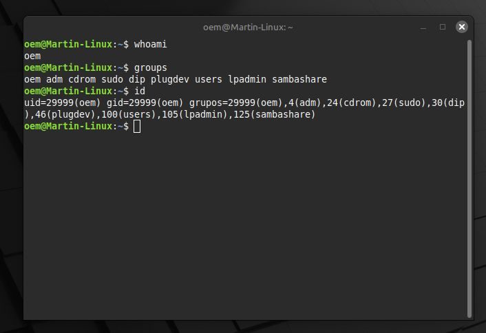
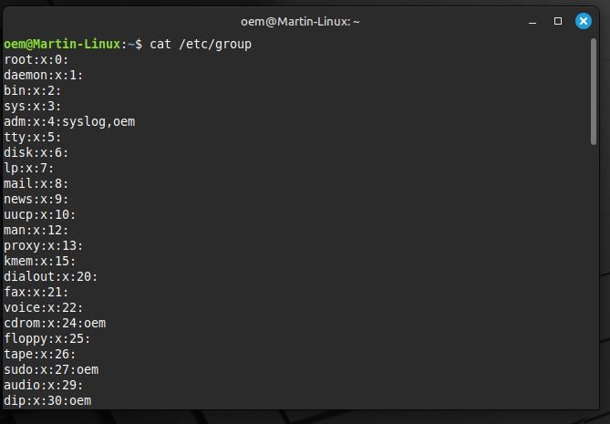
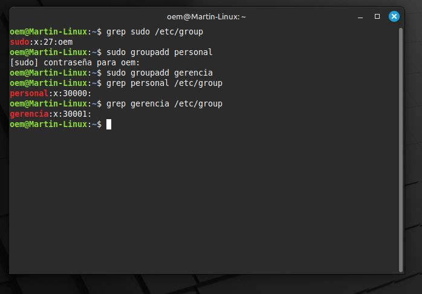
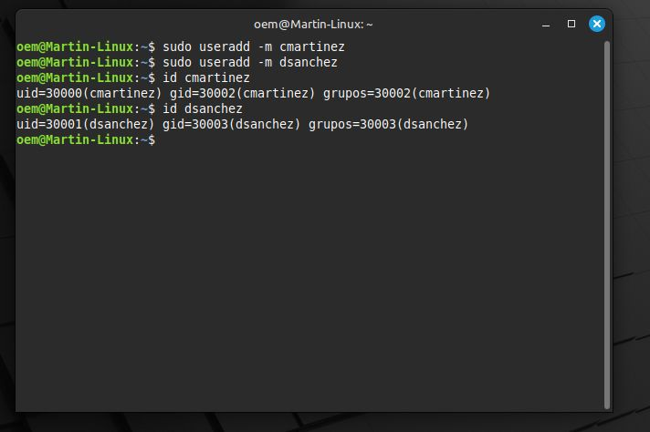
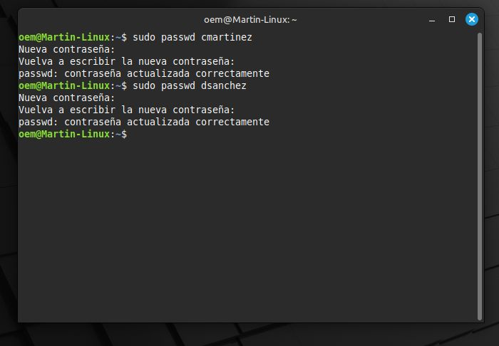
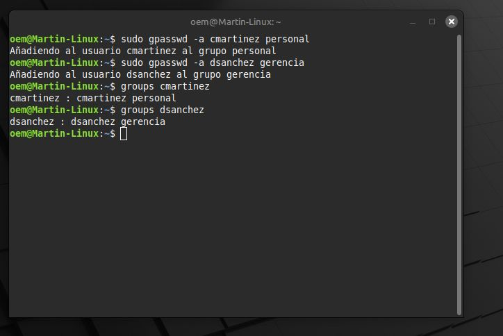
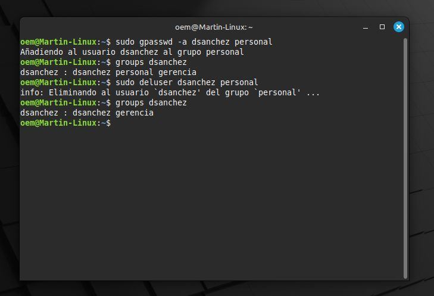
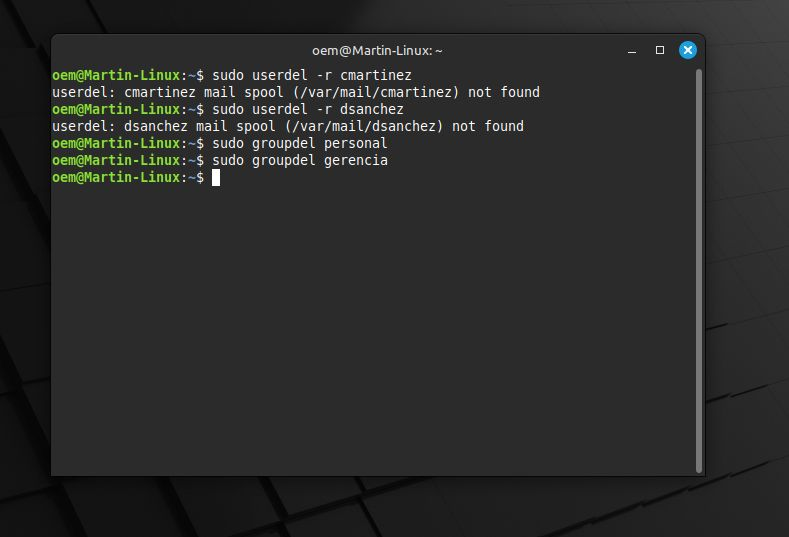

# FADENA - Licenciatura en Ciberdefensa  

## Materia: Sistemas Operativos II  

### Actividad S13-A1 – Obligatoria  

### Título: Gestión de usuarios y grupos en Ubuntu Linux  

### Alumno: Martín Alejandro Torres  

### Año: 2025  

---

## **Introducción**

En esta actividad se trabajó con la **gestión de usuarios y grupos en Ubuntu Linux** utilizando la terminal. El objetivo fue aprender a crear, modificar y eliminar usuarios y grupos, así como administrar sus permisos y pertenencias. Se emplearon comandos como `useradd`, `passwd`, `usermod`, `userdel`, `groupadd`, `gpasswd`, `groups`, y `deluser`.

Cada paso se ejecutó en una máquina virtual con Ubuntu, simulando un entorno real de administración del sistema.

---

## **Desarrollo de la actividad**

### **Paso 1: Conocer el usuario actual**

Comando utilizado:

```bash
whoami
```

**Salida simulada:**

```bash
oem
```

Este comando muestra el usuario que está ejecutando la sesión actual.

Comando adicional para ver los grupos del usuario:

```bash
groups
```

**Salida simulada:**

```bash
oem adm cdrom sudo dip plugdev lpadmin sambashare
```

**Comando `id`:**
El comando id en Linux muestra la identidad del usuario actual y los grupos a los que pertenece.

```bash
id
```

**Salida simulada:**

```bash
uid=29999(oem) gid=29999(oem) groups=29999(oem),4(adm),24(cdrom),27(sudo),30(dip),46(plugdev),100(users),105 (lpadmin),125(sambashare)
```

 **Explicación:**

* uid=29999(oem)
  * El UID (User ID) es el número que identifica al usuario dentro del sistema.
    En este caso, el usuario se llama oem y su identificador es 29999.

* gid=29999(oem)
  * El GID (Group ID) es el número que identifica al grupo principal al que pertenece el usuario.
    Aquí, el grupo principal también se llama oem y tiene el mismo número (29999).

* groups=...
  * Lista todos los grupos adicionales a los que pertenece el usuario, junto con su ID y nombre:

    * 29999(oem) → grupo principal del usuario

    * 4(adm) → grupo de administración (acceso a logs del sistema)

    * 24(cdrom) → acceso a dispositivos de CD/DVD

    * 27(sudo) → permite usar el comando sudo para ejecutar tareas como administrador

    * 30(dip) → acceso a configuraciones de red (Dial-up, VPN)

    * 46(plugdev) → acceso a dispositivos enchufables (USB, etc.)

    * 100(users) → grupo general de usuarios comunes

    * 105(lpadmin) → permisos para administrar impresoras

    * 125(sambashare) → acceso a carpetas compartidas con Samba (red)



---


### **Paso 2: Conocer los grupos existentes**

Comando utilizado:

```bash
cat /etc/group
```

Muestra todos los grupos del sistema. Cada línea sigue el formato:

```bash
nombre_del_grupo:contraseña_cifrada:GID:miembros_del_grupo
```



Para buscar un grupo específico:

```bash
grep sudo /etc/group
```

**Salida simulada:**

```bash
sudo:x:27:oem
```

---

### **Paso 3: Crear grupos de usuario**

Creación de los grupos **personal** y **gerencia**:

```bash
sudo groupadd personal
sudo groupadd gerencia
```

Verificación:

```bash
grep personal /etc/group
grep gerencia /etc/group
```

**Salida simulada:**

```bash
personal:x:30000:
gerencia:x:30001:
```

 **Explicación:**

> personal → nombre del grupo
> x → indica que la contraseña del grupo está almacenada (encriptada) en otro archivo (/etc/gshadow)
>30000 → es el GID (Group ID), el número que identifica a ese grupo en el sistema



---

### **Paso 4: Crear cuentas de usuario**

Creación de usuarios con directorio personal:

```bash
sudo useradd -m cmartinez
sudo useradd -m dsanchez
```

Verificación:

```bash
id cmartinez
id dsanchez
```

**Salida simulada:**

```bash
uid=30000(cmartinez) gid=30002(cmartinez) groups=30002(cmartinez)
uid=30001(dsanchez) gid=30003(dsanchez) groups=30003(dsanchez)
```

 **Explicación:**

> uid=30000(cmartinez) → El identificador de usuario (UID) es 30000, y el nombre del usuario es cmartinez.
> gid=30002(cmartinez) → El grupo principal (GID) del usuario es 30002, y se llama igual que el usuario (cmartinez).
> groups=30002(cmartinez) → Indica que cmartinez pertenece solo a su grupo principal, sin grupos adicionales.



---

### **Paso 5: Establecer contraseñas**

Asignación de contraseñas simples para la práctica:

```bash
sudo passwd cmartinez
sudo passwd dsanchez
```

**Salida simulada:**

```bash
Nueva contraseña:
Vuelva a escribir la nueva contraseña:
passwd: contraseña actualizada correctamente
```



---

### **Paso 6: Asignar usuarios a grupos secundarios**

Asignación de cada usuario a su grupo correspondiente:

```bash
sudo gpasswd -a cmartinez personal
sudo gpasswd -a dsanchez gerencia
```

Verificación:

```bash
groups cmartinez
groups dsanchez
```

**Salida simulada:**

```bash
cmartinez : cmartinez personal
dsanchez : dsanchez gerencia
```



---

### **Paso 7: Agregar y eliminar un usuario de un grupo**

Agregar a **dsanchez** temporalmente al grupo **personal**:

```bash
sudo gpasswd -a dsanchez personal
```

Verificar:

```bash
groups dsanchez
```

**Salida simulada:**

```bash
dsanchez : dsanchez gerencia personal
```

Eliminarlo del grupo personal:

```bash
sudo deluser dsanchez personal
```

Verificar nuevamente:

```bash
groups dsanchez
```

**Salida simulada:**

```bash
dsanchez : dsanchez gerencia
```



---

### **Paso 8: Eliminación de cuentas y grupos**

Eliminación de usuarios y sus directorios:

```bash
sudo userdel -r cmartinez
sudo userdel -r dsanchez
```

Eliminación de los grupos:

```bash
sudo groupdel personal
sudo groupdel gerencia
```

**Salida esperada:** Sin errores, lo que indica que fueron eliminados correctamente.



---

## **Preguntas finales**

**1. ¿Cuál es la diferencia principal entre `userdel nombre_usuario` y `userdel -r nombre_usuario`?**  

* `userdel nombre_usuario` elimina solo la cuenta del usuario, pero **mantiene su carpeta personal y archivos**.  
* `userdel -r nombre_usuario` **elimina también el directorio personal y los archivos asociados**, realizando una limpieza completa.

---

**2. ¿Qué comando usaría para añadir a un usuario llamado `invitado` a un grupo secundario llamado `Ventas`?**  

```bash
sudo gpasswd -a invitado Ventas
```

Este comando agrega al usuario `invitado` al grupo secundario `Ventas` sin modificar su grupo primario.

---

**3. Si olvidas el grupo primario de un usuario, ¿qué comando permite verlo rápidamente?**  
El comando es:

```bash
id nombre_usuario
```

Este muestra el UID, GID (grupo primario) y todos los grupos secundarios del usuario.

---

**4. ¿Qué comando usaría para crear un grupo nuevo llamado `Auditoria`?**  

```bash
sudo groupadd Auditoria
```

Este comando crea un nuevo grupo en el sistema con el nombre especificado.

---

## **Conclusión**

Durante esta práctica se aprendió a **administrar usuarios y grupos en Ubuntu Linux** desde la terminal. Se comprendió la importancia de manejar correctamente las pertenencias, los permisos y la estructura de grupos para mantener un entorno seguro y ordenado.

El uso de comandos como `useradd`, `passwd`, `gpasswd`, `groups` y `userdel` permite al administrador gestionar de forma eficiente las cuentas del sistema. Esta experiencia contribuye a desarrollar habilidades fundamentales para la ciberdefensa y la administración segura de sistemas Linux.

---
