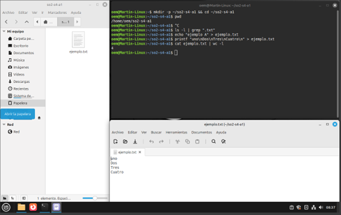
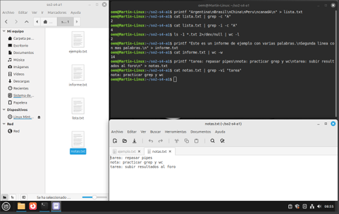

# Actividad S4-A1 – Comunicación entre procesos en Linux (Pipes)

**Alumno:** Martin Alejandro Torres  
**Materia:** Sistemas Operativos II  
**Semana 4 – Unidad 2**

---

## Ejercicios realizados

1. **Contar el número de líneas en el archivo `lista.txt` que contienen la letra "A":**

```bash
cat lista.txt | grep -c "A"
```

**Resultado:** `2`

---

2. **Contar la cantidad de archivos en el directorio actual que tienen la extensión `.txt`:**

```bash
ls -l *.txt 2>/dev/null | wc -l
```

**Resultado:** `2`

---

3. **Mostrar la cantidad total de palabras de un archivo de texto llamado `informe.txt`:**

```bash
cat informe.txt | wc -w
```

**Resultado:** `14`

---

4. **Mostrar el contenido del archivo `notas.txt`, pero excluyendo las líneas que contienen la palabra "tarea":**

```bash
cat notas.txt | grep -vi "tarea"
```

**Resultado:**

```
nota: practicar grep y wc
```

---

## Evidencia (capturas de la terminal y archivos creados)

### 📌 Primera parte


### 📌 Segunda parte


---

## Ejemplos adicionales de uso de pipes

- **Contar procesos del usuario actual:**

```bash
ps -u $USER | wc -l
```

- **Listar los 5 archivos más grandes del directorio:**

```bash
ls -lhS | head -n 5
```

- **Buscar cuántas veces aparece la palabra "seguridad" en los archivos `.txt`:**

```bash
grep -r "seguridad" *.txt | wc -l
```

- **Mostrar usuarios con sesión activa:**

```bash
who | cut -d " " -f1 | sort | uniq
```

---

## Conclusión

Los **pipes** permiten conectar procesos en Linux para automatizar tareas de filtrado, búsqueda y conteo de información. Esto los convierte en una herramienta fundamental para la administración de sistemas y el trabajo con archivos de texto.
