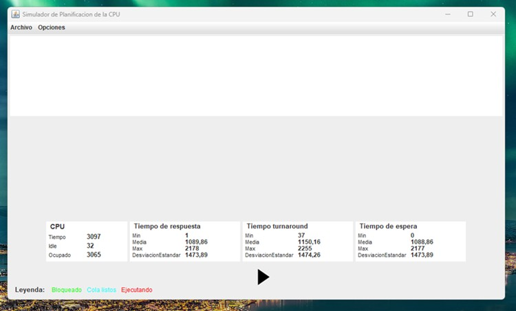
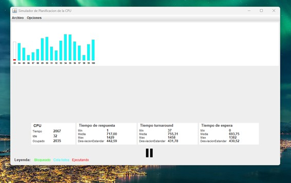
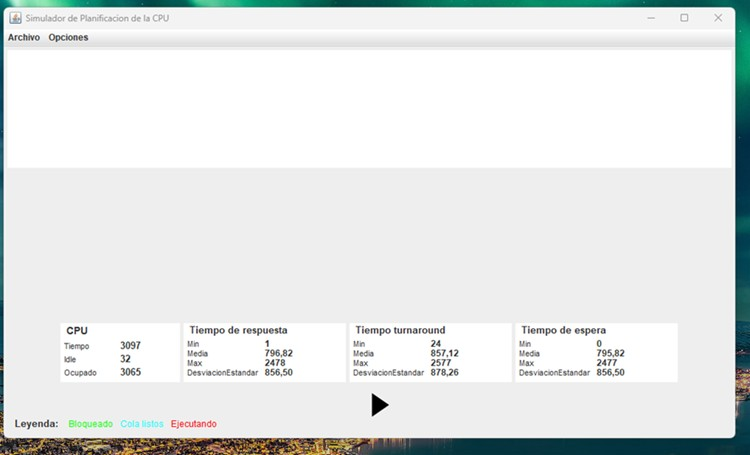
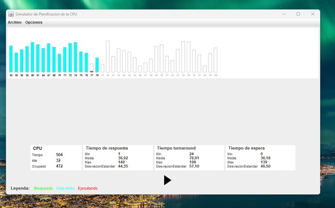
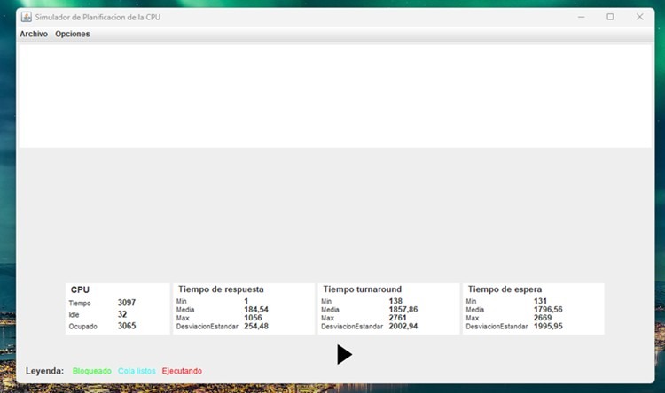
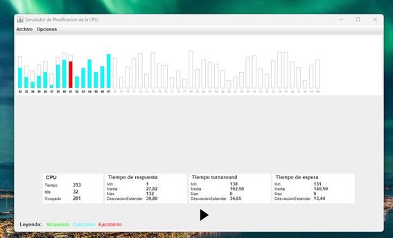
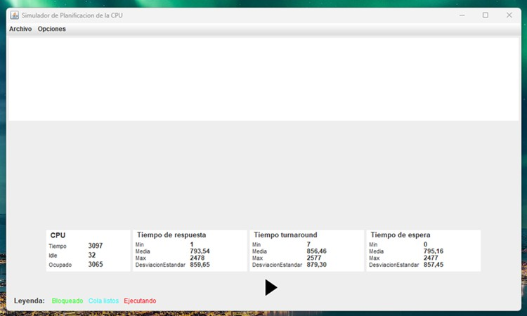
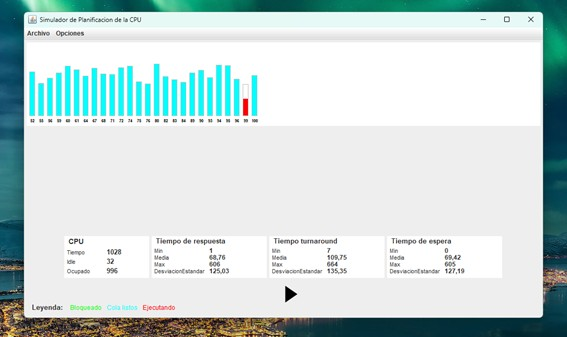

# Informe de Simulación de Planificación de Procesos  
## Materia: Sistemas Operativos II
## Actividad: S6-A1 - Planificación de Procesos
## Alumno: Martin Alejandro Torres
## Fecha: 16/09/2025

---

## 1. Introducción  
El objetivo de esta actividad fue **simular el comportamiento de distintos algoritmos de planificación de procesos** y analizar sus resultados en términos de **eficiencia, equidad y rendimiento**.  

Se utilizaron cuatro algoritmos de planificación:  

- **FIFO (First In, First Out / FCFS)** – No apropiativo.  
- **SJF (Shortest Job First)** – No apropiativo.  
- **Round Robin (RR)** – Apropiativo.  
- **PSJF (Preemptive Shortest Job First)** – Apropiativo.  

---

## 2. Metodología  
Para realizar la simulación se utilizó el **software de planificación de CPU** proporcionado en la cátedra, ejecutado sobre **Java Runtime Environment (JRE)**.  

Los pasos fueron:  
1. Cargar el archivo `tpSimulacion.dat` con la lista predefinida de procesos.  
2. Ejecutar cada uno de los algoritmos de planificación.  
3. Registrar los resultados de las métricas generadas.  
4. Comparar los valores entre algoritmos.  

---

## 3. Resultados  

### 📌 Algoritmo FCFS (FIFO)
#### Resultados obtenidos para el algoritmo First Come First Served (no apropiativo).

#### Comportamiento gráfico

### 📌 Algoritmo SRTF (Shortest Remaining Time First)
#### Resultados obtenidos para el algoritmo SRTF (no apropiativo).

#### Comportamiento gráfico

### 📌 Algoritmo Round Robin
#### Resultados obtenidos para el algoritmo Round Robin (apropiativo).

#### Comportamiento gráfico

### 📌 Algoritmo PSJF (Preemptive Shortest Job First)
#### Resultados obtenidos para el algoritmo PSJF (apropiativo).

#### Comportamiento gráfico

---

## 4. Tabla Comparativa

| Métrica                | FIFO   | SJF    | Round Robin | PSJF   |
|-------------------------|--------|--------|-------------|--------|
| **CPU - Total**         | 3097   | 3097   | 3097        | 3097   |
| **CPU - Ocioso**        | 32     | 32     | 32          | 32     |
| **CPU - Ocupado**       | 3065   | 3065   | 3065        | 3065   |
| **T. Respuesta - Mín**  | 1      | 1      | 1           | 1      |
| **T. Respuesta - Media**| 1089.86| 796.82 | 184.54      | 793.54 |
| **T. Respuesta - Máx**  | 2178   | 2478   | 1056        | 2478   |
| **T. Respuesta - DesvEst** | 1473.89 | 856.50 | 254.48  | 859.65 |
| **T. Turnaround - Mín** | 37     | 24     | 138         | 7      |
| **T. Turnaround - Media**| 1150.16| 857.12| 1857.86     | 856.46 |
| **T. Turnaround - Máx** | 2255   | 2577   | 2761        | 2577   |
| **T. Turnaround - DesvEst**| 1474.26| 878.26| 2002.94  | 879.30 |
| **T. Espera - Mín**     | 0      | 0      | 131         | 0      |
| **T. Espera - Media**   | 1088.86| 795.82 | 1796.56     | 795.16 |
| **T. Espera - Máx**     | 2177   | 2477   | 2669        | 2477   |
| **T. Espera - DesvEst** | 1473.89| 856.50 | 1995.95     | 857.45 |

---

## 5. Análisis  de las metricas

- **FIFO (FCFS):**  
  - Ventaja: sencillo de implementar, justo en el orden de llegada.  
  - Desventaja: genera **tiempos de espera y turnaround muy altos** cuando hay procesos largos.  

- **SJF (No apropiativo):**  
  - Ventaja: mejora los tiempos promedio de espera y respuesta frente a FIFO.  
  - Desventaja: puede generar **inanición** en procesos largos si siempre llegan procesos cortos.  

- **Round Robin (RR):**  
  - Ventaja: **equitativo**, asegura que todos los procesos reciban tiempo de CPU.  
  - Desventaja: el **tiempo de turnaround es muy alto**, ya que el cambio de contexto fragmenta la ejecución.  

- **PSJF (Apropiativo):**  
  - Ventaja: combina las bondades de SJF con preempción, ofreciendo buenos promedios de espera y respuesta.  
  - Desventaja: al igual que SJF, **penaliza los procesos largos**.  

---

## 6. Análisis del comportamiento gráfico en el simulador

Además de los valores numéricos, el simulador mostró dinámicamente el uso del CPU y la cola de procesos. Según el algoritmo elegido, se pudieron observar las siguientes características en los gráficos:

- **FIFO (FCFS):**  
  - Los procesos se ejecutan en el orden de llegada.  
  - En el gráfico se ve una **barra larga y continua** por cada proceso, sin interrupciones.  
  - Los procesos que llegaron después quedan **en espera completa** hasta que finaliza el que está en ejecución.  

- **SJF (No apropiativo):**  
  - Los procesos más cortos comienzan primero.  
  - En el gráfico se distinguen **bloques de barras más pequeños y rápidos al inicio**, mientras los procesos largos se van desplazando hacia el final.  
  - Se nota que los procesos cortos "limpian" rápidamente la cola, pero los largos quedan relegados.  

- **Round Robin (RR):**  
  - El CPU va alternando entre procesos con un **quantum fijo**.  
  - En el gráfico las barras de cada proceso aparecen **fragmentadas en segmentos cortos**, intercalados con otros procesos.  
  - Visualmente, se aprecia que todos los procesos tienen su turno de manera cíclica, aunque la ejecución total de cada uno tarda más.  

- **PSJF (Apropiativo):**  
  - El CPU interrumpe un proceso si llega otro con menor tiempo restante.  
  - En el gráfico se observa cómo **procesos cortos interrumpen a los largos**, insertándose con barras más pequeñas dentro de la ejecución en curso.  
  - Esto genera un movimiento dinámico donde la barra de un proceso largo es "cortada" varias veces por barras más cortas.  

---

## 7. Conclusiones  
#### A partir de los resultados obtenidos en la simulación de los algoritmos de planificación, se pueden establecer las siguientes conclusiones más relevantes:  

- El algoritmo **FCFS (FIFO)**, aunque sencillo y predecible, presentó tiempos de espera y de respuesta muy elevados. Esto lo hace ineficiente en contextos donde se requiere rapidez y equidad entre procesos.  
- El algoritmo **SJF (Shortest Job First, no apropiativo)** fue el que mejores resultados mostró en promedio, reduciendo significativamente los tiempos de turnaround y de espera. Sin embargo, su tendencia a posponer procesos largos puede generar inanición.  
- El algoritmo **Round Robin** ofreció una distribución más justa del procesador, garantizando que todos los procesos tengan oportunidad de ejecución. A pesar de un mayor overhead por cambios de contexto, resulta ideal en sistemas interactivos y multitarea.  
- El algoritmo **PSJF (Preemptive Shortest Job First)** equilibró eficiencia y equidad, logrando buenos promedios sin relegar de manera excesiva a procesos más largos, mostrando un desempeño más balanceado que SJF.  

Comparando globalmente, **SJF y PSJF sobresalen en eficiencia**, mientras que **Round Robin destaca en equidad**. **FCFS** se mostró como el menos competitivo en la mayoría de los indicadores de rendimiento.  

La selección del algoritmo más adecuado depende del entorno: en sistemas de tiempo compartido se prioriza **Round Robin o PSJF**; en sistemas por lotes con cargas previsibles, **SJF** es generalmente preferido.  
