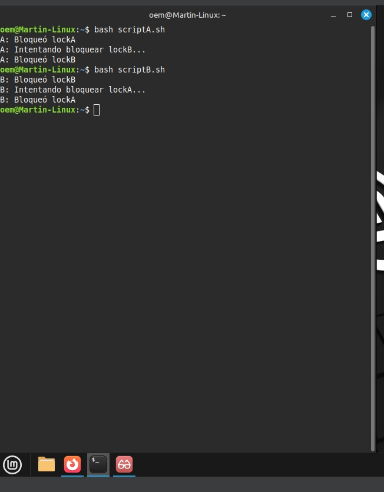
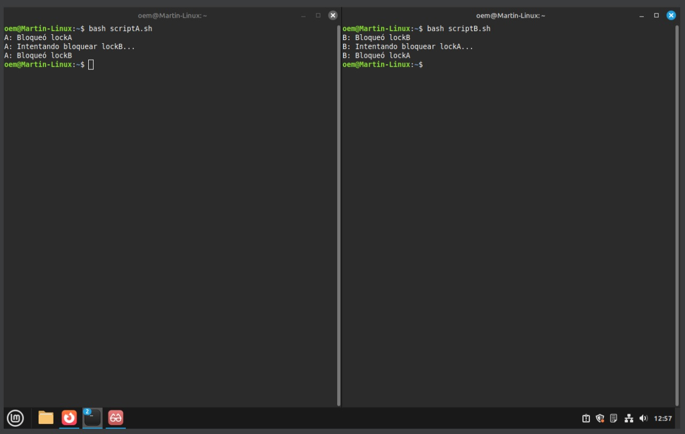
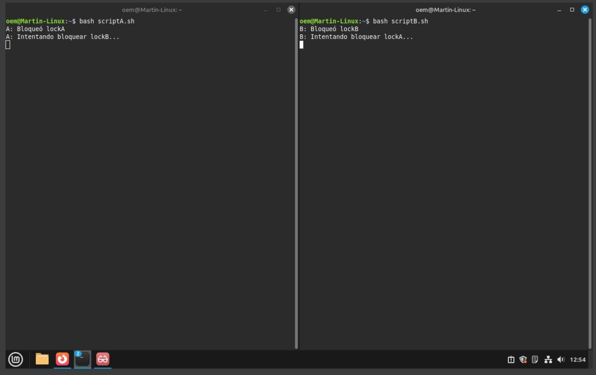
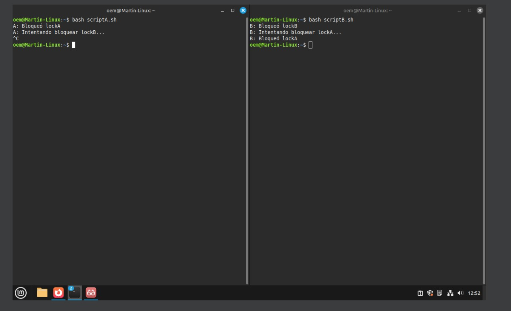

# Licenciatura en Ciberdefensa  
## Sistemas Operativos II  
### Actividad S9-A1 – Interbloqueos

---

### 1. Objetivo
Simular condiciones de interbloqueo en Linux utilizando la terminal del sistema, mediante el uso de archivos de bloqueo (`flock`) en scripts Bash.

---

### 2. Software necesario
- **VirtualBox**
- **Máquina virtual con Linux (Debian, Ubuntu u otra distribución)**
- **Editor de texto** (nano, vim, etc.)
- **Scripts y archivos necesarios**

---

### 3. Desarrollo de la actividad

#### 3.1 Preparación
En la terminal de Linux, crear los archivos de bloqueo:

```bash
touch /tmp/lockA
touch /tmp/lockB
```

Luego, crear los dos scripts: `scriptA.sh` y `scriptB.sh`.

#### scriptA.sh
```bash
#!/bin/bash
exec 3>/tmp/lockA
flock 3
echo "A: Bloqueó lockA"
sleep 2

exec 4>/tmp/lockB
echo "A: Intentando bloquear lockB..."
flock 4
echo "A: Bloqueó lockB"
```

#### scriptB.sh
```bash
#!/bin/bash
exec 4>/tmp/lockB
flock 4
echo "B: Bloqueó lockB"
sleep 2

exec 3>/tmp/lockA
echo "B: Intentando bloquear lockA..."
flock 3
echo "B: Bloqueó lockA"
```

---

### 4. Ejecución y resultados

#### **Caso 1**
- Ejecutar en una sola terminal:
  ```bash
  bash scriptA.sh
  bash scriptB.sh
  ```

**Resultado esperado:**
No se produce interbloqueo.  
`scriptA` finaliza su ejecución antes de que `scriptB` intente bloquear los archivos. Cuando `scriptB` se ejecuta, los recursos `/tmp/lockA` y `/tmp/lockB` ya están libres.

**Explicación:**
No hay simultaneidad en la ejecución; los recursos se liberan antes de que el otro proceso los necesite.

---

#### **Caso 2**
- Abrir dos terminales.
- En la terminal 1:  
  ```bash
  bash scriptA.sh
  ```
- Esperar **5 segundos**.
- En la terminal 2:  
  ```bash
  bash scriptB.sh
  ```

**Resultado esperado:**
No se produce interbloqueo.  
`scriptA` bloquea `lockA`, luego intenta `lockB`. Al ejecutarse `scriptB` más tarde, `lockB` puede bloquearse sin conflicto porque los tiempos no se superponen.

**Explicación:**
El retardo de 5 segundos permite que uno de los procesos termine antes de que el otro solicite los mismos recursos, evitando la condición de espera circular.

---

#### **Caso 3**
- Abrir dos terminales.
- En la terminal 1:
  ```bash
  bash scriptA.sh
  ```
- En la terminal 2 (antes de 2 segundos):
  ```bash
  bash scriptB.sh
  ```

**Resultado esperado:**
✅ **Se produce interbloqueo.**  
`scriptA` bloquea `lockA` y espera `lockB`.  
`scriptB` bloquea `lockB` y espera `lockA`.  
Ninguno puede continuar, quedando ambos bloqueados.

**Explicación técnica:**
Se cumple la condición de **espera circular**, una de las cuatro condiciones necesarias para el interbloqueo:
1. **Exclusión mutua:** los archivos lockA y lockB solo pueden ser usados por un proceso a la vez.  
2. **Retención y espera:** cada script mantiene un recurso mientras espera otro.  
3. **No apropiación:** un proceso no puede forzar la liberación del recurso del otro.  
4. **Espera circular:** A espera a B, y B espera a A.

---

### 5. Interrupción de procesos

#### Caso 3 – Interrumpir `scriptA` con `Ctrl + C`


**Resultado:**  
Cuando se interrumpe `scriptA`, su archivo bloqueado (`lockA`) se libera automáticamente.  
`scriptB`, que estaba esperando `lockA`, puede continuar su ejecución y finalizar normalmente.

#### Repetición – Cancelar `scriptB`
**Resultado:**  
Ocurre el mismo efecto inverso: al interrumpir `scriptB`, el recurso `lockB` se libera, permitiendo que `scriptA` complete su ejecución.

**Conclusión parcial:**  
La interrupción de uno de los procesos libera los recursos que tenía bloqueados, permitiendo al otro proceso continuar. Esto rompe la espera circular y elimina el interbloqueo.

---

### 6. Conclusiones finales

- **Casos con interbloqueo:**  
  Solo en el **Caso 3** se produjo interbloqueo.

- **Casos sin interbloqueo:**  
  En los **Casos 1 y 2** no se presentó interbloqueo debido a que los procesos no compitieron simultáneamente por los mismos recursos.

- **Recursos involucrados en el interbloqueo:**  
  `/tmp/lockA` y `/tmp/lockB`.

- **Comportamiento al interrumpir procesos:**  
  La interrupción de un proceso libera los recursos que tenía bloqueados, lo cual permite que el otro proceso termine su ejecución.

- **Conclusión general:**  
  Los interbloqueos se producen cuando dos o más procesos esperan indefinidamente recursos que el otro mantiene bloqueados. La correcta sincronización y el orden consistente en la adquisición de recursos son claves para evitar este tipo de situaciones.

---

