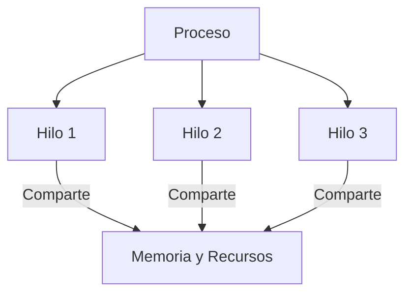

# Resumen Detallado del Capítulo 3: Descripción y Control de Procesos
*Basado en "Sistemas Operativos" de William Stallings, Capítulo 3*

---

## 1. ¿Qué es un Proceso?
Un **proceso** es un programa en ejecución, una instancia única de un programa que incluye:
- **Código ejecutable** (instrucciones).
- **Datos** (variables, constantes).
- **Estado** (registros, contador de programa, recursos asignados).
- **Recursos del sistema** (memoria, archivos abiertos, dispositivos de E/S).

### Bloque de Control de Proceso (BCP o PCB)
Estructura de datos que almacena **toda la información** del proceso:
- **Identificador único (PID)**.
- **Estado del proceso** (Ejecutando, Listo, Bloqueado, etc.).
- **Contador de programa** (siguiente instrucción a ejecutar).
- **Registros del CPU** (valores actuales).
- **Prioridad**.
- **Información de E/S** (dispositivos asignados, operaciones pendientes).
- **Límites de memoria**.

---

## 2. Estados de un Proceso
Los procesos pasan por diferentes estados durante su vida útil.

### Modelo Básico de 2 Estados
1.  **Ejecutando**: El proceso está en el CPU.
2.  **No Ejecutando**: Espera su turno (en memoria o disco).

### Modelo de 5 Estados (Más detallado)
1.  **Nuevo**: Recién creado (no está en memoria).
2.  **Listo**: En memoria, esperando CPU.
3.  **Ejecutando**: Usando el CPU.
4.  **Bloqueado**: Espera un evento (E/S, señal).
5.  **Saliente**: Terminado (liberando recursos).

### Procesos Suspendidos
- **Suspendido**: Proceso sacado de memoria (*swap*) para liberar espacio.
- **Listo/Suspendido**: En disco, esperando ser cargado.
- **Bloqueado/Suspendido**: En disco, esperando un evento.

---

## 3. Descripción de Procesos
El sistema operativo gestiona procesos mediante **tablas**.

### Tablas del Sistema Operativo
- **Tabla de Procesos**: Lista de todos los procesos (BCPs).
- **Tabla de Memoria**: Asignación de memoria a procesos.
- **Tabla de E/S**: Dispositivos asignados a cada proceso.
- **Tabla de Archivos**: Archivos abiertos por cada proceso.

### Estructura de un Proceso en Memoria
- **BCP**: Datos de control del proceso.
- **Pila de Usuario**: Llamadas a funciones y variables locales.
- **Segmento de Código**: Instrucciones del programa.
- **Segmento de Datos**: Variables globales.

---

## 4. Control de Procesos

### Modos de Ejecución del CPU
- **Modo Usuario**: Para programas normales (sin acceso privilegiado).
- **Modo Kernel**: Para el sistema operativo (acceso total al hardware).

### Creación de Procesos
Ocurre por:
- Nuevo lote de trabajos (sistemas por lotes).
- Solicitud del usuario (ejecución interactiva).
- Llamada al sistema (ej: `fork()` en UNIX).
- Proceso padre crea un hijo (herencia de recursos).

### Terminación de Procesos
Razones:
- Finalización normal (ejecución completa).
- Error (ej: división por cero).
- Intervención externa (usuario mata el proceso).

### Cambio de Proceso (Context Switch)
Cuando el SO decide cambiar de proceso:
1.  Salva el estado (registros, contador de programa).
2.  Actualiza el BCP del proceso saliente.
3.  Selecciona nuevo proceso (planificación).
4.  Restaura estado del nuevo proceso.

---

## 5. Gestión de Procesos en UNIX SVR4
- Procesos en UNIX se crean con `fork()` y se ejecutan con `exec()`.
- **Jerarquía de procesos**: Relación padre-hijo.
- **Señales**: Mecanismo para notificar eventos (ej: `SIGKILL`).

---

## 🎯 Conceptos Clave para Estudiar

| Concepto | Descripción |
| :--- | :--- |
| **✅ Proceso vs Programa** | Un proceso es **dinámico**; un programa es **estático**. |
| **✅ Estados de un proceso** | Transiciones entre Ejecutando, Listo, Bloqueado. |
| **✅ BCP** | Estructura clave para gestionar procesos. |
| **✅ Cambio de contexto** | *Overhead* al cambiar de proceso. |
| **✅ Creación/Terminación** | Eventos que los disparan. |

---

## 🔄 Ejemplo de Flujo
1.  Usuario ejecuta un comando → SO crea proceso (`fork()`).
2.  Proceso pasa a **Listo** → Planificador lo asigna al CPU (**Ejecutando**).
3.  Si hace E/S → Pasa a **Bloqueado**.
4.  Si termina → Libera recursos (**Saliente**).

---

## 📌 Consejo para el estudio:
- **Dibuja diagramas de estados** para entender las transiciones.
- **Relaciona con ejemplos reales** (ej: cómo UNIX maneja procesos).
- **Compara con otros sistemas** (Windows, Linux).

# Guía de Comandos para la Gestión de Procesos en Linux

La gestión de procesos es fundamental en sistemas operativos basados en Unix/Linux. Los siguientes comandos permiten **visualizar, controlar, ejecutar y modificar la prioridad de procesos** en el sistema.

---

## 1. Comandos para Visualizar Procesos

### a) `ps` (Process Status)
**¿Qué hace?**  
Muestra información sobre los procesos que están corriendo en tu sistema.

**¿Dónde se usa?**  
En la terminal (Ctrl + Alt + T en Ubuntu).

**Opciones comunes:**
- `ps`: Muestra solo los procesos de la terminal actual.
- `ps -e`: Lista todos los procesos del sistema.
- `ps -f`: Muestra detalles completos (usuario, PID, PPID, etc.).
- `ps aux`: Combina tres opciones para ver todos los procesos de todos los usuarios, con detalles de CPU y memoria.

**Ejemplo práctico:**
```bash
ps aux | grep firefox
```
Busca si Firefox está corriendo y muestra su PID, uso de CPU y memoria.

---

### b) `top` (Table of Processes)
**¿Qué hace?**  
Muestra una lista en tiempo real de los procesos que más recursos consumen (CPU, memoria).

**¿Dónde se usa?**  
En la terminal. Se actualiza automáticamente cada pocos segundos.

**Comandos dentro de `top`:**
- `M`: Ordena por uso de memoria (de mayor a menor).
- `P`: Ordena por uso de CPU (de mayor a menor).
- `q`: Sale de top.

**Ejemplo:**
```bash
top
```
Verás una pantalla interactiva con estadísticas del sistema y procesos activos.

---

## 2. Comandos para Controlar Procesos

### a) `kill` (Terminar un proceso)
**¿Qué hace?**  
Envía una señal para detener un proceso.

**Señales comunes:**
- `kill <PID>` → Envía **SIGTERM** (terminación suave, el proceso puede guardar datos antes de cerrarse).
- `kill -9 <PID>` → Envía **SIGKILL** (terminación forzada, mata el proceso de inmediato).

**Ejemplo:**
```bash
ps aux | grep gedit
kill 1234  # (Reemplaza 1234 con el PID real)
```
⚠️ **Precaución:** No mates procesos críticos del sistema (como `systemd` o `init`), podrías bloquear tu PC.

---

## 3. Comandos para Ejecutar Procesos en Primer o Segundo Plano

### a) `&` (Ejecutar en segundo plano)
Ejecuta un comando sin bloquear la terminal.

```bash
firefox &
```

### b) `Ctrl + Z` (Pausar un proceso)
Detiene temporalmente un proceso que está en primer plano.

```bash
sleep 1000
# Presiona Ctrl + Z → El proceso se pausa
```

### c) `jobs` (Ver procesos pausados o en segundo plano)
Muestra una lista de trabajos en segundo plano o pausados.

```bash
jobs
```
Salida posible:
```
[1]  + Stopped    sleep 1000
```

### d) `bg` (Reanudar en segundo plano)
Reanuda un proceso pausado, pero lo manda a segundo plano.

```bash
bg %1
```

### e) `fg` (Traer al primer plano)
Trae un proceso de segundo plano a primer plano (bloquea la terminal).

```bash
fg %1
```

---

## 4. Comandos para Prioridad de Procesos

### a) `nice` (Asignar prioridad al iniciar un proceso)
Define qué tan "amable" es un proceso con otros (prioridad).

**Valores:**
- `-20` → Máxima prioridad (menos "amable").
- `19` → Mínima prioridad (más "amable").

**Ejemplo:**
```bash
nice -n 10 yes > /dev/null
```

### b) `renice` (Cambiar prioridad de un proceso en ejecución)
Modifica la prioridad de un proceso que ya está corriendo.

**Ejemplo:**
```bash
ps aux | grep yes
renice +10 -p 5678  # (5678 es el PID)
sudo renice -5 -p 5678  # Para alta prioridad (requiere sudo)
```

---

## 📌 Resumen Rápido

| Comando  | Uso |
|----------|--------------------------------|
| `ps`     | Ver procesos |
| `top`    | Monitoreo en tiempo real |
| `kill`   | Terminar procesos |
| `&`      | Ejecutar en segundo plano |
| `Ctrl+Z` | Pausar proceso |
| `jobs`   | Listar procesos pausados/en bg |
| `bg`     | Reanudar en segundo plano |
| `fg`     | Traer a primer plano |
| `nice`   | Asignar prioridad al inicio |
| `renice` | Cambiar prioridad en ejecución |

---

### ✅ Conceptos Ampliados
- **Proceso:** Programa en ejecución. Cada proceso tiene un **PID** (Process ID).  
- **Job:** Tarea asociada a una terminal, puede estar en **primer plano** o **segundo plano**.  
- **Señales (signals):** Mensajes enviados a procesos para indicarles qué hacer (ej. terminar, pausar, continuar).  
- **Prioridad (nice/renice):** Determina el orden en que la CPU atiende a los procesos.  
- **Foreground vs Background:** Un proceso en primer plano bloquea la terminal, en segundo plano no.  

---

# 📘 Informe Actividad S3-A1 – Gestión de Procesos e Hilos en Linux

**Materia:** Sistemas Operativos II  
**Alumno:** *Martin Alejandro Torres*  
**Sistema:** Linux Mint 22.1 (basado en Ubuntu) en VirtualBox  

---

## 🔹 1. Comando `ps -ef`
Se listaron los procesos activos en el sistema.  
👉 Muestra información como: **UID, PID, PPID, TTY, TIME, CMD**.  
En la captura se observan procesos del sistema (`init`, `kthreadd`, `kworker`, etc.).


---

## 🔹 2. Comando `ps -efL`
Este comando incluye la información de **hilos (LWP)** y la columna **NLWP** (número de hilos asociados al proceso).  
👉 La salida muestra que algunos procesos tienen múltiples hilos.


---

## 🔹 3. Comando `ps aux` y `ps aux -L`
El formato `aux` permite ver:
- **%CPU, %MEM, VSZ, RSS, STAT, START, TIME, COMMAND**  

Además de los PIDs se identificaron procesos como `bash` y `xdg-desktop-portal`.  

Con `ps aux -L` se listan también los **hilos de cada proceso**.  


---

## 🔹 4. Proceso con mayor cantidad de hilos
Con el comando:
```bash
ps -eLf | sort -k 5 -n | tail -10

```

se identificó que el proceso `cinnamon` (PID 1419) es uno de los que tiene más hilos.

Luego se ejecutó:

```bash
ps -L -p 1419 -o pid,lwp,nlwp,psr,comm

```


👉 Se listan los **LWP**, el número de hilos (**NLWP=15**), la CPU asignada (PSR) y el comando (`cinnamon`).
👉 Se observa que los hilos no siempre corren en la misma CPU.

## 🔹 5. Exploración de /proc

Dentro del directorio `/proc/1419/task` se listaron carpetas, cada una correspondiente a un hilo del proceso `cinnamon`.

Ejemplo de inspección:

```bash
cat /proc/1419/task/1425/status


```

Se obtuvo:

- Name: gmain

- State: S (sleeping → en espera)

- PPid: 1419 (proceso padre `cinnamon`)

- Tgid: 1419 (idéntico al PID principal del proceso, indica grupo de hilos)

- Cpus_allowed_list: 0 (afinidad con CPU 0)


## 🔹 6. Conclusiones

- `ps -ef` muestra los procesos, pero `ps -efL` incluye los hilos.

- `NLWP` permite identificar cuántos hilos maneja cada proceso.

- El entorno gráfico `cinnamon` utiliza múltiples hilos para gestionar la interfaz.

- El directorio `/proc/<PID>/task` es útil para ver cada hilo como una carpeta individual.

- La información del archivo `status` permite identificar estado, afinidad de CPU y relación con el proceso padre.


# 📚 Resumen: Sistemas Operativos II - Unidad 1 / Semana 3  
**Licenciatura en Ciberdefensa**  
**Tema:** Procesos, Hilos y Planificación  

---

## 🔄 **1. Colas de Planificación**  
- **Objetivo:** Administrar procesos según su estado (Listo, Bloqueado, Ejecutando).  
- **Estructuras:**  
  - **Colas enlazadas:** Contienen punteros a los PCBs (Bloques de Control de Proceso).  
  - **Modelos:**  
    - **2 estados:** Ejecutando / No Ejecutando.  
    - **5 estados:** Nuevo, Listo, Ejecutando, Bloqueado, Terminado.  

---

## 🛠️ **2. Creación y Terminación de Procesos**  
**Causas de finalización:**  
1. **Salida normal** (ejecución exitosa).  
2. **Salida por error** (detectado por el programa).  
3. **Error fatal** (detectado por el SO).  
4. **Eliminado por otro proceso** (e.g., `kill` en Linux).  

---

## 🔄 **3. Cambio de Contexto**  
**Pasos clave:**  
1. Guardar estado del procesador (registros, contador de programa).  
2. Actualizar PCB del proceso saliente.  
3. Mover PCB a la cola correspondiente.  
4. Seleccionar y cargar nuevo proceso.  

---

## 🧵 **4. Hilos (Threads)**  
### **4.1 Conceptos Clave**  
- **Definición:** Unidad de ejecución dentro de un proceso (comparte memoria y recursos).  
- **Ventajas:**  
  - Menor sobrecarga vs. procesos.  
  - Comunicación eficiente (memoria compartida).  
  - Concurrencia en sistemas multinúcleo.  

### **4.2 Tipos de Sistemas**  
| **Tipo**       | **Descripción**                                  | **Ejemplo**       |  
|----------------|------------------------------------------------|-------------------|  
| **Monohilo**   | 1 hilo por proceso (sin concurrencia real).     | MS-DOS            |  
| **Multihilo**  | Múltiples hilos por proceso (ejecución paralela). | Windows, Linux    |  

### **4.3 Categorías de Hilos**  
| **Tipo**       | **Gestión**       | **Ventajas**                          | **Desventajas**               |  
|----------------|------------------|---------------------------------------|-------------------------------|  
| **ULT**        | Espacio usuario  | Cambio de contexto rápido.            | Bloqueo del proceso completo. |  
| **KLT**        | Núcleo (Kernel)  | Multiprocesamiento real.              | Mayor sobrecarga.             |  
| **Combinado**  | Híbrido          | Balance entre rendimiento y flexibilidad. | Complejidad.                |  

---

## 💻 **5. Procesadores: Núcleos e Hilos**  
### **5.1 Procesadores Multinúcleo**  
- **Núcleo (Core):** Unidad física de procesamiento.  
- **Hilo (Thread):** Unidad lógica (ej. Hyper-Threading).  

### **5.2 Arquitecturas**  
| **Tipo** | **Uso**                  | **Ejemplos**          |  
|----------|--------------------------|-----------------------|  
| **x86**  | PCs, servidores.         | Intel Core, AMD Ryzen |  
| **ARM**  | Móviles, eficiencia energética. | Snapdragon, Apple M1 |  

---

## 📌 **Resumen Visual**  


# 📘 Resumen – Sistemas Operativos II  
**Unidad 2 – Semana 4 (2025)**  
**Lic. en Ciberdefensa – Facultad de Defensa Nacional**  

---

## 1. Procesos y multiprogramación  
- **Multiprogramación**:  
  - Varios procesos en memoria, ejecutándose de forma alternada en **un único procesador**.  
  - El SO intercala su ejecución (apariencia de simultaneidad).  

- **Multiprocesamiento**:  
  - Varios procesadores o núcleos.  
  - Ejecución **realmente simultánea** de múltiples procesos.  

---

## 2. Procesos concurrentes  
Los procesos concurrentes se **superponen en el tiempo**, dando la ilusión de simultaneidad.  

- **Simultaneidad real**: múltiples procesadores/núcleos, procesos activos al mismo tiempo.  
- **Simultaneidad aparente**: un solo procesador, el SO alterna procesos mediante *cambio de contexto*.  

### 2.1 Formas de ejecutar procesos concurrentes  
1. **Multiprogramación**: un solo procesador, alternancia rápida.  
2. **Multiprocesamiento**: múltiples procesadores, concurrencia real.  
3. **Procesamiento distribuido**: múltiples computadoras interconectadas en red, escalabilidad y tolerancia a fallos.  

### 2.2 Concurrencia vs. Paralelismo  
- **Concurrencia**: diseño de tareas que se superponen en el tiempo. Puede existir con un único procesador.  
- **Paralelismo**: ejecución real de múltiples tareas en paralelo. Requiere múltiples procesadores/núcleos.  

---

## 3. Comunicación entre procesos (IPC – *Inter-Process Communication*)  
Mecanismos para que procesos intercambien información, se sincronicen y coordinen.  

### Tipos de procesos:  
- **Independientes**: no afectan ni son afectados por otros. Compiten por recursos.  
- **Cooperativos**: colaboran y comparten datos. Requieren comunicación.  

### 3.1 Importancia de la IPC  
- **Cooperación**: dividir tareas en subtareas.  
- **Compartición de datos**: acceso controlado y seguro.  
- **Modularidad**: desarrollo más simple.  
- **Coordinación y sincronización**: evitar conflictos en recursos compartidos.  

### 3.2 Tuberías (*pipes*)  
- Canal **unidireccional** de comunicación.  
- Modelo **FIFO** (First In, First Out).  
- **Anónimos**: solo entre procesos relacionados (padre-hijo).  
- **Con nombre (FIFOs)**: comunicación entre procesos no relacionados.  

### 3.3 Memoria compartida (*Shared Memory*)  
- Segmento de memoria común a varios procesos.  
- **Ventajas**: rapidez, eficiencia (sin copias intermedias).  
- **Desventajas**: requiere sincronización, complejidad y problemas de seguridad.  

### 3.4 Pasaje de mensajes (*Message Passing*)  
- Uso de **send** y **receive** (llamadas al sistema).  
- El kernel actúa como intermediario (copiando mensajes).  
- **Ventajas**: simplicidad, seguridad, flexibilidad (local y distribuido).  
- **Desventajas**: más lento (intervención del kernel y copias de datos).  

### 3.5 Comparación  
| Característica     | Pasaje de Mensajes | Memoria Compartida |
|--------------------|-------------------|-------------------|
| **Velocidad**      | Lento (kernel)    | Rápido (acceso directo) |
| **Sincronización** | Kernel             | Externa, manual   |
| **Seguridad**      | Alta               | Baja              |
| **Implementación** | Simple             | Compleja          |
| **Uso ideal**      | Datos pequeños, sistemas distribuidos | Grandes volúmenes de datos |

---

## 4. Cooperación e interferencia entre procesos  
### 4.1 Cooperación  
- Procesos trabajan juntos hacia un **objetivo común**.  
- Ejemplo: productor-consumidor mediante tuberías.  
- Requiere IPC.  

### 4.2 Interferencia  
- Un proceso **afecta a otro de forma no intencionada**.  
- Ejemplo: **condición de carrera** (dos procesos modifican el mismo dato al mismo tiempo).  
- Se previene con mecanismos de **sincronización**.  

---

## 📌 Actividad  
- Realizar **S4-A1** (Semana 4, Actividad 1) en el campus.  

# Actividad S4-A1 – Comunicación entre procesos en Linux (Pipes)

**Alumno:** Martin Alejandro Torres  
**Materia:** Sistemas Operativos II  
**Semana 4 – Unidad 2**

---

## Ejercicios realizados

1. **Contar el número de líneas en el archivo `lista.txt` que contienen la letra "A":**

```bash
cat lista.txt | grep -c "A"
```

**Resultado:** `2`

---

2. **Contar la cantidad de archivos en el directorio actual que tienen la extensión `.txt`:**

```bash
ls -l *.txt 2>/dev/null | wc -l
```

**Resultado:** `2`

---

3. **Mostrar la cantidad total de palabras de un archivo de texto llamado `informe.txt`:**

```bash
cat informe.txt | wc -w
```

**Resultado:** `14`

---

4. **Mostrar el contenido del archivo `notas.txt`, pero excluyendo las líneas que contienen la palabra "tarea":**

```bash
cat notas.txt | grep -vi "tarea"
```

**Resultado:**

```
nota: practicar grep y wc
```

---

## Evidencia (capturas de la terminal y archivos creados)

### 📌 Primera parte


### 📌 Segunda parte


---

## Ejemplos adicionales de uso de pipes

- **Contar procesos del usuario actual:**

```bash
ps -u $USER | wc -l
```

- **Listar los 5 archivos más grandes del directorio:**

```bash
ls -lhS | head -n 5
```

- **Buscar cuántas veces aparece la palabra "seguridad" en los archivos `.txt`:**

```bash
grep -r "seguridad" *.txt | wc -l
```

- **Mostrar usuarios con sesión activa:**

```bash
who | cut -d " " -f1 | sort | uniq
```

---

## Conclusión

Los **pipes** permiten conectar procesos en Linux para automatizar tareas de filtrado, búsqueda y conteo de información. Esto los convierte en una herramienta fundamental para la administración de sistemas y el trabajo con archivos de texto.

# 📝 Actividad S4-A1 — Comunicación entre procesos con Pipes

## 0) Requisitos y preparación
- Usar **Ubuntu en VirtualBox**.  
- Abrir una **Terminal**.  

```bash
# Crear carpeta de trabajo (opcional)
mkdir -p ~/so2-s4-a1 && cd ~/so2-s4-a1

# Ver ubicación actual
pwd
```

---

## 1) Pipe unidireccional: `ls` + `grep`
```bash
ls -l | grep ".txt"
```
- `ls -l`: lista archivos.  
- `grep ".txt"`: filtra solo los que tienen `.txt`.  

> Si no tenés `.txt`, creá uno rápido:  
```bash
echo "ejemplo A" > ejemplo.txt
```

---

## 2) Pipe unidireccional: `cat` + `wc -l`
```bash
# Crear archivo de ejemplo
printf "uno\nDos\nTres\ncuatro\n" > nombre_del_archivo.txt

# Contar líneas
cat nombre_del_archivo.txt | wc -l
```
- `cat`: muestra el contenido.  
- `wc -l`: cuenta líneas.  

---

## 3) Ejercicios (punto c)

### c1) Contar líneas con **"A"** en `lista.txt`
```bash
cat lista.txt | grep -c "A"
# Variante insensible a mayúsculas/minúsculas
cat lista.txt | grep -i -c "A"
```

### c2) Contar archivos `.txt` en el directorio actual
```bash
ls -1 *.txt 2>/dev/null | wc -l
# Variante más segura
find . -maxdepth 1 -type f -name "*.txt" | wc -l
```

### c3) Contar palabras de `informe.txt`
```bash
cat informe.txt | wc -w
```

### c4) Mostrar `notas.txt` sin la palabra "tarea"
```bash
cat notas.txt | grep -vi "tarea"
```

---

## 4) Crear archivos de ejemplo (si no existen)
```bash
printf "Argentina\nbrasil\nChile\nalemania\nPeru\ncanadA\n" > lista.txt
printf "Este es un informe de ejemplo con varias palabras.\nSegunda linea con mas palabras.\n" > informe.txt
printf "tarea: repasar pipes\nnota: practicar grep y wc\ntarea: subir resultados al foro\n" > notas.txt
```

---

## 5) Guardar resultados en un archivo
```bash
{
  echo "=== Resultados S4-A1 ==="
  echo ""
  echo "[c1] Lineas con 'A' en lista.txt:"
  cat lista.txt | grep -c "A"
  echo ""
  echo "[c2] Cantidad de archivos .txt en el directorio actual:"
  ls -1 *.txt 2>/dev/null | wc -l
  echo ""
  echo "[c3] Cantidad de palabras en informe.txt:"
  cat informe.txt | wc -w
  echo ""
  echo "[c4] notas.txt SIN la palabra 'tarea':"
  cat notas.txt | grep -vi "tarea"
} > resultados_S4-A1.txt

# Ver archivo
cat resultados_S4-A1.txt
```

---

## 6) Otros ejemplos útiles con pipes
- Top 5 archivos más grandes:
  ```bash
  ls -l | grep "^-" | awk '{print $5, $9}' | sort -n | tail -5
  ```
- Contar líneas vacías:
  ```bash
  cat informe.txt | grep -c "^$"
  ```
- Filtrar procesos `bash`:
  ```bash
  ps aux | grep "bash" | grep -v "grep"
  ```
- Ver puertos en escucha:
  ```bash
  ss -lntu | tail -n +2 | awk '{print $5}' | cut -d: -f2 | sort -n | uniq
  ```

---

## 7) Solución de problemas
- **No such file or directory** → verificar existencia con `ls`.  
- **Sin .txt en el directorio** → crearlos con `echo` o `printf`.  
- **Permisos** → no se necesita `sudo` en tu carpeta personal.  

---

## 8) Checklist para entregar
- [x] Ejecuté `ls -l | grep ".txt"`.  
- [x] Ejecuté `cat nombre_del_archivo.txt | wc -l`.  
- [x] Resolví **c1–c4** y generé `resultados_S4-A1.txt`.  
- [x] Publiqué resultados y **otros ejemplos** con pipes en el foro.  

# 📘 Sincronización de Procesos (Unidad 2 - Semana 5)

## 1. Conceptos Clave

### 🔹 Condición de Carrera
- Situación donde **múltiples procesos/hilos acceden concurrentemente a un recurso compartido**.
- El resultado depende del **orden de ejecución**, lo que puede generar inconsistencias.

**Ejemplo en C**
```c
// Variable compartida
int contador = 0;

// Proceso A
contador++; // Lee 0, incrementa a 1, escribe 1

// Proceso B (ejecutándose al mismo tiempo)
contador++; // Lee 0 (antes de que A escriba), incrementa a 1, escribe 1

// Resultado final: 1 (debería ser 2)
```
---

### 🔹 Región Crítica
- Parte del programa donde se accede a **recursos compartidos**.
- El problema ocurre cuando **dos procesos entran a la región crítica al mismo tiempo**.

---

### 🔹 Exclusión Mutua
- Mecanismo que asegura que **solo un proceso acceda a la región crítica**.
- Métodos:
  - **Con espera ocupada (busy waiting)**  
    Ejemplo: Algoritmo de Peterson o instrucción TSL (Test and Set Lock).
  - **Sin espera ocupada (sleep/wakeup)**  
    El proceso se bloquea y libera la CPU hasta que pueda continuar.

```c
// Ejemplo con espera activa
while (flag[j] && turn == j); // Espera hasta que sea su turno
```
---

### 🔹 Semáforos
- Variables enteras con operaciones atómicas:
  - `wait()` o `P`: decrementa. Si es negativo → bloquea el proceso.
  - `signal()` o `V`: incrementa. Si hay procesos bloqueados → despierta uno.

**Ejemplo de semáforo binario (mutex)**
```c
sem_t mutex;
sem_init(&mutex, 0, 1); // Inicializa en 1 (libre)

sem_wait(&mutex);   // Entra a región crítica
// Acceso a recurso compartido
sem_post(&mutex);   // Sale de región crítica
```
---

### 🔹 Problema Productor-Consumidor
Modelo clásico de sincronización entre procesos que producen y consumen ítems en un buffer.

```c
#define N 100
sem_t empty, full, mutex;

void productor() {
    while (true) {
        item = producir_item();
        sem_wait(&empty);  // Espera si buffer lleno
        sem_wait(&mutex);  // Entra a región crítica
        insertar_item(item);
        sem_post(&mutex);  // Sale de región crítica
        sem_post(&full);   // Avisa que hay un ítem nuevo
    }
}

void consumidor() {
    while (true) {
        sem_wait(&full);   // Espera si buffer vacío
        sem_wait(&mutex);  // Entra a región crítica
        item = remover_item();
        sem_post(&mutex);  // Sale de región crítica
        sem_post(&empty);  // Libera espacio
        consumir_item(item);
    }
}
```
---

## 2. Implementaciones

### 🔹 POSIX
```c
#include <semaphore.h>
sem_t sem;
sem_init(&sem, 0, 1);   // Inicializa en 1
sem_wait(&sem);         // Operación P (wait)
sem_post(&sem);         // Operación V (signal)
```

### 🔹 Windows API
```c
HANDLE sem = CreateSemaphore(NULL, 1, 1, NULL);
WaitForSingleObject(sem, INFINITE);  // P
ReleaseSemaphore(sem, 1, NULL);      // V
```
---

## 3. Otros Mecanismos

- **Monitores**  
  Abstracción que permite sincronización automática (ejemplo en Java):
  ```java
  public synchronized void metodo() {
      // Región crítica automáticamente protegida
  }
  ```

- **Barreras**  
  Sincronizan múltiples hilos en un punto común antes de continuar.
  ```c
  pthread_barrier_t barrier;
  pthread_barrier_init(&barrier, NULL, num_hilos);
  pthread_barrier_wait(&barrier);
  ```
---

## 4. Errores Comunes

❌ **Olvidar liberar un mutex** → provoca *deadlock*.  
❌ **Anidar semáforos** → riesgo de interbloqueo.  
❌ **Inversión de prioridad** → un proceso de baja prioridad bloquea a uno de alta.  

---

## 5. Casos de Uso

- **Bases de datos**: evitan que dos transacciones modifiquen el mismo dato.  
- **Sistemas operativos**: control de CPU, memoria, impresoras.  
- **Servidores web**: acceso concurrente a recursos (ejemplo: carrito de compras).  
- **Procesamiento paralelo (HPC/Big Data)**: sincronización de tareas en múltiples núcleos.  
- **Simulaciones/Juegos**: consistencia de estados entre múltiples jugadores.  

---

## 6. Ventajas

✅ Evita condiciones de carrera.  
✅ Garantiza consistencia de datos.  
✅ Coordina procesos concurrentes.  
✅ Aprovecha mejor los recursos.  
✅ Puede prevenir deadlocks si se diseña correctamente.  

---

## 7. Desventajas / Problemas

| Problema                | Explicación                                      | Posible Solución |
|--------------------------|--------------------------------------------------|------------------|
| **Deadlocks**           | Procesos se bloquean mutuamente                  | Detección, timeouts, jerarquía de locks |
| **Starvation**          | Un proceso nunca accede al recurso               | Políticas de equidad (ej: envejecimiento) |
| **Overhead de rendimiento** | Bloqueos generan latencia                      | Minimizar regiones críticas |
| **Complejidad**         | Difícil de depurar errores de concurrencia       | Usar patrones probados |
| **Inversión de prioridad** | Un proceso de baja prioridad bloquea a uno crítico | Herencia de prioridad |

---

## 8. Comparación de Mecanismos

| Mecanismo         | Ventajas                        | Desventajas                 | Uso típico |
|-------------------|---------------------------------|-----------------------------|------------|
| **Mutex (binario)**   | Simple, rápido                  | Solo un acceso permitido    | Proteger variables |
| **Semáforo contador** | Permite N accesos simultáneos   | Más complejo                | Recursos limitados |
| **Monitores**         | Automáticos en OOP              | Depende del lenguaje        | Java, C# |
| **Barreras**          | Sincroniza múltiples hilos      | Overhead en espera          | Paralelismo |
| **Spinlocks**         | Muy rápidos en esperas cortas   | Consumen CPU en espera      | Kernels, RTOS |

---

## 📌 Conclusión
- La sincronización es **fundamental** cuando varios procesos acceden a recursos compartidos.  
- Elige el **mecanismo adecuado**:  
  - Mutex → exclusión simple.  
  - Semáforos → control de recursos múltiples.  
  - Monitores → facilidad en OOP.  
  - Barreras → paralelismo.  
- Evita **deadlocks** y **starvation** con un diseño cuidadoso.  
- Optimiza el rendimiento reduciendo el tiempo dentro de regiones críticas.  

# Informe de Simulación de Planificación de Procesos  
## Materia: Sistemas Operativos II
## Actividad: S6-A1 - Planificación de Procesos
## Alumno: Martin Alejandro Torres
## Fecha: 16/09/2025

---

## 1. Introducción  
El objetivo de esta actividad fue **simular el comportamiento de distintos algoritmos de planificación de procesos** y analizar sus resultados en términos de **eficiencia, equidad y rendimiento**.  

Se utilizaron cuatro algoritmos de planificación:  

- **FIFO (First In, First Out / FCFS)** – No apropiativo.  
- **SJF (Shortest Job First)** – No apropiativo.  
- **Round Robin (RR)** – Apropiativo.  
- **PSJF (Preemptive Shortest Job First)** – Apropiativo.  

---

## 2. Metodología  
Para realizar la simulación se utilizó el **software de planificación de CPU** proporcionado en la cátedra, ejecutado sobre **Java Runtime Environment (JRE)**.  

Los pasos fueron:  
1. Cargar el archivo `tpSimulacion.dat` con la lista predefinida de procesos.  
2. Ejecutar cada uno de los algoritmos de planificación.  
3. Registrar los resultados de las métricas generadas.  
4. Comparar los valores entre algoritmos.  

---

## 3. Resultados  

### 📌 Algoritmo FCFS (FIFO)
#### Resultados obtenidos para el algoritmo First Come First Served (no apropiativo).

#### Comportamiento gráfico


### 📌 Algoritmo SRTF (Shortest Remaining Time First)
#### Resultados obtenidos para el algoritmo SRTF (no apropiativo).

#### Comportamiento gráfico


### 📌 Algoritmo Round Robin
#### Resultados obtenidos para el algoritmo Round Robin (apropiativo).

#### Comportamiento gráfico


### 📌 Algoritmo PSJF (Preemptive Shortest Job First)
#### Resultados obtenidos para el algoritmo PSJF (apropiativo).

#### Comportamiento gráfico


---

## 4. Tabla Comparativa


| Métrica                | FIFO   | SJF    | Round Robin | PSJF   |
|-------------------------|--------|--------|-------------|--------|
| **CPU - Total**         | 3097   | 3097   | 3097        | 3097   |
| **CPU - Ocioso**        | 32     | 32     | 32          | 32     |
| **CPU - Ocupado**       | 3065   | 3065   | 3065        | 3065   |
| **T. Respuesta - Mín**  | 1      | 1      | 1           | 1      |
| **T. Respuesta - Media**| 1089.86| 796.82 | 184.54      | 793.54 |
| **T. Respuesta - Máx**  | 2178   | 2478   | 1056        | 2478   |
| **T. Respuesta - DesvEst** | 1473.89 | 856.50 | 254.48  | 859.65 |
| **T. Turnaround - Mín** | 37     | 24     | 138         | 7      |
| **T. Turnaround - Media**| 1150.16| 857.12| 1857.86     | 856.46 |
| **T. Turnaround - Máx** | 2255   | 2577   | 2761        | 2577   |
| **T. Turnaround - DesvEst**| 1474.26| 878.26| 2002.94  | 879.30 |
| **T. Espera - Mín**     | 0      | 0      | 131         | 0      |
| **T. Espera - Media**   | 1088.86| 795.82 | 1796.56     | 795.16 |
| **T. Espera - Máx**     | 2177   | 2477   | 2669        | 2477   |
| **T. Espera - DesvEst** | 1473.89| 856.50 | 1995.95     | 857.45 |

---


## 5. Análisis  de las metricas

- **FIFO (FCFS):**  
  - Ventaja: sencillo de implementar, justo en el orden de llegada.  
  - Desventaja: genera **tiempos de espera y turnaround muy altos** cuando hay procesos largos.  

- **SJF (No apropiativo):**  
  - Ventaja: mejora los tiempos promedio de espera y respuesta frente a FIFO.  
  - Desventaja: puede generar **inanición** en procesos largos si siempre llegan procesos cortos.  

- **Round Robin (RR):**  
  - Ventaja: **equitativo**, asegura que todos los procesos reciban tiempo de CPU.  
  - Desventaja: el **tiempo de turnaround es muy alto**, ya que el cambio de contexto fragmenta la ejecución.  

- **PSJF (Apropiativo):**  
  - Ventaja: combina las bondades de SJF con preempción, ofreciendo buenos promedios de espera y respuesta.  
  - Desventaja: al igual que SJF, **penaliza los procesos largos**.  

---


## 6. Análisis del comportamiento gráfico en el simulador

Además de los valores numéricos, el simulador mostró dinámicamente el uso del CPU y la cola de procesos. Según el algoritmo elegido, se pudieron observar las siguientes características en los gráficos:

- **FIFO (FCFS):**  
  - Los procesos se ejecutan en el orden de llegada.  
  - En el gráfico se ve una **barra larga y continua** por cada proceso, sin interrupciones.  
  - Los procesos que llegaron después quedan **en espera completa** hasta que finaliza el que está en ejecución.  

- **SJF (No apropiativo):**  
  - Los procesos más cortos comienzan primero.  
  - En el gráfico se distinguen **bloques de barras más pequeños y rápidos al inicio**, mientras los procesos largos se van desplazando hacia el final.  
  - Se nota que los procesos cortos "limpian" rápidamente la cola, pero los largos quedan relegados.  

- **Round Robin (RR):**  
  - El CPU va alternando entre procesos con un **quantum fijo**.  
  - En el gráfico las barras de cada proceso aparecen **fragmentadas en segmentos cortos**, intercalados con otros procesos.  
  - Visualmente, se aprecia que todos los procesos tienen su turno de manera cíclica, aunque la ejecución total de cada uno tarda más.  

- **PSJF (Apropiativo):**  
  - El CPU interrumpe un proceso si llega otro con menor tiempo restante.  
  - En el gráfico se observa cómo **procesos cortos interrumpen a los largos**, insertándose con barras más pequeñas dentro de la ejecución en curso.  
  - Esto genera un movimiento dinámico donde la barra de un proceso largo es "cortada" varias veces por barras más cortas.  


---

## 7. Conclusiones  
#### A partir de los resultados obtenidos en la simulación de los algoritmos de planificación, se pueden establecer las siguientes conclusiones más relevantes:  

- El algoritmo **FCFS (FIFO)**, aunque sencillo y predecible, presentó tiempos de espera y de respuesta muy elevados. Esto lo hace ineficiente en contextos donde se requiere rapidez y equidad entre procesos.  
- El algoritmo **SJF (Shortest Job First, no apropiativo)** fue el que mejores resultados mostró en promedio, reduciendo significativamente los tiempos de turnaround y de espera. Sin embargo, su tendencia a posponer procesos largos puede generar inanición.  
- El algoritmo **Round Robin** ofreció una distribución más justa del procesador, garantizando que todos los procesos tengan oportunidad de ejecución. A pesar de un mayor overhead por cambios de contexto, resulta ideal en sistemas interactivos y multitarea.  
- El algoritmo **PSJF (Preemptive Shortest Job First)** equilibró eficiencia y equidad, logrando buenos promedios sin relegar de manera excesiva a procesos más largos, mostrando un desempeño más balanceado que SJF.  

Comparando globalmente, **SJF y PSJF sobresalen en eficiencia**, mientras que **Round Robin destaca en equidad**. **FCFS** se mostró como el menos competitivo en la mayoría de los indicadores de rendimiento.  

La selección del algoritmo más adecuado depende del entorno: en sistemas de tiempo compartido se prioriza **Round Robin o PSJF**; en sistemas por lotes con cargas previsibles, **SJF** es generalmente preferido.  


# 📚 Resumen: Sistemas Operativos II - Unidad 3 / Semana 6  
**Licenciatura en Ciberdefensa**  
**Tema:** Planificación de Procesos  

---

## 🔄 **1. Planificación de Procesos (Scheduling)**  
**Objetivo:** Optimizar el uso del CPU y mejorar el rendimiento del sistema.  

### **1.1 Planificador de CPU**  
- **Funciones:**  
  - Decide qué proceso ejecutar a continuación.  
  - Activa en 4 situaciones clave:  
    1. Proceso pasa de *ejecutando* a *espera* (E/S).  
    2. Proceso pasa de *ejecutando* a *listo* (interrupción).  
    3. Proceso pasa de *espera* a *listo* (fin de E/S).  
    4. Proceso termina.  

#### **Tipos de Planificación:**  
| **Tipo**            | **Características**                                  | **Ejemplo**         |  
|----------------------|----------------------------------------------------|---------------------|  
| **No Apropiativa**   | Proceso mantiene CPU hasta terminar o bloquearse.   | Sistemas por lotes. |  
| **Apropiativa**      | SO puede interrumpir procesos (ej: por prioridad).  | Windows, Linux.     |  

#### **Despachador (Dispatcher):**  
- Realiza el cambio de contexto.  
- Latencia de despacho: tiempo entre detener un proceso y empezar otro.  

---

## 📊 **2. Niveles de Planificación**  
| **Nivel**           | **Función**                                        | **Frecuencia**      |  
|----------------------|---------------------------------------------------|---------------------|  
| **Largo Plazo**      | Admite procesos del disco a memoria.              | Baja (horas/días).  |  
| **Medio Plazo**      | Maneja *swapping* (memoria ↔ disco).              | Media (minutos).    |  
| **Corto Plazo**      | Asigna CPU a procesos en memoria.                 | Alta (milisegundos).|  

**Ejemplo:**  
1. *Largo plazo:* Carga 20 de 100 trabajos de impresión en memoria.  
2. *Medio plazo:* Mueve 10 trabajos a disco para liberar espacio.  
3. *Corto plazo:* Asigna CPU al trabajo activo.  

---

## ⚙️ **3. Algoritmos de Planificación**  
### **3.1 Algoritmos Comunes**  
| **Algoritmo** | **Descripción**                                  | **Ventajas**                | **Desventajas**          |  
|---------------|------------------------------------------------|----------------------------|--------------------------|  
| **FCFS**      | Primero en llegar, primero en servirse.        | Simple.                    | Injusto con procesos largos. |  
| **SJF**       | Ejecuta el proceso más corto primero.          | Minimiza tiempo de espera. | Difícil predecir duración. |  
| **SRTF**      | SJF pero apropiativo (interrumpe si llega uno más corto). | Eficiente.          | Alta sobrecarga por cambios. |  
| **Round Robin** | Asigna un *quantum* de tiempo a cada proceso.  | Justo para sistemas interactivos. | Rendimiento depende del quantum. |  
| **Prioridades** | Ejecuta procesos según prioridad (números bajos = alta prioridad). | Flexible. | Riesgo de *inanición*. |  

**Ejemplo Round Robin (quantum=4):**  
```mermaid
gantt
    title Ejemplo RR
    dateFormat  X
    axisFormat %s
    P1 : 0, 4
    P2 : 4, 8
    P3 : 8, 11
    P1 : 11, 15
    P2 : 15, 17
    P1 : 17, 19
🖥️ 4. Planificación en Multiprocesadores
Desafíos:

Balanceo de carga.
Afinidad de procesador (evitar pérdida de caché).
Estrategias:

Cola única: Todos los procesadores comparten una cola de procesos.
Colas separadas: Cada procesador tiene su propia cola (mejor para afinidad).
Conceptos clave:

Afinidad suave: Intenta reutilizar el mismo procesador.
Afinidad rígida: Fija el proceso a un procesador específico.
