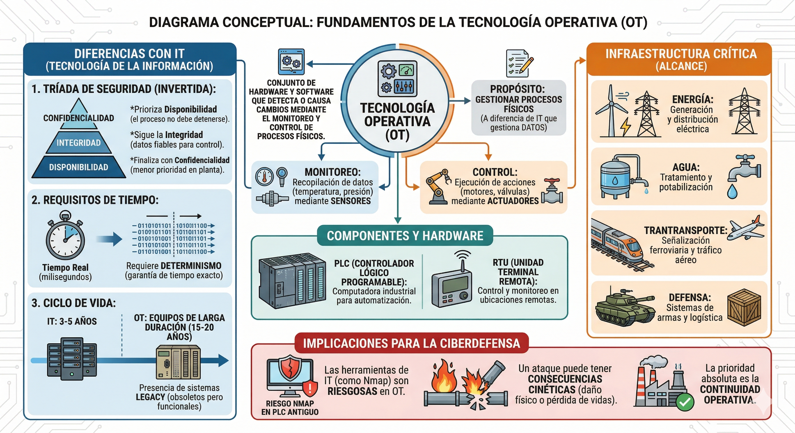

# Resumen: Electrónica Básica Aplicada al Control (2026)

Este documento resume los fundamentos de la **Unidad 1** de la asignatura **Tecnología Operativa**, centrada en cómo la lógica digital se manifiesta en componentes físicos reales y sus implicancias en la ciberdefensa.

---

## 1. Fundamentos Físicos y Hardware
* **Abstracción vs. Realidad:** En ciberdefensa se suele operar en capas altas (software/protocolos), pero en OT todo comando se ejecuta finalmente sobre silicio y cobre.
* **El Diodo:** Funciona como una válvula de retención que permite el flujo de corriente en una sola dirección.
    * **Polarización Directa:** El diodo conduce corriente (actúa como interruptor cerrado).
    * **Polarización Inversa:** El diodo bloquea la corriente (actúa como aislante).
    * **Diodo Volante (Flyback):** Protege los procesadores absorbiendo picos de voltaje inversos generados por motores o relés al apagarse.
* **El Transistor (BJT):** Es el componente clave para la conmutación lógica y la representación de bits.
    * **Corte (Cutoff):** No hay corriente en la Base; representa un **Bit 0**.
    * **Saturación (Saturation):** Fluye corriente máxima entre Colector y Emisor; representa un **Bit 1**.

## 2. Interfaz de Potencia y Ciberdefensa
* **Aislamiento Galvánico:** Uso de optoacopladores para separar eléctricamente la CPU (baja potencia) de la maquinaria industrial (alta potencia), protegiendo la integridad del sistema.
* **Vectores de Ataque Físico:**
    * **Phlashing / Bricking:** Ataque al firmware que fuerza a los transistores a oscilar rápidamente para generar calor excesivo y fundir el silicio.
    * **Manipulación de Protección:** La anulación de componentes como el diodo volante puede causar que un controlador se destruya a sí mismo mediante comandos digitales.

---

## 3. Resolución de Actividades de Verificación

### Pregunta 1: El Diodo Volante como Vector de Ataque
**Respuesta:** La remoción o anulación de este componente afecta la **Disponibilidad** porque deja al controlador desprotegido ante picos de voltaje inducidos por cargas inductivas. Sin el diodo, el simple apagado de un motor puede quemar físicamente el hardware, dejando el sistema inoperativo.

### Pregunta 2: Saturación del Transistor y Lógica Digital
**Respuesta:** En estado de saturación, el transistor permite el paso total de corriente entre Colector y Emisor al recibir una señal en la Base. Físicamente, esto cierra el circuito y, en términos de lógica binaria, representa un **Bit 1** (Verdadero/Encendido).

### Pregunta 3: Seguridad y Aislamiento Galvánico
**Respuesta:** Cumple la función de proteger la integridad de la interfaz ciber-física. Evita que fallos eléctricos o sobretensiones en la etapa de potencia dañen los circuitos lógicos sensibles de la CPU, manteniendo la separación eléctrica mediante dispositivos como optoacopladores.

### Pregunta 4: Análisis de Caso (Malware en Radar)
**Respuesta:**
* **Objetivo físico:** El ataque busca destruir permanentemente los transistores de potencia mediante estrés térmico, forzándolos a conmutar a velocidades para las que no fueron diseñados.
* **Nombre técnico:** Este vector de ataque se denomina **Phlashing** o **Bricking permanente**.

---

# Resumen: Introducción a la Tecnología Operativa (OT)

## 1. Concepto y Alcance
La **Tecnología Operativa (OT)** se define como el conjunto de hardware y software que detecta o causa un cambio mediante el monitoreo directo y/o el control de dispositivos físicos, procesos y eventos en la empresa.

* **Propósito:** A diferencia de la IT, cuyo fin es gestionar datos, la OT gestiona procesos físicos.
* **Monitoreo:** Adquisición de datos del entorno (temperatura, presión, vibración) mediante sensores.
* **Control:** Ejecución de acciones físicas (abrir una válvula, encender un motor) a través de actuadores.
* **Infraestructura Crítica:** Es el "sistema nervioso" de sectores vitales como energía eléctrica, tratamiento de agua, transporte y sistemas de armas en defensa.

## 2. Diferencias Fundamentales: IT vs. OT
Aunque la convergencia tecnológica ha hecho que compartan hardware y protocolos (Ethernet, TCP/IP, Windows), sus prioridades son opuestas.

### A. Inversión de la Tríada de Seguridad
* **Entorno IT (Modelo CIA):** Prioriza la **Confidencialidad**, luego la Integridad y al final la Disponibilidad.
* **Entorno OT (Modelo AIC):** Prioriza la **Disponibilidad** (el proceso no puede detenerse), seguida de la Integridad y, por último, la Confidencialidad.

### B. Requisitos de Tiempo y Ciclo de Vida
* **Determinismo:** En OT el tiempo real es obligatorio. Un retraso de milisegundos puede causar destrucción física. En IT, los retrasos suelen ser aceptables.
* **Obsolescencia:** El ciclo de vida en IT es de 3 a 5 años. En OT, los equipos (PLCs, RTUs) están diseñados para durar entre **15 y 20 años**, lo que obliga a defender hardware **Legacy** (obsoleto).

## 3. Cuadro Comparativo Sintético (NIST SP 800-82)

| Característica | Entorno IT (Corporativo) | Entorno OT (Industrial/Defensa) |
| :--- | :--- | :--- |
| **Prioridad de Seguridad** | Confidencialidad > Integridad > Disponibilidad | **Disponibilidad** > Integridad > Confidencialidad |
| **Respuesta en Tiempo** | No crítica (Retardos aceptables) | **Crítica (Tiempo real / Determinista)** |
| **Seguridad Física (Safety)** | Poca relevancia | **Crítica (Riesgo de vida o ambiental)** |
| **Ciclo de Vida** | 3-5 años | 15-20 años |
| **Gestión de Parches** | Frecuente / Automática | Escasa / Planificada (Ventanas de parada) |
| **Protocolos de Red** | Estándar y cifrados (HTTPS, SSH) | Propietarios o abiertos sin cifrado (Modbus) |
| **Visibilidad de Red** | Alta (Escaneos activos permitidos) | Baja (Escaneos pueden causar caídas) |

## 4. Implicaciones para la Ciberdefensa
Las herramientas y doctrinas de IT no pueden aplicarse directamente en OT sin riesgo físico. 
* **Riesgo Técnico:** Realizar escaneos activos (ej. Nmap) puede saturar un PLC antiguo y causar una parada de planta.
* **Doctrina:** Se requiere una defensa que respete la física del proceso y priorice la continuidad operativa por encima de la opacidad de los datos.

## 5 Actividades de Verificación y Análisis

### 1. Determinismo temporal: Requisito innegociable en OT vs IT
El **determinismo temporal** es la garantía de que una señal o comando se ejecutará en un lapso de tiempo exacto, constante y predecible.

* **En OT es innegociable:** Los sistemas controlan leyes físicas (inercia, presión, temperatura). Si un comando para detener una turbina que gira a 3000 RPM llega con un retraso de incluso 500 milisegundos, la sincronización mecánica falla y se produce una **catástrofe física** (explosión o rotura de componentes).
* **En IT no es crítico:** Gestiona datos para humanos. Si un correo electrónico tarda 2 segundos más en enviarse o una web demora en cargar, el impacto es una molestia administrativa, pero no hay destrucción de hardware ni riesgo de vida.

---

### 2. Escaneo activo (Nmap): Rutina en IT vs Amenaza en OT Legacy
El escaneo activo consiste en enviar paquetes a los puertos de un dispositivo para identificar servicios abiertos.

* **En IT es seguro:** Los servidores modernos y PCs de oficina tienen procesadores potentes y "stacks" de red diseñados para manejar miles de peticiones simultáneas. Si reciben paquetes inesperados, simplemente los descartan sin afectar su rendimiento.
* **En redes OT Legacy es una amenaza:** Los **PLCs antiguos** tienen procesadores muy limitados y memorias pequeñas optimizadas solo para su tarea específica. Una ráfaga de tráfico de Nmap puede desbordar el procesador del PLC, provocando un bloqueo (**Denegación de Servicio**), un reinicio o la pérdida del control del proceso físico, lo que equivale a una parada de planta no planificada.

---

### 3. Análisis de Caso: Planta Potabilizadora (Tríada AIC)
**Escenario:** El HMI (pantalla) muestra niveles de cloro normales, pero una alarma física independiente indica toxicidad.

* **Principio vulnerado:** **Integridad**.
    * *Justificación:* El atacante ha manipulado los datos en tránsito para que el operador visualice una realidad falsa (niveles normales) mientras el proceso físico es alterado. Este tipo de ataque se denomina **spoofing de sensores** o engaño.
* **Consecuencias físicas inminentes:**
    1.  **Riesgo para la salud pública:** Distribución de agua tóxica, causando envenenamiento masivo.
    2.  **Consecuencia Cinética:** Daño ambiental y posible pérdida de vidas humanas, escalando a un desastre de seguridad nacional.
    3.  **Pérdida de confianza:** Destrucción de la confiabilidad en la infraestructura crítica.

## 6. Glosario Mínimo
* **PLC (Programmable Logic Controller):** Computadora industrial robustecida para automatizar procesos.
* **RTU (Remote Terminal Unit):** Dispositivo para monitorear y controlar equipos en ubicaciones remotas.
* **Determinismo Temporal:** Garantía técnica de que una señal llegará y se ejecutará en un lapso exacto y predecible.
* **Legacy:** Tecnología obsoleta que sigue en uso porque su reemplazo es costoso o complejo.

