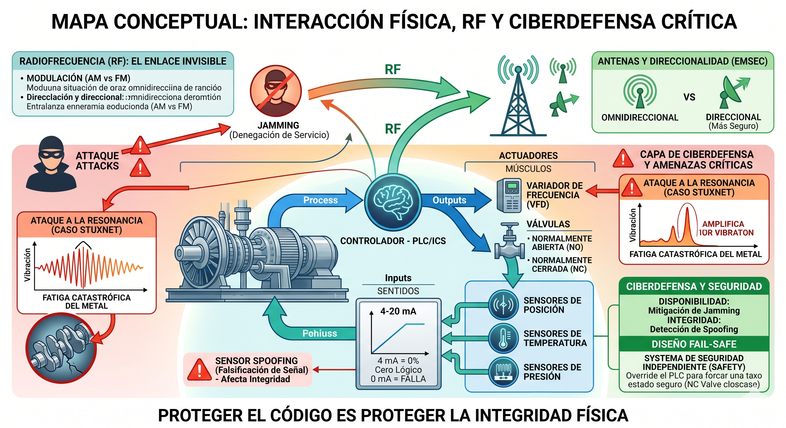

# FACULTAD DE DEFENSA NACIONAL (FADENA)
## LICENCIATURA EN CIBERDEFENSA
**Asignatura:** Tecnología Operativa (2026)
**Documento de Cátedra N° 3**

---

# Documento de Cátedra N° 3: Interacción con el Mundo Físico (Sensores y Actuadores)

## 1. Introducción: La Interfaz Ciber-Física
Un Sistema de Control Industrial (ICS) es ciego y sordo sin dispositivos que lo conecten al entorno físico. Definimos estos componentes como la **Interfaz Ciber-Física**:
* **Sensores:** Los sentidos (Inputs).
* **Actuadores:** Los músculos (Outputs).

## 2. Sensores: Los Ojos del Sistema (Inputs)
Miden una variable física y la convierten en una señal eléctrica analógica o digital.

### 2.1. Clasificación Principal
* **Posición y Proximidad:**
    * **Interruptores de Final de Carrera:** Electromecánicos y robustos.
    * **Sensores Inductivos:** Detectan metales sin contacto (campos magnéticos).
    * **Encoders:** Convierten movimiento en código digital (críticos en radares y armamento).
* **Temperatura y Presión:**
    * **Termopares y RTD (PT100):** Miden calor.
    * **Galgas Extensiométricas:** Miden deformación mecánica para inferir presión.

### 2.2. Nota de Ciberdefensa: Integridad
Un sensor comprometido es más peligroso que uno roto. El **Sensor Spoofing** permite engañar al controlador inyectando datos falsos (ej. ataque Stuxnet y el Replay Attack).

## 3. Actuadores y Válvulas: Los Músculos del Sistema (Outputs)
Dispositivos que convierten órdenes eléctricas en acciones físicas. Es el punto donde el ciberataque se convierte en **daño cinético**.

### 3.1. Tipos de Actuadores
* **Solenoides:** Movimiento rápido por campo magnético (cerrojos, gatillos).
* **Motores Eléctricos:** Corazón de bombas y ventiladores.
* **Variadores de Frecuencia (VFD):** Controlan la velocidad de motores AC. Son un vector de ataque primario.

### 3.2. Válvulas y Seguridad (Fail-Safe)
* **Normalmente Abierta (NO):** Se abre al perder energía (ej. refrigeración nuclear).
* **Normalmente Cerrada (NC):** Se cierra al perder energía.
* **Estrategia de Ataque:** Un atacante puede intentar mantener energizada una válvula NO para evitar que se abra en una emergencia.

## 4. Transmisores y el Estándar 4-20 mA
El transmisor acondiciona la señal para largas distancias.
* **4 mA:** 0% de la medición (Cero lógico).
* **20 mA:** 100% de la medición.
* **0 mA:** Falla (cable cortado). Esta distinción es una característica vital de **Safety**.

## 5. Actividades de Verificación y Análisis

1. El Estándar 4-20 mA y el "Cero Lógico"Uso de 4 mA: En la instrumentación analógica industrial, el valor de 4 mA se utiliza para representar el 0% de la medición (por ejemplo, un tanque vacío).Diferencia con 0 mA: El valor de 0 mA queda reservado exclusivamente para indicar una falla física, como un cable cortado o la pérdida de alimentación del sensor.Ventaja de Seguridad (Safety): Esta distinción permite que el sistema de control sepa instantáneamente si el proceso está en su nivel mínimo (4 mA) o si el sistema de monitoreo ha fallado (0 mA). Si se usara 0 mA para ambos casos, el sistema no podría distinguir entre un tanque vacío y un sensor desconectado, lo cual es crítico para evitar accidentes operativos.

2. Válvulas en un Reactor Nuclear (NO vs. NC)Elección: Para el sistema de refrigeración de emergencia, se deben exigir válvulas Normalmente Abiertas (NO).Justificación: En un escenario de corte total de energía, una válvula NO pasará automáticamente a su estado de reposo (abierta) mediante un mecanismo físico como un resorte. Esto asegura que el flujo de agua de enfriamiento llegue al núcleo del reactor de forma pasiva, sin necesidad de comandos electrónicos o electricidad, evitando una fusión del núcleo. Una válvula NC (Normalmente Cerrada) impediría el paso del agua en un apagón, agravando la emergencia.
 
 3. Ataque de "Sensor Spoofing"Definición: Consiste en una técnica de ciberataque donde se inyectan datos falsificados en el sistema de telemetría para engañar al controlador (PLC) o al operador humano.Gravedad: Representa una amenaza mayor que la destrucción física porque un sensor roto genera una alarma inmediata de falla (0 mA), permitiendo que el sistema pase a un estado seguro. En cambio, un sensor comprometido mantiene la apariencia de normalidad operativa (por ejemplo, reportando una temperatura estable) mientras el proceso físico real se degrada hacia un estado catastrófico, impidiendo cualquier respuesta defensiva oportuna.
 4. Análisis de Caso: Gasoducto CríticoTipo de Ataque: Se trata de un ataque de Sensor Spoofing. Específicamente, el atacante está inyectando o "congelando" la señal en 12 mA (un valor que aparenta normalidad o estado operativo) para ocultar la realidad física de la rotura y la caída de presión.Principio AIC vulnerado: El principio vulnerado de forma activa es la Integridad. Se ha roto la correspondencia entre los datos del sistema y la realidad física del proceso; lo que el operador "ve" en su monitor ya no es real. También podría considerarse una afectación indirecta a la disponibilidad, ya que impide actuar sobre el proceso de forma necesaria.

## 6. Glosario Mínimo
* **Sensor Spoofing:** Inyección de datos falsos en la telemetría.
* **VFD:** Dispositivo que regula velocidad variando la frecuencia.
* **Fail-Safe:** Diseño donde el sistema pasa a un estado seguro ante fallas.

---
*Referencia: Bolton, W. (2017). Mecatrónica: Sistemas de control electrónico en la ingeniería mecánica y eléctrica.*

