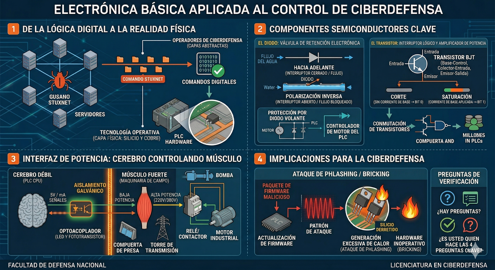
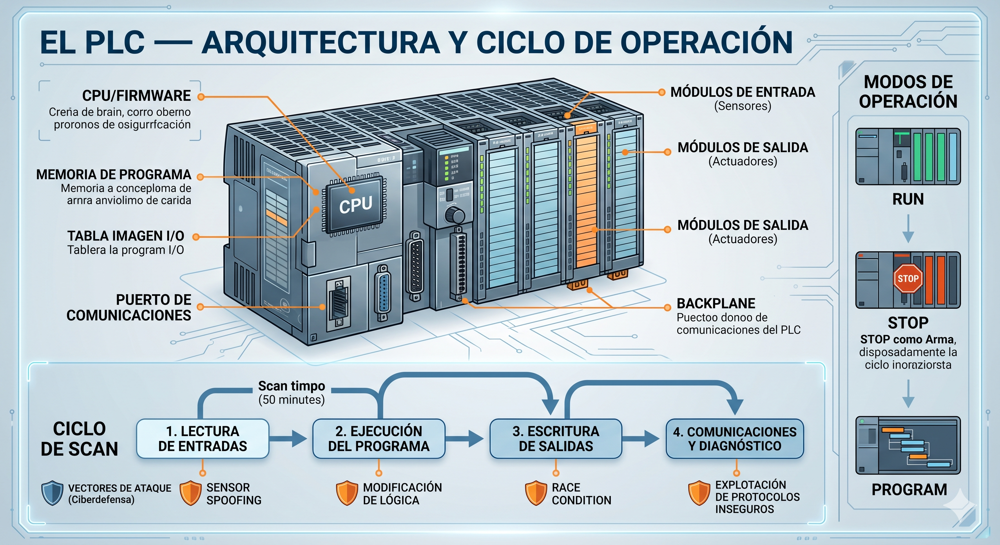
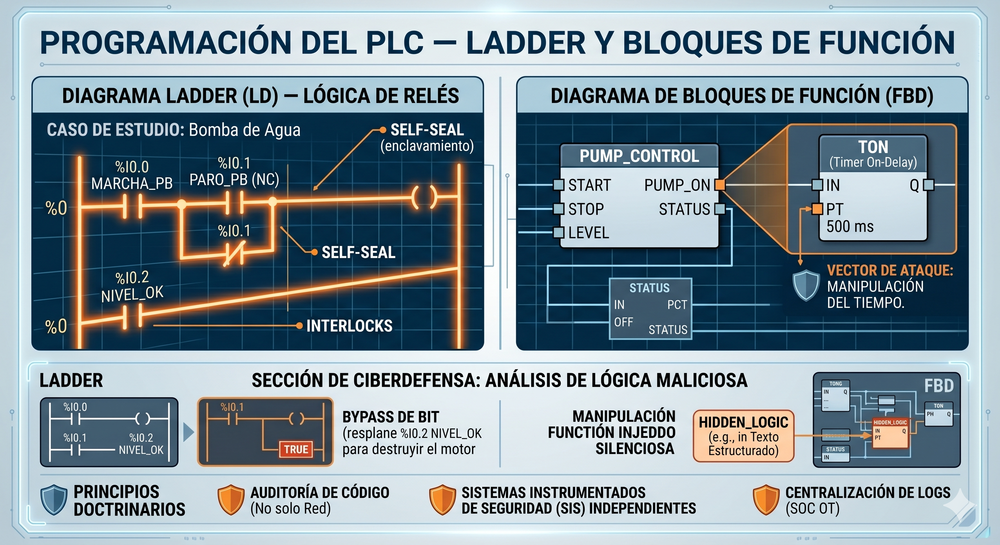
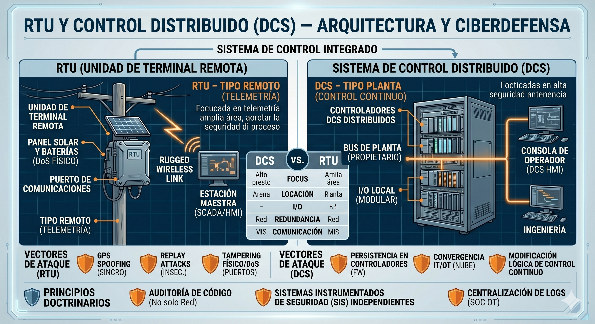

# Resumen: Electrónica Básica Aplicada al Control (2026)

Este documento resume los fundamentos de la **Unidad 1** de la asignatura **Tecnología Operativa**, centrada en cómo la lógica digital se manifiesta en componentes físicos reales y sus implicancias en la ciberdefensa.

---

## 1. Fundamentos Físicos y Hardware
* **Abstracción vs. Realidad:** En ciberdefensa se suele operar en capas altas (software/protocolos), pero en OT todo comando se ejecuta finalmente sobre silicio y cobre.
* **El Diodo:** Funciona como una válvula de retención que permite el flujo de corriente en una sola dirección.
    * **Polarización Directa:** El diodo conduce corriente (actúa como interruptor cerrado).
    * **Polarización Inversa:** El diodo bloquea la corriente (actúa como aislante).
    * **Diodo Volante (Flyback):** Protege los procesadores absorbiendo picos de voltaje inversos generados por motores o relés al apagarse.
* **El Transistor (BJT):** Es el componente clave para la conmutación lógica y la representación de bits.
    * **Corte (Cutoff):** No hay corriente en la Base; representa un **Bit 0**.
    * **Saturación (Saturation):** Fluye corriente máxima entre Colector y Emisor; representa un **Bit 1**.

## 2. Interfaz de Potencia y Ciberdefensa
* **Aislamiento Galvánico:** Uso de optoacopladores para separar eléctricamente la CPU (baja potencia) de la maquinaria industrial (alta potencia), protegiendo la integridad del sistema.
* **Vectores de Ataque Físico:**
    * **Phlashing / Bricking:** Ataque al firmware que fuerza a los transistores a oscilar rápidamente para generar calor excesivo y fundir el silicio.
    * **Manipulación de Protección:** La anulación de componentes como el diodo volante puede causar que un controlador se destruya a sí mismo mediante comandos digitales.

---

## 3. Resolución de Actividades de Verificación

### Pregunta 1: El Diodo Volante como Vector de Ataque
**Respuesta:** La remoción o anulación de este componente afecta la **Disponibilidad** porque deja al controlador desprotegido ante picos de voltaje inducidos por cargas inductivas. Sin el diodo, el simple apagado de un motor puede quemar físicamente el hardware, dejando el sistema inoperativo.

### Pregunta 2: Saturación del Transistor y Lógica Digital
**Respuesta:** En estado de saturación, el transistor permite el paso total de corriente entre Colector y Emisor al recibir una señal en la Base. Físicamente, esto cierra el circuito y, en términos de lógica binaria, representa un **Bit 1** (Verdadero/Encendido).

### Pregunta 3: Seguridad y Aislamiento Galvánico
**Respuesta:** Cumple la función de proteger la integridad de la interfaz ciber-física. Evita que fallos eléctricos o sobretensiones en la etapa de potencia dañen los circuitos lógicos sensibles de la CPU, manteniendo la separación eléctrica mediante dispositivos como optoacopladores.

### Pregunta 4: Análisis de Caso (Malware en Radar)
**Respuesta:**
* **Objetivo físico:** El ataque busca destruir permanentemente los transistores de potencia mediante estrés térmico, forzándolos a conmutar a velocidades para las que no fueron diseñados.
* **Nombre técnico:** Este vector de ataque se denomina **Phlashing** o **Bricking permanente**.


---

# Resumen: Introducción a la Tecnología Operativa (OT)

## 1. Concepto y Alcance
La **Tecnología Operativa (OT)** se define como el conjunto de hardware y software que detecta o causa un cambio mediante el monitoreo directo y/o el control de dispositivos físicos, procesos y eventos en la empresa.

* **Propósito:** A diferencia de la IT, cuyo fin es gestionar datos, la OT gestiona procesos físicos.
* **Monitoreo:** Adquisición de datos del entorno (temperatura, presión, vibración) mediante sensores.
* **Control:** Ejecución de acciones físicas (abrir una válvula, encender un motor) a través de actuadores.
* **Infraestructura Crítica:** Es el "sistema nervioso" de sectores vitales como energía eléctrica, tratamiento de agua, transporte y sistemas de armas en defensa.

## 2. Diferencias Fundamentales: IT vs. OT
Aunque la convergencia tecnológica ha hecho que compartan hardware y protocolos (Ethernet, TCP/IP, Windows), sus prioridades son opuestas.

### A. Inversión de la Tríada de Seguridad
* **Entorno IT (Modelo CIA):** Prioriza la **Confidencialidad**, luego la Integridad y al final la Disponibilidad.
* **Entorno OT (Modelo AIC):** Prioriza la **Disponibilidad** (el proceso no puede detenerse), seguida de la Integridad y, por último, la Confidencialidad.


### B. Requisitos de Tiempo y Ciclo de Vida
* **Determinismo:** En OT el tiempo real es obligatorio. Un retraso de milisegundos puede causar destrucción física. En IT, los retrasos suelen ser aceptables.
* **Obsolescencia:** El ciclo de vida en IT es de 3 a 5 años. En OT, los equipos (PLCs, RTUs) están diseñados para durar entre **15 y 20 años**, lo que obliga a defender hardware **Legacy** (obsoleto).

## 3. Cuadro Comparativo Sintético (NIST SP 800-82)

| Característica | Entorno IT (Corporativo) | Entorno OT (Industrial/Defensa) |
| :--- | :--- | :--- |
| **Prioridad de Seguridad** | Confidencialidad > Integridad > Disponibilidad | **Disponibilidad** > Integridad > Confidencialidad |
| **Respuesta en Tiempo** | No crítica (Retardos aceptables) | **Crítica (Tiempo real / Determinista)** |
| **Seguridad Física (Safety)** | Poca relevancia | **Crítica (Riesgo de vida o ambiental)** |
| **Ciclo de Vida** | 3-5 años | 15-20 años |
| **Gestión de Parches** | Frecuente / Automática | Escasa / Planificada (Ventanas de parada) |
| **Protocolos de Red** | Estándar y cifrados (HTTPS, SSH) | Propietarios o abiertos sin cifrado (Modbus) |
| **Visibilidad de Red** | Alta (Escaneos activos permitidos) | Baja (Escaneos pueden causar caídas) |

## 4. Implicaciones para la Ciberdefensa
Las herramientas y doctrinas de IT no pueden aplicarse directamente en OT sin riesgo físico. 
* **Riesgo Técnico:** Realizar escaneos activos (ej. Nmap) puede saturar un PLC antiguo y causar una parada de planta.
* **Doctrina:** Se requiere una defensa que respete la física del proceso y priorice la continuidad operativa por encima de la opacidad de los datos.

## 5 Actividades de Verificación y Análisis

### 1. Determinismo temporal: Requisito innegociable en OT vs IT
El **determinismo temporal** es la garantía de que una señal o comando se ejecutará en un lapso de tiempo exacto, constante y predecible.

* **En OT es innegociable:** Los sistemas controlan leyes físicas (inercia, presión, temperatura). Si un comando para detener una turbina que gira a 3000 RPM llega con un retraso de incluso 500 milisegundos, la sincronización mecánica falla y se produce una **catástrofe física** (explosión o rotura de componentes).
* **En IT no es crítico:** Gestiona datos para humanos. Si un correo electrónico tarda 2 segundos más en enviarse o una web demora en cargar, el impacto es una molestia administrativa, pero no hay destrucción de hardware ni riesgo de vida.

---

### 2. Escaneo activo (Nmap): Rutina en IT vs Amenaza en OT Legacy
El escaneo activo consiste en enviar paquetes a los puertos de un dispositivo para identificar servicios abiertos.

* **En IT es seguro:** Los servidores modernos y PCs de oficina tienen procesadores potentes y "stacks" de red diseñados para manejar miles de peticiones simultáneas. Si reciben paquetes inesperados, simplemente los descartan sin afectar su rendimiento.
* **En redes OT Legacy es una amenaza:** Los **PLCs antiguos** tienen procesadores muy limitados y memorias pequeñas optimizadas solo para su tarea específica. Una ráfaga de tráfico de Nmap puede desbordar el procesador del PLC, provocando un bloqueo (**Denegación de Servicio**), un reinicio o la pérdida del control del proceso físico, lo que equivale a una parada de planta no planificada.

---

### 3. Análisis de Caso: Planta Potabilizadora (Tríada AIC)
**Escenario:** El HMI (pantalla) muestra niveles de cloro normales, pero una alarma física independiente indica toxicidad.

* **Principio vulnerado:** **Integridad**.
    * *Justificación:* El atacante ha manipulado los datos en tránsito para que el operador visualice una realidad falsa (niveles normales) mientras el proceso físico es alterado. Este tipo de ataque se denomina **spoofing de sensores** o engaño.
* **Consecuencias físicas inminentes:**
    1.  **Riesgo para la salud pública:** Distribución de agua tóxica, causando envenenamiento masivo.
    2.  **Consecuencia Cinética:** Daño ambiental y posible pérdida de vidas humanas, escalando a un desastre de seguridad nacional.
    3.  **Pérdida de confianza:** Destrucción de la confiabilidad en la infraestructura crítica.

## 6. Glosario Mínimo
* **PLC (Programmable Logic Controller):** Computadora industrial robustecida para automatizar procesos.
* **RTU (Remote Terminal Unit):** Dispositivo para monitorear y controlar equipos en ubicaciones remotas.
* **Determinismo Temporal:** Garantía técnica de que una señal llegará y se ejecutará en un lapso exacto y predecible.
* **Legacy:** Tecnología obsoleta que sigue en uso porque su reemplazo es costoso o complejo.


# FACULTAD DE DEFENSA NACIONAL (FADENA)
## LICENCIATURA EN CIBERDEFENSA
**Asignatura:** Tecnología Operativa (2026)
**Documento de Cátedra N° 3**

---

# Documento de Cátedra N° 3: Interacción con el Mundo Físico (Sensores y Actuadores)

## 1. Introducción: La Interfaz Ciber-Física
Un Sistema de Control Industrial (ICS) es ciego y sordo sin dispositivos que lo conecten al entorno físico. Definimos estos componentes como la **Interfaz Ciber-Física**:
* **Sensores:** Los sentidos (Inputs).
* **Actuadores:** Los músculos (Outputs).

## 2. Sensores: Los Ojos del Sistema (Inputs)
Miden una variable física y la convierten en una señal eléctrica analógica o digital.

### 2.1. Clasificación Principal
* **Posición y Proximidad:**
    * **Interruptores de Final de Carrera:** Electromecánicos y robustos.
    * **Sensores Inductivos:** Detectan metales sin contacto (campos magnéticos).
    * **Encoders:** Convierten movimiento en código digital (críticos en radares y armamento).
* **Temperatura y Presión:**
    * **Termopares y RTD (PT100):** Miden calor.
    * **Galgas Extensiométricas:** Miden deformación mecánica para inferir presión.

### 2.2. Nota de Ciberdefensa: Integridad
Un sensor comprometido es más peligroso que uno roto. El **Sensor Spoofing** permite engañar al controlador inyectando datos falsos (ej. ataque Stuxnet y el Replay Attack).

## 3. Actuadores y Válvulas: Los Músculos del Sistema (Outputs)
Dispositivos que convierten órdenes eléctricas en acciones físicas. Es el punto donde el ciberataque se convierte en **daño cinético**.

### 3.1. Tipos de Actuadores
* **Solenoides:** Movimiento rápido por campo magnético (cerrojos, gatillos).
* **Motores Eléctricos:** Corazón de bombas y ventiladores.
* **Variadores de Frecuencia (VFD):** Controlan la velocidad de motores AC. Son un vector de ataque primario.

### 3.2. Válvulas y Seguridad (Fail-Safe)
* **Normalmente Abierta (NO):** Se abre al perder energía (ej. refrigeración nuclear).
* **Normalmente Cerrada (NC):** Se cierra al perder energía.
* **Estrategia de Ataque:** Un atacante puede intentar mantener energizada una válvula NO para evitar que se abra en una emergencia.

## 4. Transmisores y el Estándar 4-20 mA
El transmisor acondiciona la señal para largas distancias.
* **4 mA:** 0% de la medición (Cero lógico).
* **20 mA:** 100% de la medición.
* **0 mA:** Falla (cable cortado). Esta distinción es una característica vital de **Safety**.

## 5. Actividades de Verificación y Análisis

1. El Estándar 4-20 mA y el "Cero Lógico"Uso de 4 mA: En la instrumentación analógica industrial, el valor de 4 mA se utiliza para representar el 0% de la medición (por ejemplo, un tanque vacío).Diferencia con 0 mA: El valor de 0 mA queda reservado exclusivamente para indicar una falla física, como un cable cortado o la pérdida de alimentación del sensor.Ventaja de Seguridad (Safety): Esta distinción permite que el sistema de control sepa instantáneamente si el proceso está en su nivel mínimo (4 mA) o si el sistema de monitoreo ha fallado (0 mA). Si se usara 0 mA para ambos casos, el sistema no podría distinguir entre un tanque vacío y un sensor desconectado, lo cual es crítico para evitar accidentes operativos.

2. Válvulas en un Reactor Nuclear (NO vs. NC)Elección: Para el sistema de refrigeración de emergencia, se deben exigir válvulas Normalmente Abiertas (NO).Justificación: En un escenario de corte total de energía, una válvula NO pasará automáticamente a su estado de reposo (abierta) mediante un mecanismo físico como un resorte. Esto asegura que el flujo de agua de enfriamiento llegue al núcleo del reactor de forma pasiva, sin necesidad de comandos electrónicos o electricidad, evitando una fusión del núcleo. Una válvula NC (Normalmente Cerrada) impediría el paso del agua en un apagón, agravando la emergencia.
 
 3. Ataque de "Sensor Spoofing"Definición: Consiste en una técnica de ciberataque donde se inyectan datos falsificados en el sistema de telemetría para engañar al controlador (PLC) o al operador humano.Gravedad: Representa una amenaza mayor que la destrucción física porque un sensor roto genera una alarma inmediata de falla (0 mA), permitiendo que el sistema pase a un estado seguro. En cambio, un sensor comprometido mantiene la apariencia de normalidad operativa (por ejemplo, reportando una temperatura estable) mientras el proceso físico real se degrada hacia un estado catastrófico, impidiendo cualquier respuesta defensiva oportuna.
 4. Análisis de Caso: Gasoducto CríticoTipo de Ataque: Se trata de un ataque de Sensor Spoofing. Específicamente, el atacante está inyectando o "congelando" la señal en 12 mA (un valor que aparenta normalidad o estado operativo) para ocultar la realidad física de la rotura y la caída de presión.Principio AIC vulnerado: El principio vulnerado de forma activa es la Integridad. Se ha roto la correspondencia entre los datos del sistema y la realidad física del proceso; lo que el operador "ve" en su monitor ya no es real. También podría considerarse una afectación indirecta a la disponibilidad, ya que impide actuar sobre el proceso de forma necesaria.

## 6. Glosario Mínimo
* **Sensor Spoofing:** Inyección de datos falsos en la telemetría.
* **VFD:** Dispositivo que regula velocidad variando la frecuencia.
* **Fail-Safe:** Diseño donde el sistema pasa a un estado seguro ante fallas.

---
*Referencia: Bolton, W. (2017). Mecatrónica: Sistemas de control electrónico en la ingeniería mecánica y eléctrica.*


# FACULTAD DE DEFENSA NACIONAL (FADENA)
## LICENCIATURA EN CIBERDEFENSA
**Asignatura:** TECNOLOGÍA OPERATIVA (2026)
**UNIDAD 1: FUNDAMENTOS FÍSICOS Y HARDWARE DE CONTROL**
**DOCUMENTO DE CÁTEDRA N° 4**

---

# TEMA: RADIOFRECUENCIA Y MONITOREO DE ACTIVOS CRÍTICOS

## 1. Introducción: De la Señal al Daño Estructural
En este documento analizamos cómo el ciberespacio se extiende a través del aire mediante la **Radiofrecuencia (RF)** y cómo, al controlar maquinaria pesada, entramos en el dominio de la **mecánica crítica**. El objetivo es entender cómo una señal invisible puede, en última instancia, partir un bloque de acero [cite: 112-117].

## 2. Sistemas de Radiofrecuencia (RF): El Enlace Invisible

### 2.1. Principios de Transmisión
Para que un dato viaje por el aire, debe sufrir un proceso de transformación [cite: 125]:
* **Onda Portadora:** Señal de alta frecuencia que actúa como "vehículo" [cite: 127-128].
* **Modulación:** Proceso de imprimir información sobre la portadora [cite: 129].
    * **AM (Amplitud Modulada):** Variación de la potencia; sensible al ruido [cite: 130].
    * **FM (Frecuencia Modulada):** Variación de la velocidad de la onda; robusta para uso táctico [cite: 131].
    * **Modulación Digital (ASK, FSK):** Conversión de bits en cambios de frecuencia o fase [cite: 132-133].

### 2.2. Antenas: La Interfaz Aire-Circuito
* **Longitud de Onda (λ) y Tamaño:** El tamaño físico de la antena es proporcional a la longitud de onda de la frecuencia que usa [cite: 137]. 
    * *Ciberdefensa:* Antenas grandes indican baja frecuencia (largo alcance); antenas pequeñas indican alta frecuencia (ej. Wi-Fi) [cite: 138-139].
* **Direccionalidad:**
    * **Omnidireccional:** Irradia en todas direcciones; fácil de interceptar [cite: 141].
    * **Direccional (Yagi, Parabólica):** Enfoca la energía en un haz estrecho; más segura contra interferencias [cite: 142-143].

> **Nota de Ciberdefensa (Jamming):** El Jamming es un ataque a la **Disponibilidad** que satura el receptor con ruido para impedir la señal legítima [cite: 144-146].

## 3. Monitoreo de Componentes Mecánicos: El Caso del Cigüeñal
El **Cigüeñal** es la columna vertebral de motores pesados en infraestructuras críticas [cite: 148-151].

### 3.1. Monitoreo de Vibraciones
Se utilizan **Acelerómetros** para medir la "firma de vibración". El análisis espectral permite detectar [cite: 157-158]:
* **1x RPM:** Desbalanceo [cite: 159].
* **2x RPM:** Desalineación [cite: 160].

### 3.2. Stuxnet y el Ataque a la Resonancia
Stuxnet modificó la frecuencia de los variadores (VFD) para que los rotores giraran a su **Frecuencia de Resonancia Natural** [cite: 161-164]. 
* **Efecto:** La vibración se auto-amplifica exponencialmente causando fatiga catastrófica del metal [cite: 165].
* **Ciclado Extremo:** El malware alternaba velocidades (1410 Hz, 2 Hz, 1064 Hz) para maximizar el estrés mecánico y evadir alarmas [cite: 168-169].

## 4. Implicaciones para la Ciberdefensa
Proteger el código es proteger la física. Un bit alterado en RF o un comando malicioso en un variador puede destruir infraestructura crítica [cite: 172-173].

---

## 5. Actividades de Verificación y Análisis

1. Explique por qué un enlace táctico debe priorizar antenas direccionales (EMSEC) [cite: 177].
 - Seguridad de las Emisiones (EMSEC) y AntenasDesde la perspectiva de la seguridad de las emisiones, un enlace táctico debe priorizar las antenas direccionales (como las Yagi o Parabólicas) por las siguientes razones:Detección e Intercepción: Las antenas omnidireccionales irradian señal en todas las direcciones, lo que facilita que el enemigo intercepte la comunicación. En cambio, las direccionales enfocan la energía en un haz estrecho hacia el receptor.Interferencia (Jamming): Al concentrar la señal en una sola dirección, el enlace es mucho más difícil de interferir o saturar por parte de un atacante.Prioridad Táctica: En el ámbito militar, reducir la "huella" electromagnética es vital para mantener el sigilo y asegurar que la energía de transmisión solo llegue al destino deseado.
 
2. Relacione el Jamming con la tríada AIC [cite: 178].

 - Jamming y la Tríada AICEl ataque de Jamming (interferencia deliberada) se relaciona directamente con el principio de Disponibilidad.Funcionamiento: No se trata de romper el cifrado del mensaje, sino de saturar la antena receptora con "ruido" en la misma frecuencia.Consecuencia: El receptor no puede distinguir la señal legítima del ruido, lo que resulta en una denegación del servicio de comunicaciones. Al impedir que el sistema reciba órdenes o telemetría, se vulnera la capacidad de operar el activo crítico cuando es necesario.

3. Análisis de Caso: Picos de 1x RPM que cambian a frecuencias inusuales antes de una fractura de eje [cite: 180-182].

 - Análisis de Caso: Vibraciones en el GeneradorComo analista forense, la hipótesis inicial sería un posible ciberataque en lugar de una falla mecánica natural.Justificación de la Hipótesis: Si bien el pico inicial de 1x RPM indica un desbalanceo (algo común en desgaste) , el cambio abrupto a frecuencias inusuales que no coinciden con los armónicos naturales justo antes de la fractura es un comportamiento anómalo.Precedente Técnico: Este patrón es característico de ataques sofisticados como Stuxnet, donde el malware no apaga la máquina, sino que manipula los variadores de frecuencia (VFD) para forzar al metal a su Frecuencia de Resonancia Natural.Mecanismo de Daño: El atacante puede utilizar un "ciclado extremo" (variando velocidades bruscamente, por ejemplo, entre 1410 Hz y 2 Hz) para maximizar el estrés mecánico y evadir las alarmas de vibración estándar del sistema, logrando una fatiga catastrófica del metal en segundos.

## 6. Glosario Mínimo
* **Frecuencia de Resonancia Natural:** Punto de máxima amplitud de vibración [cite: 185].
* **Jamming:** Denegación de servicio por saturación de RF [cite: 187].
* **VFD:** Componente atacado por Stuxnet para manipular velocidad [cite: 191].

---
*Referencias: Tomasi (2003), Langner (2013), IEC 62591 [cite: 195-200].*

# Resumen: El PLC — Arquitectura y Ciclo de Operación
**Asignatura:** Tecnología Operativa (2026)  
**Institución:** Facultad de Defensa Nacional (FADENA) - Licenciatura en Ciberdefensa  
**Unidad 2:** Controladores y Lógica de Automatización (Documento de Cátedra N° 5)

---

## 1. Introducción y Contexto Histórico

* **El PLC (Controlador Lógico Programable):** Es considerado el "cerebro" o la máquina que piensa para controlar dentro de los entornos industriales. Su conocimiento profundo es indispensable tanto para la defensa de infraestructuras críticas como para el análisis de incidentes digitales.
* **Caso de Estudio (Ucrania, 2015):** Primera interrupción del suministro eléctrico atribuida a un ciberataque (malware *BlackEnergy*). No destruyó el hardware, sino que tomó el control de los PLCs y RTUs, ordenando la apertura de disyuntores y colocándolos en modo `STOP` para impedir la respuesta remota de los operadores, dejando a 230.000 personas sin luz en invierno. El vector clave fue el entendimiento de su ciclo de operación.
* **Origen:** Nació en 1968 para reemplazar los paneles de relés electromecánicos en la industria automotriz. Sustituyó armarios cableados complejos por una **lógica equivalente en software**: flexible, reprogramable y sin desgaste mecánico.
* **Función esencial:** Se sintetiza en tres acciones continuas: **Leer** el proceso (sensores), **Decidir** (ejecutar lógica de usuario) y **Actuar** (actuadores).

---

## 2. Definición Estándar (IEC 61131-1)

El estándar **IEC 61131-1** define formalmente al PLC como:
> *"Un sistema electrónico de funcionamiento digital, diseñado para su uso en un entorno industrial, que utiliza una memoria programable para el almacenamiento interno de instrucciones orientadas al usuario para la implantación de funciones específicas, como lógica, secuenciación, temporización, recuento y funciones aritméticas, para controlar, mediante entradas y salidas digitales o analógicas, diversos tipos de máquinas o procesos"*.

A diferencia de una PC comercial, el PLC está diseñado específicamente para operar en tiempo real bajo condiciones ambientales hostiles (vibración, temperatura, ruido electromagnético) y de manera altamente confiable.

---

## 3. Arquitectura Interna y Vectores de Ataque

### Tabla de Componentes y Relevancia en Ciberdefensa

| Componente | Función Operativa | Relevancia / Vector en Ciberdefensa |
| :--- | :--- | :--- |
| **CPU** | Ejecuta el programa de control (ciclo de scan). Contiene el firmware del fabricante y almacena el código (Ladder/FBD). | Punto de entrada para firmware malicioso (*Bricking/Phlashing*). Controla directamente el modo de operación (`RUN`/`STOP`). |
| **Memoria de Programa** | Almacena la lógica de control desarrollada por el ingeniero. | Si el atacante tiene acceso de escritura, altera la lógica de control sin dejar rastro inmediato en la HMI. |
| **Memoria de Datos<br>(I/O Image Table)** | Tabla espejo que representa el estado de las entradas/salidas durante el scan. | Blanco de ataques de *Race Condition*: escribir en esta tabla entre fases del scan acciona salidas no autorizadas. |
| **Módulos de Entrada<br>(DI / AI)** | Reciben señales físicas analógicas o digitales de los sensores del proceso. | *Sensor Spoofing*: manipulación o inyección de señales falsas antes de que sean leídas por la tabla imagen. |
| **Módulos de Salida<br>(DO / AO)** | Envían señales de control directas hacia los actuadores. | Punto crítico donde el ciberataque digital se transforma en **daño físico real**. |
| **Fuente de Alimentación** | Suministra tensión regulada y estable a todos los módulos internos del PLC. | Sabotaje físico o corte energético que actúa como una Denegación de Servicio física (**DoS físico**). |
| **Puerto de Comunicaciones** | Interfaces seriales o de red (RS-485, Modbus RTU, Industrial Ethernet, EtherNet/IP). | Protocolos nativos sin cifrado ni autenticación; principal vector de ataque remoto en redes IT/OT convergentes. |

### Detalles Técnicos de los Componentes

* **La CPU y el Firmware:** La CPU ejecuta instrucciones secuencialmente de forma **determinista** (tiempo de ciclo garantizado y predecible). Su sistema operativo de tiempo real (**RTOS**) gestiona las comunicaciones, autodiagnósticos y el ciclo de scan.
    * *Nota de Ciberdefensa (Phlashing/Bricking):* Un firmware malicioso permite persistencia total por debajo del programa de usuario, evadiendo detecciones convencionales, pudiendo ralentizar el ciclo o apagar módulos de seguridad.
* **Segmentación de Memorias:**
    * *Memoria de Programa:* Código fuente (Ladder, FBD). Modificarlo altera el comportamiento del proceso de forma directa.
    * *Memoria de Datos (Tabla Imagen I/O):* Representación interna instantánea. **La CPU nunca lee los sensores directamente durante la lógica; consulta esta tabla**.
    * *Memoria del Sistema:* Aloja el firmware. Protegida como solo lectura en condiciones normales.
* **Módulos de Entrada y Salida (I/O):**
    * **DI (Entradas Digitales):** Señales discretas ON/OFF (pulsadores, finales de carrera).
    * **DO (Salidas Digitales):** Actuación discreta (encendido de motores, electroválvulas).
    * **AI (Entradas Analógicas):** Señales continuas (estándar de **4-20 mA** o 0-10 V) para variables como temperatura o presión.
    * **AO (Salidas Analógicas):** Control continuo (posicionamiento de válvulas o velocidad mediante VFD).
    * *Enlace con Filosofía Fail-Safe:* Ante pérdidas de comunicación con la CPU, las salidas digitales pueden configurarse para adoptar un estado seguro predefinido.
* **Backplane (Chasis):** Bus de comunicación interno propietario y de alta velocidad que interconecta la CPU con cada slot de los módulos.

---

## 4. Modos de Operación del PLC

El PLC cuenta con tres modos fundamentales de operación (seleccionables físicamente o por comando remoto):

1. **Modo RUN:** Estado operacional normal. Ejecuta el ciclo de scan continuamente; las salidas físicas se encuentran completamente activas y responden al código.
2. **Modo STOP:** Suspende la ejecución del programa. Las salidas pasan a un estado seguro predefinido (desactivadas) deteniendo el proceso. Es obligatorio para realizar la carga o modificación de lógica.
3. **Modo PROGRAM (REMOTE):** Modo de mantenimiento que habilita a la consola de programación para realizar lecturas y escrituras en la memoria de programa.

> ⚠️ **El Modo STOP como Arma:** Comandos remotos maliciosos de `STOP` afectan de forma directa e inmediata a la **Disponibilidad (A)** dentro de la tríada AIC, paralizando las operaciones físicas industriales (como ocurrió en el ataque a la subestación de Ucrania en 2015).

---

## 5. El Ciclo de Scan (El Corazón del PLC)

El ciclo de scan (o escaneo) es un lazo infinito, secuencial y determinista (mismo orden, tiempo predecible acotado) que diferencia al PLC de sistemas operativos multipropósito no deterministas. El tiempo total se denomina **Scan Time** (medido típicamente entre 1 y 100 ms).

### Las 4 Fases Secuenciales del Scan

1. **Lectura de Entradas (Input Scan):** La CPU examina el estado físico de los módulos de entrada y realiza una copia exacta en la Tabla Imagen.
    * *Riesgo:* **Sensor Spoofing** (Inyección de datos falsos para distorsionar la realidad del proceso ante el controlador).
2. **Ejecución del Programa (Program Scan):** La CPU procesa la lógica de control (Ladder / FBD) utilizando **únicamente** los datos de la Tabla Imagen creados en la fase anterior, no los sensores físicos en tiempo real.
    * *Riesgo:* **Modificación de lógica** en memoria de manera silenciosa.
3. **Escritura de Salidas (Output Scan):** La CPU vuelca el resultado final guardado en la tabla imagen hacia los módulos de salida físicos, accionando los actuadores.
    * *Riesgo:* **Race Condition (Condición de Carrera):** Si un atacante modifica la tabla imagen entre el fin de la Fase 1 y el inicio de la Fase 2, fuerza al PLC a ejecutar acciones basadas en datos falsos sin comprometer sensores reales.
4. **Comunicaciones y Diagnóstico:** Ventana de tiempo donde el PLC procesa peticiones de red (HMI, SCADA, consolas) y corre rutinas de autodiagnóstico de salud.
    * *Riesgo:* **Explotación de Protocolos** inseguros (Modbus, EtherNet/IP) que permiten comandos directos de lectura/escritura sin requerir autenticación.

> 🔬 **Ataques Sincronizados (Scan Time):** Adversarios avanzados (ej. *Stuxnet*) analizan minuciosamente la granularidad del Scan Time para sincronizar cargas útiles (*payloads*) dentro de las ventanas de una fase específica, evitando generar anomalías observables y minimizando su detección. El incremento anómalo del Scan Time sin cambios de programa válidos es un indicador clave de compromiso o código malicioso inyectado.

---

## 6. Clasificación según su Forma Física

El factor de forma física define las facilidades de acceso y los límites de manipulación del hardware:

* **Compactos (Nano/Micro):** Integran CPU, I/O y fuente en un solo bloque. Económicos, espacio reducido y capacidad de I/O limitada (Ej: *Siemens LOGO!*, *Allen-Bradley Micro820*).
* **Modulares:** Componentes independientes (módulos) conectados a través de un rack o *backplane* común. Flexibles y expansibles; estándar para medianas y grandes industrias. El análisis forense es complejo dado que permite el reemplazo individualizado de módulos.
* **PLCs Redundantes:** Variación modular a gran escala con alta disponibilidad, donde una CPU secundaria toma el control en milisegundos si la primaria falla.

> 🔒 **Implicación de Seguridad Física:** En seguridad OT, la seguridad física es la primera línea de defensa. Un PLC compacto en gabinetes periféricos sin cerradura (ej. estaciones de bombeo remotas) expone puertos de comunicación permitiendo conexiones directas de consolas maliciosas, puenteando cualquier defensa perimetral lógica de la red.

---

## 7. Glosario Clave para Repaso Rápido

* **Determinismo Temporal:** Garantía de que los procesos y operaciones se ejecutan dentro de un tiempo máximo predecible y estrictamente acotado (Requisito mandatorio en OT).
* **Race Condition (en PLCs):** Explotación de la ventana temporal entre fases del ciclo de scan para inyectar datos maliciosos en la Tabla Imagen antes de que comience la fase de ejecución del programa.
* **Phlashing / Bricking:** Ataque destructivo o de persistencia avanzada enfocado en reescribir/flashear el firmware (RTOS) de la CPU.
* **IEC 61131-3:** Sección del estándar internacional encargada de regular los cinco lenguajes industriales de programación (como Ladder Diagram y Function Block Diagram).


# Resumen: Programación del PLC — Ladder y Bloques de Función
**Asignatura:** Tecnología Operativa (2026)  
**Institución:** Facultad de Defensa Nacional (FADENA) - Licenciatura en Ciberdefensa  
**Unidad 2:** Controladores y Lógica de Automatización (Documento de Cátedra N° 6)

---



## 1. Introducción y Contexto Forense

* **Apertura (Caso Ucrania 2015 / Industroyer):** En las investigaciones forenses del ciberataque a la red eléctrica ucraniana en 2015, se descubrió que el malware *Industroyer/Crashoverride* no solo detuvo los PLCs mediante comandos de `STOP`. Su nivel de sofisticación radicó en **cargar programas Ladder maliciosos** que operaron de forma autónoma para abrir los disyuntores. 
* **El vector silencioso:** La reprogramación de la lógica permite que el sistema ejecute el ataque por sí mismo, independientemente de si se corta la comunicación con el atacante. Para la Ciberdefensa, la competencia clave pasa de comprender el funcionamiento del hardware a **leer, interpretar y auditar la lógica de control**.

---

## 2. El Estándar IEC 61131-3 y los 5 Lenguajes

Publicado por la *International Electrotechnical Commission*, el estándar unificó las tecnologías propietarias de los fabricantes, permitiendo la portabilidad y facilitando las auditorías de seguridad. Define cinco lenguajes que pueden coexistir en un mismo proyecto:

| Lenguaje | Sigla | Tipo | Uso Típico y Relevancia en Ciberdefensa |
| :--- | :---: | :---: | :--- |
| **Diagrama Ladder** | **LD** | Gráfico | **Origen:** Reemplazo de relés electromecánicos. Estándar en sistemas de seguridad y maquinaria industrial. Es el lenguaje más analizado en auditorías de seguridad OT. |
| **Diagrama de Bloques de Función** | **FBD** | Gráfico | Flujo de datos entre bloques funcionales. Usado en control continuo (regulación de temperatura, presión) y procesos complejos. Foco de auditorías complejas. |
| **Texto Estructurado** | **ST** | Textual | Alto nivel (similar a Pascal). Potente para algoritmos complejos. **Riesgo:** El malware puede inyectar código ST en la memoria sin ser detectado visualmente al revisar el Ladder. |
| **Lista de Instrucciones** | **IL** | Textual | Bajo nivel (tipo ensamblador). En desuso progresivo; presente en sistemas *legacy* (antiguos). Crítico para análisis forense clásico. |
| **Diagrama de Funciones Secuenciales** | **SFC** | Gráfico | Representación de secuencias de estados (procesos por lotes/batch y lógicas de arranque/parada). Relevante en sistemas de armas. |

---

## 3. Diagrama Ladder (LD): Lógica de Relés en Software

### 3.1. Analogía Eléctrica y Filosofía Fail-Safe
El Diagrama Ladder simula una escalera: dos rieles verticales representan la alimentación eléctrica y las líneas horizontales se denominan **peldaños o rungs** (ramas del circuito). Si existe un camino continuo de corriente lógica de izquierda a derecha, la bobina final se acciona.

* **Conexión con la Filosofía Fail-Safe (Unidad 1):** La correspondencia es funcional. Un contacto Normalmente Cerrado (NC) en Ladder representa una variable que en estado normal (energizada, valor = 1) mantiene el circuito cerrado. Si la variable cae a 0 (por fallo del sensor, corte de comunicación o ataque), el contacto se abre e interrumpe el circuito de forma segura, simulando físicamente a una válvula Normalmente Abierta (NO) de hardware.

### 3.2. Elementos Básicos de Notación (ASCII estándar)
* **Contacto Normalmente Abierto (NA) `-[]-`:** Conduce corriente lógica cuando la variable asociada es **1 (VERDADERO)**. Si es 0, bloquea. Común en condiciones de habilitación (ej. pulsar MARCHA).
* **Contacto Normalmente Cerrado (NC) `-[/]-`:** Conduce corriente lógica cuando la variable asociada es **0 (FALSO)**. Se abre si es 1. Es la base de las lógicas de seguridad y paradas (la diagonal indica inversión lógica).
* **Bobina de Salida `-()-`:** Representa la acción resultante del rung. Se activa (1) si hay camino continuo de corriente. Modifica variables físicas o internas (flags).
* **Bobina Negada `-( )`:** Se activa cuando NO existe un camino de corriente. Empleada en lógicas de seguridad específicas.
* **Bobina Set (S) y Reset (R):** Establecen o borran el estado de una variable de forma permanente o remanente. **Riesgo OT:** Un `SET` malicioso puede mantener un actuador activo indefinidamente aunque la condición física de activación haya desaparecido.

---

## 4. La Dimensión Temporal: Temporizadores y Contadores

La manipulación del tiempo es uno de los objetivos más sutiles y dañinos de los atacantes, dado que altera el proceso sin levantar alarmas inmediatas en los sistemas de supervisión (HMI).

* **TON (Timer On-Delay):** Se activa cuando la entrada pasa a 1. La salida `Q` se pone en 1 tras un retardo preestablecido (`PT`). Se usa para evitar arranques intempestivos o amortiguar pulsos cortos.
* **TOF (Timer Off-Delay):** Se activa cuando la entrada baja a 0. La salida mantiene el estado 1 y cae a 0 solo después del tiempo `PT`. (Ej. ventilador que sigue encendido para enfriamiento post-parada).
* **TP (Timer Pulse):** Ante un flanco ascendente en la entrada, genera un pulso en la salida de duración fija (`PT`).
* **CTU (Count Up) / CTD (Count Down):** Contadores crecientes y decrecientes mediante flancos ascendentes. Activan su salida al alcanzar el valor prefijado (`PV`) o llegar a 0.

> ⚠️ **Vector de Ataque Sutil:** Cambiar el parámetro de tiempo preestablecido (`PT`) de un TON de seguridad de 500 ms a 5000 ms requiere modificar un solo número entero en la memoria. Visualmente es casi imperceptible en una revisión superficial, pero genera una ventana desprotegida de 4.5 segundos donde el sistema opera en riesgo físico sin activar alarmas en la HMI.

---

## 5. Estudio de Caso: Lógica de Control de una Bomba de Agua

Para comprender la auditoría de código, se analiza un patrón común en plantas industriales, tratamiento de aguas e instalaciones de refrigeración militar.

### Tabla de Variables del Sistema
* `%I0.0` | `MARCHA_PB` | Entrada Digital | Pulsador de marcha (NA, transmite 1 al presionar).
* `%I0.1` | `PARO_PB` | Entrada Digital | Pulsador de parada (**NC cableado**: transmite 0 al presionar).
* `%I0.2` | `NIVEL_OK` | Entrada Digital | Sensor de nivel mínimo (NA, transmite 1 si hay agua suficiente).
* `%Q0.0` | `BOMBA_M` | Salida Digital | Contactor físico que arranca el motor de la bomba.
* `%Q0.1` | `PILOTO_L` | Salida Digital | Luz piloto verde de estado en el panel.
* `%M0.0` | `SEAL_BOMBA` | Marca Interna | Bit de enclavamiento para retención del estado.

### Estructura del Programa en 3 Rungs

```text
R001 (Red 1: Arranque, Retención e Interlocks)
|--[ MARCHA_PB ]---+---[/ PARO_PB ]---[ NIVEL_OK ]---( BOMBA_M )--|
|--[ SEAL_BOMBA ]--+

R002 (Red 2: Actualización de la Retención)
|--[ BOMBA_M ]---------------------------------------( SEAL_BOMBA )--|

R003 (Red 3: Indicador Visual)
|--[ BOMBA_M ]---------------------------------------( PILOTO_L )---|

```
# Análisis de la Red 1 (R001) y sus Mecanismos

## 1. Arranque
La corriente fluye por la rama superior si **MARCHA_PB** es presionado (`1`).

## 2. Self‑Seal (Enclavamiento de Arranque)
Al soltar el pulsador, la bomba se mantiene encendida gracias a la rama inferior en paralelo (OR) con el contacto NA de **SEAL_BOMBA** (actualizado en la Red 2).
Si se elimina esta lógica, la bomba solo funcionaría mientras el operador mantenga presionado el botón.

## 3. Interlock de Parada
El contacto NC de **PARO_PB** está en serie.
- En reposo vale `1` (conduce).
- Al presionarse pasa a `0`, abriendo el circuito y rompiendo el enclavamiento.

## 4. Interlock de Seguridad (NIVEL_OK)
Evalúa que haya agua en el depósito.
Si el nivel es insuficiente (`NIVEL_OK = 0`), el contacto NA se abre y bloquea la activación de la bobina, evitando daños mecánicos por cavitación (operación en seco).

## 5. Ataques de Condición de Carrera (Race Condition)
El orden de ejecución de las redes dentro del ciclo de scan es estricto.
Si un atacante lograra alterar temporalmente el orden o retrasar el volcado de la Red 2, el mecanismo de enclavamiento fallaría, provocando **paradas espontáneas del proceso**.

---

# 6. Comparativa: Ladder Diagram (LD) vs. Function Block Diagram (FBD)

**Ladder (LD)** emula circuitos eléctricos lógicos-secuenciales, ideal para arranques, enclavamientos e interlocks discretos.

**FBD** modela el flujo de datos continuos (funciones matemáticas, lazos PID de temperatura o presión) mediante bloques con pines de entrada y salida.

### Ventaja ofensiva en FBD
Las modificaciones maliciosas son mucho más difíciles de auditar visualmente que en Ladder.
- En Ladder, cambiar un contacto NC a NA es evidente.
- En FBD, insertar un bloque intermedio que manipule sutilmente la señal de un sensor antes de llegar a un PID puede pasar completamente desapercibido.

---

# 7. Anatomía del Ataque a la Lógica de Control

A diferencia de un DoS tradicional, que detiene el controlador y dispara alarmas, las manipulaciones en la lógica de control son **silenciosas y persistentes**.
El sistema opera dentro de parámetros aparentemente normales, sin alarmas en la HMI, mientras el daño físico progresa hasta ser irreversible.

## Ejemplo: Bypass de un Interlock (Modificación de Bit)

Un atacante con privilegios de escritura en la memoria de programa (por ejemplo, mediante protocolos industriales sin autenticación como **Modbus TCP**) realiza el siguiente cambio:

### Lógica original

```text
--[ MARCHA_PB ]--[ SEAL_BOMBA ]--[/ PARO_PB ]--[ NIVEL_OK ]--( BOMBA_M )--

```

### Lógica modificada

```text

--[ MARCHA_PB ]--[ SEAL_BOMBA ]--[/ PARO_PB ]--[   TRUE   ]--( BOMBA_M )--

```

### Efecto
El atacante reemplaza el contacto NA dependiente del sensor físico **NIVEL_OK** por una constante lógica `TRUE`.
La bomba funcionará aun cuando se vacíe el depósito, destruyendo el motor por sobrecalentamiento.
La HMI mostrará que la bomba opera normalmente (`BOMBA_M = 1`) sin reportar fallos de nivel.

---

# 8. Principios Doctrinarios de Ciberdefensa Industrial

## Verificación de Integridad Basada en Firmas
Comparar periódicamente el checksum o el código activo de la CPU contra los respaldos del sistema de gestión de cambios.  
Cualquier desvío es un indicador de compromiso.

## Segmentación y Control de Puertos de Programación
Bloquear los protocolos de carga de lógica (Siemens S7, EtherNet/IP CIP, etc.) en los switches industriales.  
El acceso debe restringirse únicamente a la MAC/IP autorizada.

## Centralización de Audit Logs
Configurar los PLCs para enviar logs y marcas de tiempo hacia un SIEM del SOC OT.

## Sistemas Instrumentados de Seguridad (SIS) Independientes
Las funciones de parada crítica deben implementarse en hardware dedicado con certificación SIL, separado físicamente del PLC de control.  
Si el PLC es comprometido, el atacante no puede manipular el SIS.



# Resumen: La RTU - Control Distribuido en el Territorio

## 1. Introducción y Contexto
La **Unidad Terminal Remota (RTU)** es el dispositivo fundamental para gestionar infraestructuras críticas que se extienden por grandes territorios. A diferencia de los sistemas locales, la RTU habita en el "extremo más lejano", donde los controles de seguridad suelen ser más débiles.

* **Caso de estudio**: Incidente en Oldsmar, Florida (2021). Un atacante manipuló niveles químicos accediendo directamente a una computadora de campo, evadiendo la detección del servidor central.

## 2. Arquitectura Funcional de la RTU
Toda RTU se basa en cuatro capacidades esenciales:

| Componente | Función | Riesgo en Ciberdefensa |
| :--- | :--- | :--- |
| **CPU** | Ejecuta lógica local y scripts de adquisición de datos. | Vulnerable a actualizaciones de firmware maliciosas. |
| **Módulos de I/O** | Reciben señales de sensores y activan actuadores físicos. | Punto donde el ataque se materializa (ej. apertura de válvulas). |
| **Data Logger** | Registra variables con marca de tiempo en memoria interna. | Fuente forense primaria; puede ser manipulado si no está cifrado. |
| **Puerto de Comms** | Interfaz con el canal hacia el centro de control. | Principal vector de ataque remoto. |

## 3. El Modo Stand-Alone (Operación Autónoma)
Capacidad de la RTU para tomar decisiones de control local si se interrumpe el enlace con el centro de control (SCADA).
* **Resiliencia**: Permite que el sistema siga funcionando ante fallos de comunicación.
* **Riesgo**: Un adversario puede modificar esta lógica previamente para que la RTU actúe erróneamente durante un ataque coordinado.

## 4. Diferenciación Técnica
* **PLC**: Automatización industrial local (planta); ciclos en milisegundos; lenguaje Ladder.
* **RTU**: Supervisión remota y telemetría de campo; tolera latencia; gran dispersión geográfica.
* **IED**: Dispositivo específico para protección eléctrica; respuestas en microsegundos.

## 5. Medios de Comunicación y Ciberseguridad
* **Radio (VHF/UHF)**: Vulnerable a Jamming (interferencia) e inyección de paquetes.
* **Celular (3G/4G/5G)**: Dependencia de infraestructura civil; vulnerable a IMSI catchers.
* **Satélite (VSAT)**: Alta latencia y vulnerabilidad en el segmento de subida (uplink).
* **Protocolos (DNP3)**: Históricamente sin autenticación. Cualquier atacante con acceso puede emitir comandos de control.

## 6. Estrategia de Defensa en Profundidad
1. **Protección física**: Sensores de apertura en gabinetes (Tamper Switch).
2. **Seguridad lógica**: Implementación de DNP3 Secure Authentication v5 (IEEE 1815).
3. **Monitoreo**: Uso de IDS OT para detectar anomalías en el tráfico de red.
4. **Redundancia**: Canales de comunicación diversos para mitigar ataques de denegación de servicio físico.

---


*Documento de Cátedra N° 7 - Licenciatura en Ciberdefensa (2026)*

# Resumen: La HMI - El Operador en el Loop de Control

## 1. Introducción y Concepto
La **Interfaz Hombre-Máquina (HMI)** es el punto de interacción entre el operador humano y el proceso industrial. Según el Documento de Cátedra N° 8, la HMI no es solo una pantalla, sino el elemento que permite la supervisión y el control del proceso físico.

* **Caso de estudio**: Ataque a la red eléctrica de Ucrania (2015). Los atacantes tomaron control de las HMIs para desconectar subestaciones y utilizaron "capturas de pantalla" estáticas para engañar a los operadores, ocultando el estado real de la crisis.

## 2. Funciones Principales de la HMI
Una HMI moderna debe cumplir con tres roles críticos para la operación:
1.  **Visualización**: Representación gráfica del estado del proceso (presión, temperatura, estados de motores).
2.  **Control**: Permite el envío de comandos (abrir/cerrar válvulas, cambiar consignas o setpoints).
3.  **Gestión de Alarmas**: Notifica al operador sobre condiciones fuera de los límites normales.

## 3. Vulnerabilidades y Riesgos en Ciberdefensa
La HMI es un objetivo de alto valor porque controla la percepción del operador:
* **Secuestro de Sesión**: Los atacantes pueden tomar el control del cursor (como en el caso de Ucrania o Oldsmar).
* **Ataques de "Man-in-the-Middle" (MitM)**: Alteración de los datos que viajan hacia la pantalla para que el operador tome decisiones basadas en información falsa.
* **Sistemas Operativos Obsoletos**: Muchas HMIs corren sobre versiones antiguas de Windows (XP o 7), lo que facilita la explotación de vulnerabilidades conocidas.

## 4. El Factor Humano: "Situational Awareness"
El documento destaca que una HMI mal diseñada puede degradar la **Conciencia Situacional** del operador:
* **Fatiga por alarmas**: Demasiadas notificaciones irrelevantes causan que el operador ignore alarmas críticas.
* **Representación engañosa**: El uso excesivo de colores o gráficos 3D puede distraer de lo que realmente importa en una emergencia.

## 5. Estrategias de Protección (Defensa en Profundidad)
1.  **Autenticación Robusta**: Uso de contraseñas fuertes y gestión de perfiles (operador vs. administrador).
2.  **Segregación de Redes**: La HMI debe estar en una zona desmilitarizada (DMZ) o en una VLAN específica de control, aislada de la red corporativa e Internet.
3.  **Endurecimiento (Hardening)**: Desactivar servicios innecesarios, puertos USB y software de acceso remoto no autorizado.
4.  **Validación de Datos**: Comparar lo que muestra la HMI con instrumentos locales o sistemas de respaldo para detectar inconsistencias.

---
*Documento de Cátedra N° 8 - Licenciatura en Ciberdefensa (2026)*

# Actividades de Verificación y Análisis - Unidad 2

## 1. Diferencia funcional entre Polling y Reporte por Excepción (RBE)

* **Diferencia Funcional:** * **Polling (Sondeo):** Es un método determinístico donde el Maestro (MTU) interroga secuencialmente a cada esclavo (RTU). La RTU solo responde cuando se le pregunta. Garantiza que el canal de comunicación funciona, pero consume mucho ancho de banda.
    * **RBE (Reporte por Excepción):** La RTU tiene autonomía para iniciar la comunicación solo cuando una variable cambia significativamente o cruza un umbral. Es altamente eficiente en el uso del ancho de banda, ideal para enlaces costosos o lentos (satélite/radio).

* **Escenario de Riesgo en Ataque:**
    * El **RBE** representa un riesgo mayor en ataques de **Supresión de Eventos**. 
    * **Justificación:** En un sistema de Polling, si un atacante bloquea la comunicación, el Maestro detecta inmediatamente la falta de respuesta ("timeout"). En RBE, como el silencio es lo normal (significa que nada ha cambiado), un atacante puede interceptar y descartar selectivamente los paquetes de alarma de la RTU. El operador en el centro de control creerá que el proceso está estable cuando, en realidad, se está produciendo un incidente que la RTU intenta reportar sin éxito.

---

## 2. Disponibilidad en Redes Celulares y Ataques de Jamming

* **Contramedida ante fallo del proveedor (Cuestión de infraestructura):**
    * **Recomendación:** Implementar **Redundancia de Portadora o Multisim**.
    * **Justificación:** Al no existir un SLA (Acuerdo de Nivel de Servicio), el sistema es vulnerable a caídas masivas del proveedor. Utilizar módems con doble SIM de proveedores distintos garantiza que, si una red cae, la RTU conmute automáticamente a la otra, manteniendo la visibilidad del proceso.

* **Contramedida ante Jamming deliberado (Ataque físico de RF):**
    * **Recomendación:** Implementar **Diversidad de Medios (Comunicación Híbrida)**.
    * **Justificación:** El Jamming satura una frecuencia específica (en este caso, las bandas de 4G). La única defensa efectiva es contar con un medio físico diferente, como un enlace de Radio VHF/UHF privado o una línea cableada, que opere en un espectro distinto al atacado, permitiendo que la RTU envíe la señal de alerta de "interferencia detectada".

---

## 3. Comparativa de Superficie de Ataque: PLC vs. RTU

* **Diferencia de Contexto:** El PLC está protegido por el "perímetro físico" de la planta (paredes, guardias, cámaras), mientras que la RTU está expuesta en gabinetes en la vía pública o descampados.

* **Tres Vectores de Ataque exclusivos para la RTU en este contexto:**
    1.  **Manipulación Física del Hardware (Tampering):** Acceso directo a los bornes de I/O o puertos serie/USB para inyectar señales falsas o extraer el firmware directamente.
    2.  **Ataque al Medio de Comunicación Inalámbrico:** Intercepción y spoofing de señales de radio o celular que viajan por el aire, vector inexistente en un PLC cableado dentro de una sala blindada.
    3.  **Robo de Dispositivo para Ingeniería Inversa:** El atacante puede remover físicamente la RTU para analizarla en un laboratorio propio, obteniendo claves de cifrado o configuraciones que luego usará para atacar al resto de la red.

* **Efecto en la Doctrina de Defensa en Profundidad:** * Obliga a desplazar el control de seguridad al **propio dispositivo** (seguridad basada en el host). Al no poder confiar en el perímetro físico (primera capa de defensa), se vuelve mandatorio el uso de gabinetes con sensores de apertura (**Tamper Switches**), cifrado de datos extremo a extremo y autenticación fuerte en el protocolo (ej. DNP3-SA).

---

## 4. Análisis de Caso: Escucha Pasiva en Red de Gas

* **Información Valiosa de la Escucha Pasiva:**
    * **Mapeo de Activos:** Identificación de las direcciones IP y IDs de todas las RTUs activas.
    * **Lógica de Proceso:** Determinación de los rangos operativos normales (presiones, flujos) y los umbrales de alarma.
    * **Fingerprinting de Protocolos:** Identificación de versiones de firmware y protocolos específicos (ej. Modbus TCP sin seguridad) para buscar vulnerabilidades conocidas.

* **Fases del Ataque preparadas:**
    * **Reconocimiento:** Obtención de datos sobre la arquitectura de la red.
    * **Armamento / Preparación:** Desarrollo de comandos de control específicos basados en el tráfico observado (saber exactamente qué registro escribir para cerrar una válvula).

* **Medida de Seguridad que habría impedido la exfiltración:**
    * **Cifrado de Capa de Red (VPN/IPsec) o de Capa de Aplicación:** El uso de túneles cifrados o la implementación de protocolos seguros (como DNP3 Secure Authentication) habría hecho que el tráfico interceptado fuera ilegible para el adversario, impidiéndole obtener inteligencia operativa.


# Actividades de Verificación y Análisis - Unidad 2 (Parte II)

## 1. Conexión de HMI a Red Corporativa y Reportes

* **Riesgo de seguridad específico:** Esta decisión elimina el **aislamiento (Air-Gap)** o la segmentación lógica, introduciendo el riesgo de **Movimiento Lateral**. Al conectar la HMI directamente, cualquier amenaza que comprometa la red corporativa (como un Ransomware iniciado por un phishing en una oficina) puede saltar al entorno de control. Un atacante podría tomar control remoto de la HMI y, por ende, del proceso físico de la planta petroquímica.

* **Contramedida de Arquitectura Recomendada:** Implementación de una **DMZ Industrial (Zona Desmilitarizada)** con un servidor intermedio (*Historian* de réplica).
* **Justificación:** Se debe configurar un firewall que solo permita el tráfico de datos en un sentido (desde la HMI hacia la DMZ). La red corporativa consultará los reportes en el servidor de la DMZ, nunca directamente en la HMI. Esto permite la automatización de reportes manteniendo el loop de control aislado.

---

## 2. Clasificación del *Alarm Flooding* (Tríada AIC)

* **Principio Atacado Primariamente:** **Disponibilidad (Availability)**.
* **Justificación:** El ataque satura la capacidad del operador para procesar información. Al inundar la interfaz con miles de alertas, el sistema de supervisión deja de estar "disponible" para su función real: informar sobre el estado crítico del proceso.

* **Afectación a la Integridad (Ejemplo):**
    * **Escenario:** Un atacante genera una inundación de alarmas de baja prioridad en una planta química. El operador, desbordado y fatigado, decide silenciar el panel.
    * **Violación de Integridad:** Aprovechando el "ruido", el atacante inyecta un comando para alterar la mezcla de precursores químicos. El sensor genera una alarma legítima de "Reacción Exotérmica Inestable", pero esta se pierde entre las 500 alarmas falsas. El proceso físico se altera (integridad violada), pudiendo causar una explosión o un producto defectuoso, porque el operador perdió la capacidad de discernir la señal real.

---

## 3. Comparativa de Vectores: USB vs. Acceso Remoto

| Criterio | USB (Caso Stuxnet) | Acceso Remoto (Caso Oldsmar) |
| :--- | :--- | :--- |
| **Requisitos de acceso físico** | **Alto:** Requiere que alguien inserte el dispositivo en la planta. | **Nulo/Bajo:** Se realiza a través de Internet o redes saltadas. |
| **Detectabilidad (Red)** | **Baja:** El malware opera localmente antes de intentar propagarse. | **Alta:** Deja logs de conexiones, intentos de login y tráfico RDP/VNC. |
| **Dificultad de Contramedida** | **Alta:** Requiere control de conducta humana y sellado físico. | **Media:** Se mitiga con MFA, VPNs y firewalls bien configurados. |

* **Mayor Riesgo Actual:** El **Acceso Remoto sin protección**.
* **Justificación:** En el contexto de la convergencia IT/OT, la conectividad es la norma. Mientras que el USB requiere un esfuerzo logístico de inteligencia (insider), el acceso remoto permite a un atacante global explotar miles de plantas simultáneamente con herramientas automatizadas, aprovechando la debilidad de las credenciales y la falta de segmentación.

---

## 4. Análisis de Caso Integrador: Planta de Agua

### Identificación de Fases y Tríada AIC

1.  **Fase de Saturación (02:15):** Utilización de **Alarm Flooding**.
    * *Vulneración:* **Disponibilidad**. Se bloquea la capacidad de respuesta del operador.
2.  **Fase de Inducción al Error (02:23):** El operador silencia el panel.
    * *Vulneración:* **Disponibilidad**. El lazo de control humano queda ciego voluntariamente.
3.  **Fase de Ejecución/Ataque al Proceso (02:31):** Alteración de los niveles de cloro.
    * *Técnica:* Inyección de comandos de control.
    * *Vulneración:* **Integridad**. El proceso físico ha sido alterado maliciosamente.
4.  **Fase de Ofuscación (Visualización):** La HMI muestra valores normales mientras el agua está contaminada.
    * *Técnica:* Manipulación de la interfaz / Captura de pantalla estática.
    * *Vulneración:* **Integridad de los datos**.
5.  **Fase de Borrado de Huellas:** Sobreescritura del *Historian*.
    * *Vulneración:* **Integridad y Trazabilidad**. Se destruye la evidencia para impedir el análisis forense.

### Contramedidas Recomendadas
* **Gestión de Alarmas (ISA-18.2):** Implementar priorización para que las alarmas críticas no puedan ser ocultadas por las de baja prioridad.
* **Validación Cruzada (Out-of-Band):** Un sistema que compare los datos de la red con sensores físicos independientes y genere una alerta sonora externa si hay discrepancia.
* **Seguridad en el Historian:** Configurar el servidor de datos como "solo lectura" para usuarios de red o implementar firmas digitales en los registros para evitar su alteración.
* **IDS OT:** Un sistema de detección de intrusos que hubiera alertado sobre la ráfaga anómala de comandos a las 02:15.

---
*Documentos de Cátedra N° 7 y 8 - Licenciatura en Ciberdefensa (2026)*


