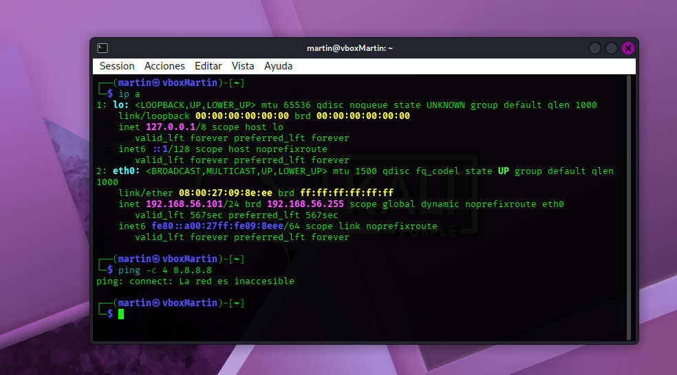
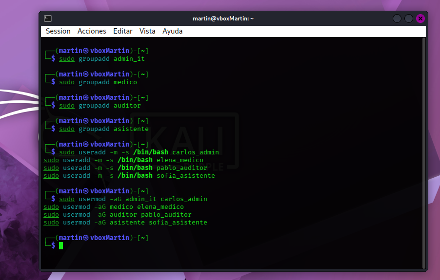
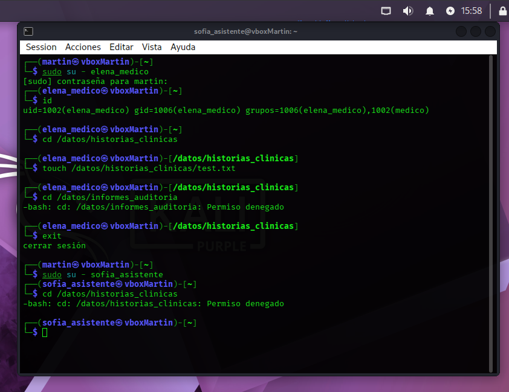

# Semana 4- Actividad Obligatoria -Unidad VI

**Diseño de Matriz de Accesos, Configuración Práctica de Roles y Análisis de Riesgos**

**Alumno:** Martin Alejandro Torres 

## 1. Modelado Organizacional: Sanatorio Salud

Para este laboratorio, se seleccionó la organización hipotética "Sanatorio Salud", una clínica médica privada dedicada a la atención integral de pacientes. Esta organización maneja información altamente crítica y sensible, regulada por la Ley de Protección de los Datos Personales (Ley N° 25.326) en materia de datos sensibles de salud.

### Definición de Roles (RBAC)
*   **admin_it:** Administrador técnico de infraestructura. Administra servidores, bases de datos y portales web de la clínica.
*   **medico:** Profesional médico responsable de la consulta asistencial directa y la evolución de los pacientes.
*   **auditor:** Analista encargado de auditar la calidad asistencial, procesos internos y generar métricas consolidadas.
*   **asistente:** Soporte administrativo y de recepción encargados del agendamiento y facturación de consultas.

### Definición de Recursos
*   `/datos/historias_clinicas`: Registros de salud de pacientes.
*   `/datos/informes_auditoria`: Reportes consolidados y métricas operativas de calidad de la clínica.
*   `/datos/agenda_turnos`: Calendario compartido de asignación de turnos y disponibilidad de consultorios.
*   `/datos/portal_publico`: Información estática de horarios, folletos informativos y material institucional.

---

## 2. Matriz de Accesos de Recursos de la Organización

| Rol / Grupo | /historias_clinicas | /informes_auditoria | /agenda_turnos | /portal_publico |
| :--- | :--- | :--- | :--- | :--- |
| **admin_it** (TI) | --- | --- | --- | rwx |
| **medico** (Médicos) | rwx | --- | --- | r-x |
| **auditor** (Auditoría) | --- | rwx | --- | r-x |
| **asistente** (Recepción) | --- | --- | rwx | r-x |

*Fuente de la matriz: Guía de Laboratorio, Sanatorio Salud.*

---

## 3. Justificación y Criterios de Seguridad Aplicados

*   **Principio de Privilegio Mínimo:** Cada rol posee únicamente el acceso necesario para realizar sus funciones. Aunque el Administrador de TI tiene privilegios máximos en el portal, se le deniega el acceso a las historias clínicas (---), ya que un perfil técnico no requiere leer diagnósticos para mantener operativos los servidores.
*   **Segregación de Funciones:** Se dividen las tareas críticas para evitar que una sola persona manipule todos los pasos de un proceso. El Auditor genera informes y tiene control total en auditorías (rwx), pero tiene vetado el historial médico directo para mantener la objetividad del análisis.
*   **Necesidad de Conocer:** Los asistentes de recepción gestionan el calendario de citas (rwx) pero carecen de acceso a los informes médicos de los pacientes o métricas de calidad institucional, protegiendo datos sensibles contra incidentes o fugas de información.

---

## 4. Evidencia de Configuración en el Laboratorio (VirtualBox)

### A. Configuración de Red Aislada
Para recrear el entorno corporativo con seguridad, se configuró la máquina virtual en un entorno aislado utilizando un adaptador tipo 'Red Interna' (o 'Solo-Anfitrión'), asegurando que los flujos de tráfico queden confinados dentro del hipervisor.

---



### B. Creación de Usuarios y Grupos (Roles IAM)
Se crearon los grupos correspondientes a cada rol organizativo y se registraron los usuarios en el sistema, mapeando las identidades al modelo de Control de Acceso Basado en Roles (RBAC).




### C. Validación de Permisos y Restricciones
Se certificó el comportamiento del control de accesos. Al intentar ingresar al directorio de historias clínicas con el usuario del área de recepción (`sofia_asistente`), el sistema bloqueó el acceso cumpliendo con la directiva estipulada.



---

## 5. Análisis de Riesgos de Permisos Incorrectos

*   **Permiso analizado:** Grupo `asistente` con acceso `rwx` sobre `/datos/historias_clinicas`.
*   **Descripción del riesgo:** Asignar control total de lectura y escritura de historias clínicas al personal de asistencia genera impactos graves alineados con la matriz de amenazas reales de ciberseguridad:
    1.  **Escalada de Privilegios (MITRE T1068):** Las credenciales del personal de recepción son las más expuestas a ataques de ingeniería social o phishing. Si una cuenta es comprometida, un atacante externo hereda de inmediato control total sobre el recurso más valioso de la clínica sin requerir vulnerar sistemas avanzados.
    2.  **Vulneración de Confidencialidad de Datos Sensibles (NIST / Ley de Protección de Datos Personales N° 25.326):** Acceso a información protegida sin justificación médica, provocando contingencias de responsabilidad legal directa y millonarias multas operativas.
    3.  **Pérdida de Integridad Clínica:** Personal sin entrenamiento médico adquiere el poder de alterar o eliminar alergias, historiales o prescripciones, poniendo en riesgo letal y directo la vida física del paciente en consultas.

---

## 6. Simulación Práctica del Riesgo: Explotación por Mala Configuración

En este escenario se simula la materialización de la amenaza descrita: un atacante obtiene las credenciales de la asistente de recepción (`sofia_asistente`) mediante técnicas de *phishing* o ingeniería social, y aprovecha una mala configuración de permisos en el sistema para vulnerar los datos médicos.

### Paso 1: Aplicar el permiso incorrecto (Simulación del error)
Como administrador del sistema, se introduce inadvertidamente el error de asignarle control total (`rwx`) al grupo de recepción sobre las historias clínicas:

```bash
sudo chown :asistente /datos/historias_clinicas
sudo chmod 770 /datos/historias_clinicas
```

### Paso 2: Ingresar como el atacante (Sofía)
El atacante utiliza las credenciales comprometidas de la recepcionista e inicia sesión en el sistema:

```bash
sudo su - sofia_asistente
```

### Paso 3: Explotar la vulnerabilidad y alterar registros (Impacto)
Aprovechando la indebida asignación de permisos, el atacante accede al directorio restringido y adultera la información médica de un paciente, provocando una **pérdida crítica de Integridad Clínica**:

```bash
cd /datos/historias_clinicas
echo "Paciente sin alergias (DATO ALTERADO)" > historial_paciente_01.txt
cat historial_paciente_01.txt
```

> **Verificación:** El atacante logró crear, modificar y leer un archivo médico sin requerir herramientas complejas de intrusión, evidenciando cómo un fallo en la matriz de permisos de Linux compromete directamente la seguridad del paciente.


