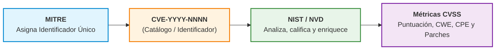

# Ciberseguridad Aplicada — Resumen Clase 5: Gestión de Vulnerabilidades y Segmentación de Redes

> **Resumen de Clase:** Guía completa y estructurada sobre gestión proactiva de vulnerabilidades, frameworks internacionales (NIST, ISO 27001, OWASP, MITRE), priorización mediante CVSS, reducción de la superficie de ataque, arquitectura de redes (Modelo OSI, IPv4, Subnetting con ejercicio práctico resuelto) e integración de seguridad perimetral (DMZ, Firewalls, IDS/IPS e IAM).

---

## 📌 Índice Temático
1. [Gestión de Vulnerabilidades y Marcos de Referencia](#1-gestión-de-vulnerabilidades-y-marcos-de-referencia)
2. [Detección y Catalogación de Vulnerabilidades (CVE vs. NVD)](#2-detección-y-catalogación-de-vulnerabilidades-cve-vs-nvd)
3. [Priorización del Riesgo y Sistema CVSS](#3-priorización-del-riesgo-y-sistema-cvss)
4. [Superficie de Ataque y Reducción por Capas](#4-superficie-de-ataque-y-reducción-por-capas)
5. [Fundamentos de Redes y Modelo OSI](#5-fundamentos-de-redes-y-modelo-osi)
6. [Equipos de Red y Direccionamiento IPv4](#6-equipos-de-red-y-direccionamiento-ipv4)
7. [Segmentación de Redes y Subnetting (CIDR / VLSM)](#7-segmentación-de-redes-y-subnetting-cidr--vlsm)
   - [Resolución Paso a Paso del Ejercicio Obligatorio](#-resolución-del-ejercicio-obligatorio-de-la-clase)
8. [Perímetro, Dispositivos de Seguridad e Integración con IAM](#8-perímetro-dispositivos-de-seguridad-e-integración-con-iam)
9. [Operación, Monitoreo y Mantenimiento Continuo](#9-operación-monitoreo-y-mantenimiento-continuo)

---

## 1. Gestión de Vulnerabilidades y Marcos de Referencia

### Conceptos Clave
* **Definición de Vulnerabilidad:** Es una debilidad o fallo presente en un sistema de información, procedimiento operativo, diseño de software, hardware o control de seguridad que puede ser aprovechada por una amenaza para comprometer la Confidencialidad, Integridad o Disponibilidad (**tríada CID/CIA**) de los activos de la organización.
* **Origen y Naturaleza:** Puede originarse en el código de software (bugs, desactualizaciones), arquitectura de hardware, errores de configuración (servicios por defecto, puertos abiertos) o fallas en los procesos y comportamiento humano.
  > [!NOTE]
  > Una vulnerabilidad por sí sola **no constituye un incidente**, pero representa la condición necesaria que habilita su explotación por parte de un atacante.

* **Relación con el Riesgo:** La vulnerabilidad impacta directamente sobre la **probabilidad** de ocurrencia de un incidente, según el modelo fundamental de riesgo:
  $$\text{Riesgo} = \text{Probabilidad} \times \text{Impacto}$$

### Marcos de Referencia Internacionales
| Marco / Estándar | Alcance y Aplicación Principal |
| :--- | :--- |
| **NIST (SP 800-30, SP 800-40, SP 800-115)** | Guías oficiales para evaluación de riesgos, gestión corporativa de parches y ejecución de pruebas técnicas de seguridad. |
| **ISO/IEC 27001 / 27002** | Estándar global para la implementación y auditoría de un Sistema de Gestión de Seguridad de la Información (SGSI) y catálogo de controles. |
| **OWASP (Top 10)** | Clasificación estandarizada de las vulnerabilidades más críticas en aplicaciones web, APIs y entornos móviles/cloud. |
| **MITRE CVE** | Sistema internacional de catalogación unificada e identificación estandarizada de vulnerabilidades conocidas. |

---

## 2. Detección y Catalogación de Vulnerabilidades (CVE vs. NVD)

### Métodos de Detección en la Organización
1. **Escaneo Automatizado:** Ejecución programada de herramientas que cotejan la infraestructura contra bases de datos de vulnerabilidades:
   * *Infraestructura y Red:* Nessus, OpenVAS, Qualys VMDR, Rapid7 InsightVM.
   * *Aplicaciones Web:* Burp Suite, OWASP ZAP.
2. **Monitoreo de Seguridad en Tiempo Real (SIEM / XDR):** Centralización de eventos, correlación de logs y detección de anomalías mediante plataformas como **Wazuh** o **IBM QRadar**.
3. **Auditorías de Seguridad:** Revisiones manuales periódicas de configuraciones, políticas internas y cumplimiento normativo.
4. **Pruebas de Penetración (*Pentesting*):** Simulaciones controladas y éticas de ataques reales para validar la explotabilidad práctica de las brechas.
5. **Bases de Conocimiento e Inteligencia de Amenazas:** Consulta activa de repositorios públicos y boletines de seguridad para detección temprana.

### Diferencia Clave: CVE vs. NVD



* **CVE (*Common Vulnerabilities and Exposures*):** Mantenido por **MITRE Corporation**. Es un diccionario público que asigna un código alfanumérico identificador único a cada fallo de seguridad reportado (ej. `CVE-2021-44228`).
* **NVD (*National Vulnerability Database*):** Base de datos del gobierno de EE.UU. administrada por el **NIST**. Toma los identificadores CVE y los enriquece técnicamente con:
  * Puntuación de severidad objetiva (**CVSS**).
  * Tipo de debilidad subyacente (**CWE**).
  * Plataformas y versiones afectadas (**CPE**).
  * Vínculos a parches, avisos oficiales y exploits conocidos.

> [!IMPORTANT] **Idea Clave para Exámenes:**
> **CVE identifica** la vulnerabilidad; **NVD la analiza, califica y clasifica**.

---

## 3. Priorización del Riesgo y Sistema CVSS

### El Problema del Volumen
En entornos productivos reales se detectan miles de vulnerabilidades simultáneamente. Resulta técnica y económicamente imposible parchar la totalidad de los hallazgos al mismo tiempo. La ciberseguridad eficaz consiste en **gestionar el orden de tratamiento** basándose en el riesgo relativo para optimizar recursos.

### Estándar CVSS (*Common Vulnerability Scoring System*)
Mantenido por el consorcio internacional **FIRST**, asigna una puntuación objetiva de severidad de **0.0 a 10.0**:

| Rango CVSS | Nivel de Severidad | Prioridad y Plazo de Remediación Sugerido |
| :---: | :---: | :--- |
| **0.0** | Ninguna (*None*) | Sin impacto apreciable. |
| **0.1 – 3.9** | **Baja (*Low*)** | Corrección en mantenimientos programados ordinarios. |
| **4.0 – 6.9** | **Media (*Medium*)** | Mitigación dentro de los ciclos periódicos de parcheo. |
| **7.0 – 8.9** | **Alta (*High*)** | Tratamiento prioritario en plazos breves. |
| **9.0 – 10.0** | **Crítica (*Critical*)** | Parcheo de emergencia o mitigación compensatoria inmediata (horas/días). |

### Criterios Multidimensionales para la Priorización Real:
1. **Puntaje Base CVSS:** Severidad técnica intrínseca.
2. **Impacto en la Tríada CID:** Daño potencial a la confidencialidad, integridad o disponibilidad.
3. **Nivel de Exposición del Activo:** Un servicio publicado a Internet requiere mayor prioridad que uno en una red aislada.
4. **Explotabilidad Real:** Existencia de exploits públicos funcionales (*Exploit in the Wild* / CISA KEV).
5. **Criticidad del Activo para el Negocio:** Relevancia de los datos y procesos que alberga el sistema.

---

## 4. Superficie de Ataque y Reducción por Capas

### ¿Qué es la Superficie de Ataque?
Es la suma consolidada de todos los puntos de entrada, vías de acceso y componentes expuestos (internos y externos) que un atacante puede utilizar para intentar vulnerar un sistema.

* **Vectores típicos:** Puertos y servicios en escucha innecesarios, interfaces de administración públicas, APIs sin autenticación, credenciales por defecto o débiles y librerías desactualizadas.

### Reducción de la Superficie de Ataque por Capas del Ciberespacio

| Capa del Ciberespacio | Medidas y Controles Defensivos |
| :--- | :--- |
| **1. Capa Física** | • Control biométrico o con tarjeta en datacenters y salas técnicas.<br>• Bloqueo físico de puertos USB no autorizados.<br>• Resguardo perimetral de cableados y switches.<br>• Retiro y decomiso seguro de hardware obsoleto o no inventariado. |
| **2. Capa Lógica (Tecnológica)** | • Segmentación estricta de redes (VLANs, subredes, DMZ).<br>• Cierre de puertos innecesarios y apagado de servicios no utilizados (*Hardening*).<br>• Implementación del Principio de Mínimo Privilegio mediante IAM.<br>• Inspección y filtrado de tráfico mediante Firewalls y WAFs para APIs. |
| **3. Capa Cognitiva (Humana)** | • Concientización continua frente a técnicas de *phishing* e ingeniería social.<br>• Exigencia obligatoria de Autenticación Multifactor (MFA).<br>• Políticas claras de uso aceptable y clasificación de datos.<br>• Asignación de permisos por roles mínimos indispensables (RBAC). |

---

## 5. Fundamentos de Redes y Modelo OSI

El **Modelo OSI (Open Systems Interconnection)** organiza la comunicación en **7 capas** para estandarizar protocolos, aislar fallas y diseñar la seguridad por niveles.

### Matriz Completa del Modelo OSI

| Nivel | Capa | PDU (Unidad de Datos) | Identificador / Direccionamiento | Dispositivos Representativos | Protocolos / Ejemplos |
| :---: | :--- | :--- | :--- | :--- | :--- |
| **7** | **Aplicación** | Datos | Nombre de servicio / URI | Proxies de aplicación, WAF | HTTP, HTTPS, DNS, SSH, SMTP |
| **6** | **Presentación**| Datos | Sintaxis y Formato | Pasarelas de cifrado | TLS/SSL, JSON, JPEG, ASCII |
| **5** | **Sesión** | Datos | ID de Sesión / Socket | Servidores de autenticación | NetBIOS, RPC, SOCKS |
| **4** | **Transporte** | **Segmento** (TCP) / **Datagrama** (UDP) | **Puertos** (16 bits: 0 a 65535) | Firewalls L4, Balanceadores | TCP, UDP |
| **3** | **Red** | **Paquete** | **Dirección IP** (Lógica) | **Routers**, Switches Capa 3 | IPv4, IPv6, ICMP, IPsec |
| **2** | **Enlace de Datos** | **Trama (*Frame*)** | **Dirección MAC** (Física) | **Switches**, Access Points, NICs | Ethernet (802.3), Wi-Fi (802.11), ARP |
| **1** | **Física** | **Bits** | Señales eléctricas / ópticas | Hubs, Repetidores, Cables | UTP Cat 6, Fibra Óptica, Radio RF |

* **Proceso de Encapsulamiento:** A medida que la información viaja desde la capa de aplicación hacia la capa física, cada nivel añade una cabecera (*header*) con información de control propia. En el receptor se produce el **desencapsulamiento** inverso.
* **Medios de Transmisión:**
  * *Cable de Par Trenzado (UTP):* Conector RJ-45, alcance estándar de 100 m para LAN.
  * *Fibra Óptica:* Conectores SC/LC, transmisión mediante pulsos de luz a altas velocidades y largas distancias (ej. 100BASE-FX, 1000BASE-X). Inmune a interferencias electromagnéticas.
  * *Inalámbrico (Wi-Fi):* Radiofrecuencia coordinada mediante Puntos de Acceso (*Access Points*).

---

## 6. Equipos de Red y Direccionamiento IPv4

### Dispositivos Centrales de Red
* **Switch (Conmutador — Capa 2):**
  * Conecta dispositivos dentro de una misma red local (**LAN**) bajo el estándar Ethernet (IEEE 802.3).
  * Mantiene una **tabla de direcciones MAC** (tabla CAM) asociando cada puerto físico con la MAC del equipo conectado para enviar las tramas únicamente al destinatario legítimo (*Unicast*).
  * Velocidades habituales: Fast Ethernet (10/100 Mbps), Gigabit Ethernet (1 Gbps) y 10 Gbps (cobre o fibra).
* **Punto de Acceso (*Access Point*):**
  * Extiende la red cableada al medio inalámbrico, coordinando la autenticación y el tráfico Wi-Fi.
* **Router (Enrutador — Capa 3):**
  * Interconecta redes lógicas independientes y selecciona la mejor ruta para enviar paquetes hacia el destino.
  * Emplea su **tabla de enrutamiento** (redes destino, métricas, interfaces y siguiente salto o *next hop*).
* **Protocolo ARP (*Address Resolution Protocol*):**
  * Permite asociar una dirección IP lógica conocida con la dirección física MAC del dispositivo en el segmento local.

> [!CAUTION] **Regla Fundamental del Router:**
> **Nunca se deben configurar dos interfaces de un mismo router en la misma red o subred IP**. Esto genera ambigüedades en la tabla de enrutamiento, bucles ARP y pérdida del tráfico.

### Direccionamiento IPv4
Direcciones lógicas compuestas por **32 bits**, expresadas en 4 octetos decimales separados por puntos (ej. `192.168.1.1`).

* **Clases Tradicionales de Direcciones IP:**
  * **Clase A:** `1.0.0.0` a `126.255.255.255` (Máscara por defecto: `/8` o `255.0.0.0`).
  * **Clase B:** `128.0.0.0` a `191.255.255.255` (Máscara por defecto: `/16` o `255.255.0.0`).
  * **Clase C:** `192.0.0.0` a `223.255.255.255` (Máscara por defecto: `/24` o `255.255.255.0`).
  * **Clase D:** `224.0.0.0` a `239.255.255.255` (Multicast).
  * **Clase E:** `240.0.0.0` a `255.255.255.255` (Uso experimental).
* **Identificación de Red y Host:** La **máscara de subred** (o notación CIDR) indica qué porción de los 32 bits corresponde al identificador de red y cuál a los hosts individuales.

---

## 7. Segmentación de Redes y Subnetting (CIDR / VLSM)

### Problemas de las "Redes Planas"
En una red plana, todos los hosts comparten un único **dominio de difusión (*broadcast domain*)**:
* El tráfico broadcast innecesario satura el ancho de banda y degrada el rendimiento de los equipos.
* Facilita el **movimiento lateral**: si un atacante vulnera un equipo secundario, puede escanear y atacar directamente cualquier servidor crítico de la organización sin barreras intermedias.

### Segmentación de Redes
Consiste en subdividir la infraestructura en zonas o subredes independientes mediante routers, switches L3 y VLANs:
* Confinamiento de intrusiones y malware.
* Reducción de la superficie de ataque y aplicación granular de políticas de seguridad.

### Mecánica del Subnetting
Se basa en **tomar bits prestados** de la porción de host para crear identificadores de subred adicionales:
* Cantidad de subredes generadas: $2^n$ (donde $n$ = bits prestados).
* Hosts útiles por subred: $2^h - 2$ (donde $h$ = bits restantes de host; se restan la dirección de red y la de broadcast).

#### Ejemplo de Clase: División de `192.168.10.0/24`
* Tomando **2 bits prestados**: Máscara `/26` $\rightarrow$ `255.255.255.192`.
* Subredes: $2^2 = 4$.
* Hosts útiles por subred: $2^6 - 2 = 64 - 2 = \mathbf{62\text{ hosts}}$.

---

### 📝 Resolución del Ejercicio Obligatorio de la Clase

> **Consigna:** Diseñar **6 subredes independientes** con capacidad para **al menos 30 hosts útiles cada una**, a partir del bloque de red base **`192.168.100.0/24`**.

#### 1. Cálculo de bits necesarios para subredes ($n$):
* Se necesitan al menos 6 subredes:
  * Con 2 bits: $2^2 = 4 < 6$ (Insuficiente).
  * Con **3 bits**: $2^3 = 8 \ge 6$ (**Cumple** con margen de 2 subredes de reserva).

#### 2. Cálculo de bits restantes para hosts ($h$):
* Bits totales de host en `/24` = 8 bits.
* Bits restantes para host: $8 - 3 = 5\text{ bits}$.
* Hosts útiles por subred: $2^5 - 2 = 32 - 2 = \mathbf{30\text{ hosts útiles}}$. (**Cumple exactamente** la consigna).

#### 3. Parámetros de la nueva máscara:
* Notación CIDR: $/24 + 3 = \mathbf{/27}$.
* Máscara decimal: `11111111.11111111.11111111.11100000` $\rightarrow$ **`255.255.255.224`**.
* Salto de red (tamaño de bloque): $256 - 224 = \mathbf{32}$.

#### 4. Tabla de Direccionamiento de las Subredes Diseñadas:

| N° | Subred (Network ID) | Rango de Hosts Útiles (Asignables) | Dirección de Broadcast | Máscara | Estado |
| :---: | :--- | :--- | :--- | :---: | :---: |
| **1** | `192.168.100.0/27` | `192.168.100.1` — `192.168.100.30` | `192.168.100.31` | `255.255.255.224` | **Asignada** |
| **2** | `192.168.100.32/27` | `192.168.100.33` — `192.168.100.62` | `192.168.100.63` | `255.255.255.224` | **Asignada** |
| **3** | `192.168.100.64/27` | `192.168.100.65` — `192.168.100.94` | `192.168.100.95` | `255.255.255.224` | **Asignada** |
| **4** | `192.168.100.96/27` | `192.168.100.97` — `192.168.100.126`| `192.168.100.127`| `255.255.255.224` | **Asignada** |
| **5** | `192.168.100.128/27`| `192.168.100.129` — `192.168.100.158`| `192.168.100.159`| `255.255.255.224` | **Asignada** |
| **6** | `192.168.100.160/27`| `192.168.100.161` — `192.168.100.190`| `192.168.100.191`| `255.255.255.224` | **Asignada** |
| *7* | `192.168.100.192/27`| `192.168.100.193` — `192.168.100.222`| `192.168.100.223`| `255.255.255.224` | *Reserva* |
| *8* | `192.168.100.224/27`| `192.168.100.225` — `192.168.100.254`| `192.168.100.255`| `255.255.255.224` | *Reserva* |

---

## 8. Perímetro, Dispositivos de Seguridad e Integración con IAM

### Arquitectura de Red Segura con DMZ

```mermaid
flowchart TD
    Internet(["🌐 Internet (Zona No Confiable)"]) --> FW["🛡️ Firewall Perimetral"]
    
    subgraph DMZ["Zona Desmilitarizada (DMZ)"]
        Web["Servidor Web (HTTP/S)"]
        Mail["Servidor Correo"]
    end
    
    subgraph LAN["Red Interna Confiable (LAN)"]
        DB[("Base de Datos")]
        Users["Estaciones de Trabajo"]
        AD["Active Directory / IAM"]
    end
    
    FW -->|Tráfico Público Permitido| DMZ
    FW -->|Acceso Restringido| LAN
    DMZ -.->|Consultas Estrictas (Bloqueo Directo)| DB
```

* **Perímetro de Red:** Punto fronterizo entre la red interna y las redes externas donde se inspecciona y filtra el tráfico aplicando directivas de seguridad.
* **DMZ (*Zona Desmilitarizada*):** Subred intermedia aislada que aloja servidores con servicios públicos (Web, DNS, correo). Si un atacante compromete un servidor en la DMZ, el firewall le impide acceder directamente a la red interna y sus bases de datos.
* **ACLs (*Access Control Lists*):** Conjuntos de reglas secuenciales configuradas en routers o switches L3 que filtran paquetes evaluando IP origen, IP destino, protocolo y puerto, aplicando acciones de **permitir (`ALLOW`)** o **denegar (`DENY` / `DROP`)**.

### Evolución de los Firewalls

| Tipo de Firewall | Capas OSI de Trabajo | Características y Alcance |
| :--- | :---: | :--- |
| **Tradicional / Filtrado de Paquetes (*Stateless*)** | Capas 3 y 4 | Inspecciona cabeceras paquete por paquete de forma aislada (IPs y puertos). No recuerda el estado de la conexión previa. |
| **Inspección con Estado (*Stateful Inspection*)** | Capas 3 y 4 | Mantiene una tabla de conexiones activas; permite automáticamente el tráfico de retorno legítimo sin requerir reglas bidireccionales abiertas. |
| **Firewall de Próxima Generación (*NGFW*)** | Capas 3 a 7 | Incorpora Inspección Profunda de Paquetes (**DPI**), identificación granular de aplicaciones (sin importar el puerto), prevención de intrusiones (IPS) y control según identidad de usuario. |

### Detección vs. Prevención de Intrusiones: IDS vs. IPS
* **IDS (*Intrusion Detection System*):** Opera en modo pasivo analizando una copia del tráfico (*SPAN/Mirror*). Detecta anomalías o firmas de ataque y **genera alertas** para el SOC sin intervenir en la conexión.
* **IPS (*Intrusion Prevention System*):** Opera en línea (*in-line*), insertado directamente en la ruta del tráfico. Al detectar un ataque, **bloquea activamente** el flujo, resetea la sesión TCP o descarta los paquetes maliciosos en tiempo real.

### Integración Conceptual: IAM + Control de Red
* **IAM (Nivel Lógico e Identidad):** Define quién es el usuario, su rol y a qué datos o recursos tiene derecho a acceder.
* **Control de Red (Nivel de Infraestructura):** Traduce e impone las políticas de IAM en la red física y lógica mediante reglas de firewall, VLANs dinámicas (802.1X), microsegmentación y control de puertos/IPs.

---

## 9. Operación, Monitoreo y Mantenimiento Continuo

### Operación y Visibilidad Continua
Administración activa de subredes, VLANs, ACLs y rutas para garantizar la estabilidad, rendimiento y cumplimiento estricto de las directivas de seguridad.

### Ecosistema de Herramientas Operativas
* **Gestión de Eventos y Protocolos Base:** Logs del sistema (*Syslog*) y telemetría mediante **SNMP** (*Simple Network Management Protocol*).
* **Disponibilidad y Estado de Equipos:** Nagios, Zabbix.
* **Telemetría y Métricas en Tiempo Real:** Prometheus con tableros interactivos en Grafana.
* **Análisis Profundo de Paquetes (Sniffing L2-L7):** Wireshark, tcpdump.
* **Correlación de Eventos de Seguridad (SIEM):** Splunk, Elastic SIEM (ELK Stack), Wazuh.

### Estrategias de Mantenimiento
* **Mantenimiento Preventivo:**
  * Actualización periódica de firmware y software en switches, routers y appliances de seguridad.
  * Aplicación disciplinada de parches de seguridad.
  * Auditoría y depuración de reglas obsoletas en firewalls y ACLs (evitar el crecimiento descontrolado de reglas permisivas *"Any-Any"*).
  * Optimización continua de configuraciones.
* **Mantenimiento Correctivo:**
  * Diagnóstico y contención de incidentes y fallas activas.
  * Análisis forense de registros (*logs*) tras anomalías o brechas.
  * Restablecimiento seguro del servicio y aplicación de lecciones aprendidas.
