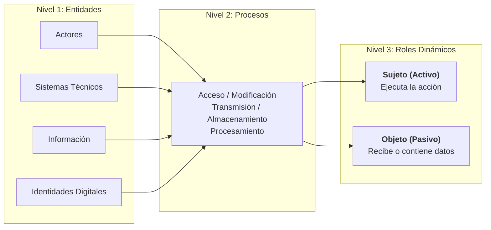
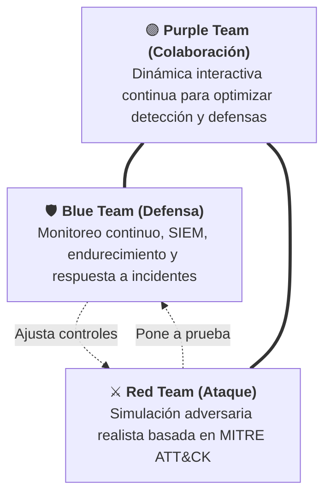
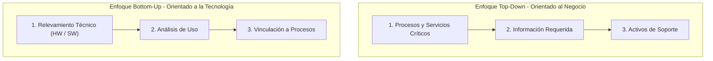
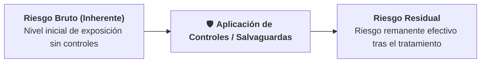
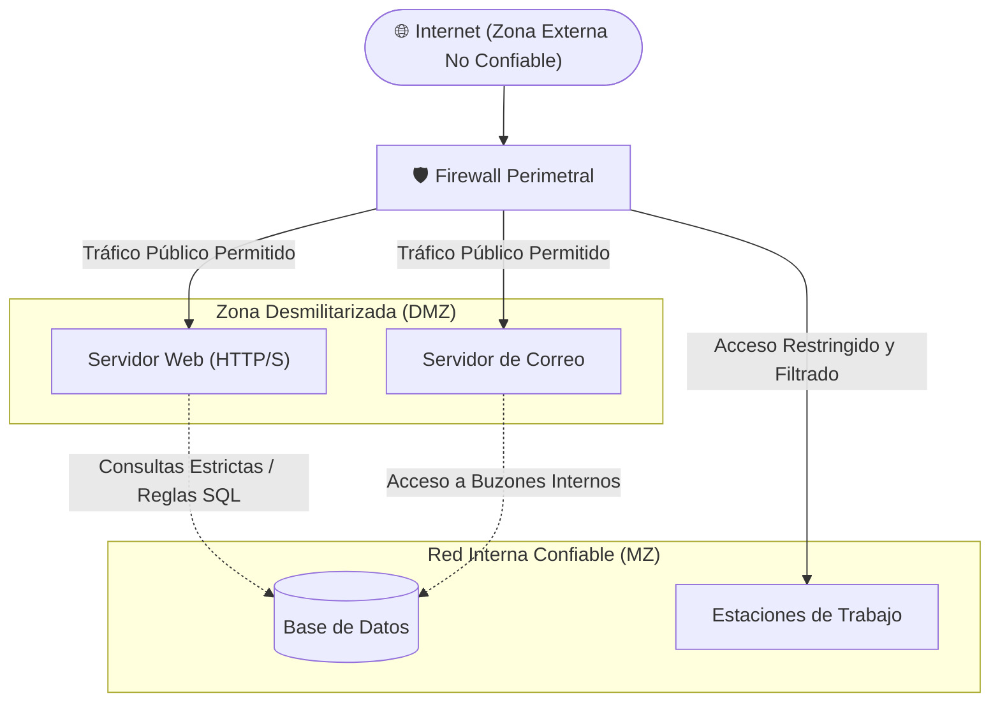

# 📚 Guía de Repaso Integral para Parcial: Ciberseguridad Aplicada

> **Guía de Estudio:** Resumen estructurado para examen parcial que abarca las 7 Unidades de la materia, integrando definiciones ontológicas, propiedades de la información, matrices de riesgo, gestión de activos, modelos IAM y segmentación de redes.

---

## 📌 Índice Temático por Unidades

* [UNIDAD I: Espacio Cibernético y Conceptos Fundamentales](#unidad-i-espacio-cibernético-y-conceptos-fundamentales)
  * [1. Origen y Estructura del Ciberespacio](#1-origen-y-estructura-del-ciberespacio)
  * [2. Capas y Modelos del Ciberespacio](#2-capas-y-modelos-del-ciberespacio)
  * [3. Entidades, Procesos y Roles](#3-entidades-procesos-y-roles)
  * [4. Diferenciación de Dominios de Seguridad](#4-diferenciación-de-dominios-de-seguridad)
* [UNIDAD II: Datos, Información y Propiedades de la Seguridad](#unidad-ii-datos-información-y-propiedades-de-la-seguridad)
  * [1. Transformación de Datos en Información](#1-transformación-de-datos-en-información)
  * [2. Ciclo de Vida de la Información](#2-ciclo-de-vida-de-la-información)
  * [3. Propiedades de la Seguridad de la Información](#3-propiedades-de-la-seguridad-de-la-información)
  * [4. Criterios de Priorización según el Contexto](#4-criterios-de-priorización-según-el-contexto)
* [UNIDAD III: Amenazas, Vulnerabilidades y Riesgos](#unidad-iii-amenazas-vulnerabilidades-y-riesgos)
  * [1. Trinomio Fundamental y Fórmulas](#1-trinomio-fundamental-y-fórmulas)
  * [2. Clasificación de Amenazas](#2-clasificación-de-amenazas)
  * [3. Ingeniería Social y Vulnerabilidad Humana](#3-ingeniería-social-y-vulnerabilidad-humana)
  * [4. Enfoques Operativos en Ciberseguridad](#4-enfoques-operativos-en-ciberseguridad)
* [UNIDAD IV: Gestión de Activos](#unidad-iv-gestión-de-activos)
  * [1. Definición y Concepto de Activo](#1-definición-y-concepto-de-activo)
  * [2. Metodologías de Identificación de Activos](#2-metodologías-de-identificación-de-activos)
  * [3. Categorías y Dependencias](#3-categorías-y-dependencias)
  * [4. Roles sobre el Activo](#4-roles-sobre-el-activo)
  * [5. Ciclo de Vida y Activos Desconocidos](#5-ciclo-de-vida-y-activos-desconocidos)
* [UNIDAD V: Gestión de Riesgos](#unidad-v-gestión-de-riesgos)
  * [1. Fases del Análisis de Riesgo](#1-fases-del-análisis-de-riesgo)
  * [2. Métodos de Cálculo del Impacto Total (C-I-D)](#2-métodos-de-cálculo-del-impacto-total-c-i-d)
  * [3. Cuantificación y Escalado del Riesgo](#3-cuantificación-y-escalado-del-riesgo)
  * [4. Opciones de Tratamiento del Riesgo](#4-opciones-de-tratamiento-del-riesgo)
  * [5. Riesgo Bruto vs. Riesgo Residual](#5-riesgo-bruto-vs-riesgo-residual)
  * [6. Ciberresiliencia](#6-ciberresiliencia)
* [UNIDAD VI: Gestión de Identidades y Accesos (IAM)](#unidad-vi-gestión-de-identidades-y-accesos-iam)
  * [1. Desglose de Componentes en IAM](#1-desglose-de-componentes-en-iam)
  * [2. Autenticación vs. Autorización](#2-autenticación-vs-autorización)
  * [3. Modelos de Control de Acceso](#3-modelos-de-control-de-acceso)
  * [4. Principios Fundamentales](#4-principios-fundamentales)
  * [5. Aspectos Legales y Gestión de Terceros](#5-aspectos-legales-y-gestión-de-terceros)
  * [6. Laboratorio Práctico Linux (Comandos e IAM)](#6-laboratorio-práctico-linux-comandos-e-iam)
* [UNIDAD VII: Gestión de Vulnerabilidades y Segmentación de Redes](#unidad-vii-gestión-de-vulnerabilidades-y-segmentación-de-redes)
  * [1. Estándares de Vulnerabilidades](#1-estándares-de-vulnerabilidades)
  * [2. Detección y Reducción de Superficie de Ataque](#2-detección-y-reducción-de-superficie-de-ataque)
  * [3. Infraestructura y Direccionamiento de Redes](#3-infraestructura-y-direccionamiento-de-redes)
  * [4. Segmentación y Control de Tráfico](#4-segmentación-y-control-de-tráfico)

---

## UNIDAD I: Espacio Cibernético y Conceptos Fundamentales

### 1. Origen y Estructura del Ciberespacio
* **Definición de Ciberespacio**: Es un entorno de interacción socio-técnica multidimensional.
* **Discontinuidad Ontológica**: El ciberespacio no es una mera extensión del espacio físico tradicional; representa un cambio en la naturaleza del ser y de la realidad que rompe las categorías clásicas de territorio, frontera, presencia física y jurisdicción.
* **El Prefijo "Ciber"**: Proviene de la Cibernética (estudio del control y comunicación en animales y máquinas, formulado por Norbert Wiener en 1948). Brett Williams enfatiza que "ciber" es un prefijo y jamás debe utilizarse de forma aislada.
* **Lo Virtual vs. Lo Digital vs. Lo Material**: La virtualización existía antes de la digitalización (como un dibujo en papel). La información digital requiere siempre de un soporte material y tangible (servidores, cables, energía) para existir y procesarse.

---

### 2. Capas y Modelos del Ciberespacio

| Modelo Doctrinal | Capas que lo Componen | Alcance / Enfoque |
| :--- | :--- | :--- |
| **Modelo de 3 Capas (Doctrina TRADOC / EE. UU.)** | • **Capa Física:** Componentes geográficos y red física. • **Capa Lógica:** Componentes de red lógica y protocolos. • **Capa Social:** Personas y ciberpersonas / identidades. | Visión operativa y de telecomunicaciones militares. |
| **Modelo de Reino Unido (DCDC)** | • **Capa Física** • **Capa Virtual** • **Capa Cognitiva** | Énfasis en la percepción y la dimensión humana del conflicto. |
| **Modelo de 6 Capas (JID - Junta Interamericana de Defensa)** | 1. Terreno 2. Infraestructura TIC 3. Sistemas de Información 4. Información 5. Ciberpersonas 6. Personas | Desagregación detallada para defensa y cooperación regional. |

---

### 3. Entidades, Procesos y Roles

* **Roles Dinámicos:**
  * **Sujeto (Entidad Activa):** Quien ejecuta la acción sobre la información (ej. usuario, proceso en memoria).
  * **Objeto (Entidad Pasiva):** Quien recibe la acción o contiene la información (ej. archivo en disco, base de datos).
  * **Dualidad del Software:** Es **sujeto** cuando está en ejecución procesando datos, y es **objeto** cuando está almacenado como código fuente o binario en disco.

---

### 4. Diferenciación de Dominios de Seguridad

| Dominio | Objeto de Protección | Alcance y Marco Legal |
| :--- | :--- | :--- |
| **Seguridad Informática** | Sistemas informáticos, redes, hardware y software. | Confinada a la infraestructura tecnológica y computacional. |
| **Seguridad de la Información** | La información en sí misma y la preservación de la tríada CID. | **Dominio más amplio:** Aplica a cualquier soporte (digital, papel o verbal). |
| **Ciberseguridad** | Activos y sistemas digitales interconectados en el ciberespacio. | Protección frente a ciberamenazas en redes e Internet. |
| **Ciberdefensa** | Soberanía, infraestructuras críticas y activos estratégicos del Estado. | Capacidad militar ante agresiones externas estatales (Estrategia Nacional de Ciberseguridad, **Res. 44/2023**; **Res. 1380/2019**). |

---

## UNIDAD II: Datos, Información y Propiedades de la Seguridad

### 1. Transformación de Datos en Información
* **Dato:** Hecho, valor o símbolo bruto sin interpretar (ej. `"42"`).
* **Información:** Dato procesado, organizado y contextualizado que adquiere significado y reduce la incertidumbre del receptor.
* **Conocimiento:** Resultado de analizar, interpretar e integrar la información para la toma de decisiones estratégicas.

---

### 2. Ciclo de Vida de la Información

La seguridad debe garantizarse en cada una de sus **6 etapas consecutivas**:

```mermaid
flowchart LR
    E1["<b>1. Creación / Captura</b>"] --> E2["<b>2. Almacenamiento</b>"]
    E2 --> E3["<b>3. Uso / Procesamiento</b>"]
    E3 --> E4["<b>4. Compartición / Distribución</b>"]
    E4 --> E5["<b>5. Archivo</b>"]
    E5 --> E6["<b>6. Eliminación Segura</b>"]

    style E1 fill:#e1f5fe,stroke:#0288d1,stroke-width:2px
    style E2 fill:#e8f5e9,stroke:#388e3c,stroke-width:2px
    style E3 fill:#fff3e0,stroke:#f57c00,stroke-width:2px
    style E4 fill:#f3e5f5,stroke:#7b1fa2,stroke-width:2px
    style E5 fill:#efebe9,stroke:#5d4037,stroke-width:2px
    style E6 fill:#ffebee,stroke:#c62828,stroke-width:2px
```

---

### 3. Propiedades de la Seguridad de la Información

#### Tríada CID (Base Clásica)
* **Confidencialidad:** Acceso permitido únicamente a personas, entidades o procesos debidamente autorizados.
* **Integridad:** Exactitud, completitud y salvaguarda contra modificaciones no autorizadas o accidentales.
* **Disponibilidad:** Acceso oportuno y confiable a la información y recursos cuando los usuarios autorizados lo requieran.

#### Propiedades Extendidas
* **Autenticidad:** Certeza y verificación inequívoca de la identidad del emisor o del origen de los datos.
* **Trazabilidad (*Accountability*):** Capacidad de registrar y auditar qué entidad ejecutó cada acción y en qué momento exacto.
* **No Repudio:** Imposibilidad de que el emisor o receptor niegue la autoría o ejecución de una acción o transacción realizada.

---

### 4. Criterios de Priorización según el Contexto

| Entorno Operativo / Tipo de Activo | Propiedad Principal Priorizada | Fundamentación |
| :--- | :---: | :--- |
| **Datos Personales / Salud (PII)** | **Confidencialidad** | Cumplimiento legal estricto y resguardo de la privacidad individual. |
| **Sistemas de Control Industrial (SCADA / ICS)** | **Disponibilidad** | Un corte o retraso en la operación puede causar daños físicos catastróficos o víctimas. |
| **Registros Legales / Contratos Digitales** | **Integridad y No Repudio** | Necesidad de validez jurídica probatoria inalterable a lo largo del tiempo. |
| **Sistemas Financieros y Bancarios** | **Disponibilidad e Integridad** | Continuidad ininterrumpida de transacciones y consistencia exacta de balances y saldos. |

---

## UNIDAD III: Amenazas, Vulnerabilidades y Riesgos

### 1. Trinomio Fundamental y Fórmulas
* **Amenaza:** Evento, factor o acción (accidental, por error o intencional) con potencial de causar daño a un activo de la organización.
* **Vulnerabilidad:** Debilidad, fallo o defecto de seguridad técnico, humano u organizativo que puede ser explotado por una amenaza.
* **Impacto:** Medida cuantitativa o cualitativa de la consecuencia o daño sufrido por el activo al materializarse la amenaza.
* **Riesgo:** Combinación de la probabilidad de que ocurra un evento adverso y la magnitud de su impacto negativo:

> [!IMPORTANT] **Fórmula Fundamental del Riesgo:**
> $$\mathbf{\text{Riesgo} = \text{Probabilidad} \times \text{Impacto}}$$

---

### 2. Clasificación de Amenazas

| Categoría | Tipos y Variantes | Ejemplos Representativos |
| :--- | :--- | :--- |
| **Ambientales** | Fenómenos naturales y siniestros de infraestructura. | Inundaciones, incendios, fallas en el suministro eléctrico, colapsos edilicios. |
| **Humanas** | • **Accidentales / Errores:** Sin dolo. • **Intencionales Internas / Externas:** Con premeditación. • **Estructuradas:** Grupos avanzados organizados. • **No Estructuradas:** Atacantes aislados. | • Errores de configuración, borrado accidental. • Sabotaje interno, robo de datos, ciberdelincuencia. • APTs (*Advanced Persistent Threats*), agencias de inteligencia con altos recursos. • Script kiddies, oportunistas o curiosos. |
| **Tecnológicas** | Fallos intrínsecos de hardware y software. | Ruptura de discos, bugs en sistemas operativos, caídas de bases de datos o de enlaces de red. |

---

### 3. Ingeniería Social y Vulnerabilidad Humana
Consiste en la manipulación psicológica de individuos para que ejecuten acciones o revelen información confidencial, explotando el miedo, la urgencia, la autoridad o la confianza.

* **Casos Históricos Emblemáticos:**
  * **Victor Lustig:** Vendió la Torre Eiffel dos veces como chatarra utilizando falsa autoridad y manipulación.
  * **Carlo Ponzi:** Diseñó el esquema piramidal de inversiones basado en la confianza ciega y retornos insostenibles.
  * **Frank Abagnale Jr.:** Impostor serial de identidades y profesiones mediante persuasión interpersonal y carisma.
  * **Kevin Mitnick:** Demostró que el factor humano es el eslabón más débil, combinando intrusión informática con ingeniería social telefónica.
* **Vectores Principales:**
  * **Phishing:** Suplantación de identidad por correo electrónico o mensajería.
  * **Ransomware:** Software malicioso que cifra los archivos de la víctima exigiendo un rescate extorsivo.
  * **Fuerza Bruta:** Ataque automatizado de prueba masiva y secuencial de credenciales.

---

### 4. Enfoques Operativos en Ciberseguridad

---

## UNIDAD IV: Gestión de Activos

### 1. Definición y Concepto de Activo
Un **activo (*asset*)** es todo recurso tangible o intangible que posee valor intrínseco para la organización y resulta necesario para el cumplimiento de sus objetivos misionales (ISO/IEC 27001, MAGERIT v3).

> [!NOTE] **Premisa Central:**
> *"No se puede proteger aquello que no se conoce"*.

---

### 2. Metodologías de Identificación de Activos

* **Enfoque Práctico:** Ambos enfoques son **complementarios**: el *Top-Down* asegura la alineación con la estrategia del negocio y el *Bottom-Up* garantiza la exhaustividad técnica del inventario.

---

### 3. Categorías y Dependencias
* **Activos Esenciales:** La **Información** y los **Servicios** de la organización.
* **Activos de Soporte:** Componentes que alojan o procesan los activos esenciales: Software, Hardware, Redes/Comunicaciones, Instalaciones físicas y Personal.
* **Relaciones de Dependencia:** Los activos funcionan como un sistema interdependiente en árbol. La degradación o ataque sobre una capa inferior (ej. corte eléctrico o fallo de red) se propaga en cascada afectando a los servicios e información superiores.

---

### 4. Roles sobre el Activo

| Rol | Responsabilidad Principal | Ejemplos / Perfil |
| :--- | :--- | :--- |
| **Propietario (*Owner*)** | Define el valor, la clasificación de seguridad y los requisitos de protección del activo según las necesidades del negocio. | Directores de área, líderes de negocio, gerentes de producto. |
| **Responsable (*Custodio*)** | Vela por la administración operativa cotidiana del activo e implementa los controles técnicos estipulados por el propietario. | Administradores de sistemas, DevOps, personal de IT o seguridad. |
| **Usuario** | Utiliza el activo para el desempeño de sus tareas cotidianas en estricto apego a las políticas establecidas. | Empleados, operadores, contratistas autorizados. |

---

### 5. Ciclo de Vida y Activos Desconocidos
* **Fases del Ciclo:** **Alta** (adquisición e inventario) $\rightarrow$ **Modificación** (mantenimiento y cambio de estado) $\rightarrow$ **Baja controlada** (desmantelamiento y destrucción segura de datos).
* **Riesgo de *Shadow Assets*:** Equipos, servidores o servicios no documentados en los inventarios oficiales (*Shadow IT*), que carecen de parches y monitoreo, ampliando drásticamente la superficie de ataque.

---

## UNIDAD V: Gestión de Riesgos

### 1. Fases del Análisis de Riesgo
1. **Identificación de activos**
2. **Identificación de amenazas**
3. **Identificación de vulnerabilidades**
4. **Análisis de impacto**
5. **Estimación de probabilidad**
6. **Determinación del riesgo**
7. **Priorización y tratamiento**

---

### 2. Métodos de Cálculo del Impacto Total (C-I-D)

| Método de Cálculo | Fórmula KaTeX | Justificación Metodológica |
| :--- | :---: | :--- |
| **Criterio del Máximo** | $$\text{Impacto} = \max(C, I, D)$$ | Enfoque conservador adoptado por **ISO 27005** y **MAGERIT**; asume que el activo es tan crítico como su dimensión más vulnerable. |
| **Criterio de la Suma** | $$\text{Impacto} = C + I + D$$ | Refleja el efecto acumulativo de pérdidas simultáneas en varias dimensiones. |
| **Promedio Ponderado** | $$\text{Impacto} = W_c \cdot C + W_i \cdot I + W_d \cdot D$$ | Asigna pesos ($W$) según la criticidad estratégica particular de cada dimensión para la empresa. |

> [!CAUTION] **Regla de Oro Metodológica:**
> Se debe mantener una consistencia metodológica previamente definida y formalmente documentada en toda la organización.

---

### 3. Cuantificación y Escalado del Riesgo
* **Matriz de Probabilidad:** Frecuencia temporal estimada del evento (desde *Muy Probable* $\ge 1/\text{año}$ hasta *Improbable* $\le 1/10\text{ años}$).
* **Niveles de Riesgo y Acción Sugerida:**
  * 🟢 **Bajo (1–4):** Nivel aceptable; requiere monitoreo rutinario.
  * 🟡 **Medio (5–9):** Nivel tolerable; se programa tratamiento en mantenimientos periódicos.
  * 🟠 **Alto (10–14):** Inaceptable; plan de tratamiento formal a corto plazo.
  * 🔴 **Extremo (15–25):** Crítico; exige acción correctiva o contingente inmediata.

---

### 4. Opciones de Tratamiento del Riesgo
1. **Mitigar / Reducir:** Implementar salvaguardas, controles técnicos o procedimentales para disminuir la probabilidad o el impacto.
2. **Transferir / Compartir:** Derivar parte del impacto hacia un tercero mediante seguros, contratos de tercerización o cláusulas con proveedores.
3. **Evitar:** Suprimir la actividad, servicio o tecnología riesgosa para eliminar la exposición al riesgo.
4. **Aceptar:** Asumir formalmente el riesgo residual cuando se encuentra dentro del apetito de riesgo de la organización.

---

### 5. Riesgo Bruto vs. Riesgo Residual

---

### 6. Ciberresiliencia
Es la capacidad sistémica de una organización para **anticipar**, **resistir**, **responder**, **recuperarse** y **adaptarse** ante incidentes o condiciones adversas graves (incluyendo ciberataques con vulnerabilidades desconocidas o *Zero-Day*).

---

## UNIDAD VI: Gestión de Identidades y Accesos (IAM)

### 1. Desglose de Componentes en IAM
* **Gestión de Identidades (*Identity Management*):** Define el ciclo de vida del sujeto digital, sus atributos y niveles de aseguramiento:
  * **NIST IAL1:** Identidad autodeclarada, sin verificación.
  * **NIST IAL2:** Verificación remota o presencial mediante documentos oficiales.
  * **NIST IAL3:** Verificación física presencial con validación biométrica estricta.
* **Gestión de Usuarios (*User Management*):** Administración de credenciales y cuentas en sistemas (altas, modificaciones, congelamientos y bajas).
* **Gestión de Accesos (*Access Management*):** Regulación dinámica de permisos y privilegios sobre los recursos protegidos.

---

### 2. Autenticación vs. Autorización

| Proceso | Pregunta Clave | Mecanismo y Factores |
| :--- | :---: | :--- |
| **Autenticación** | *¿Quién sos?* | Validación de identidad mediante: **Algo que sabe** (clave), **Algo que tiene** (token/OTP) o **Algo que es** (biometría). |
| **Autorización** | *¿Qué podés hacer?* | Concesión y comprobación de permisos y privilegios específicos sobre un recurso o servicio determinado. |

---

### 3. Modelos de Control de Acceso

| Modelo | Nombre Completo | Criterio de Decisión |
| :--- | :--- | :--- |
| **RBAC** | *Role-Based Access Control* | Los permisos se asignan a **roles predefinidos** en la organización, y los usuarios heredan permisos al pertenecer al rol. |
| **ABAC** | *Attribute-Based Access Control* | Decisión dinámica y granular basada en **atributos** del usuario, del recurso, de la acción y del **entorno/contexto** (hora, IP, geolocalización). |
| **ACL** | *Access Control Lists* | Listas de control de acceso adjuntas directamente a cada **recurso individual**, indicando qué sujetos tienen acceso. |

---

### 4. Principios Fundamentales de Seguridad
* **Principio de Mínimo Privilegio:** Cada usuario o proceso debe contar únicamente con el conjunto mínimo de privilegios indispensables para realizar su tarea.
* **Segregación de Funciones (*SoD*):** División de responsabilidades críticas para evitar que una sola persona concentre el poder de vulnerar un proceso integral.
* **Zero Trust Architecture (ZTA):** Paradigma arquitectónico regido por la premisa *"Nunca confiar, verificar siempre de forma explícita".*

---

### 5. Aspectos Legales y Gestión de Terceros
* **Firma de Conformidad:** Formalización legal y documentada de responsabilidades y políticas de uso aceptable:
  > *"Lo que no está formalmente documentado no existe en el ámbito jurídico".*
* **Gestión de Terceros:** Control contractual de la cadena de valor mediante Acuerdos de Nivel de Servicio (**SLA**), cláusulas de confidencialidad y revocación inmediata de accesos al finalizar el contrato.

---

### 6. Laboratorio Práctico Linux (Comandos e IAM)

#### Permisos Octales en Linux (`rwx`)
* **Lectura (`r`):** Valor 4
* **Escritura (`w`):** Valor 2
* **Ejecución (`x`):** Valor 1
* **Estructura jerárquica:** `Usuario | Grupo | Otros`  
  *(Ejemplo: `chmod 770 archivo` $\rightarrow$ `rwx` completo para usuario y grupo; denegado total `---` para otros).*

#### Comandos Clave en Linux
* **Gestión de Identidades:** `useradd`, `passwd`, `groupadd`, `usermod -aG`.
* **Gestión de Objetos y Permisos:** `mkdir`, `chown`, `chmod`.
* **Auditoría de Sesión:** `whoami`, `id`, `groups`.

#### Relación con el Marco MITRE ATT&CK
Una configuración deficiente de permisos IAM o debilidades en Linux habilitan directamente tácticas adversarias de:
1. **Escalada de Privilegios (*Privilege Escalation*)**
2. **Acceso a Credenciales (*Credential Access*)**
3. **Movimiento Lateral (*Lateral Movement*)**

---

## UNIDAD VII: Gestión de Vulnerabilidades y Segmentación de Redes

### 1. Estándares de Vulnerabilidades
* **CVE (*Common Vulnerabilities and Exposures* - MITRE):** Catálogo de identificadores únicos estandarizados para fallos de seguridad conocidos.
* **NVD (*National Vulnerability Database* - NIST):** Repositorio oficial del gobierno de EE.UU. que enriquece los CVEs con análisis de severidad y mitigaciones.
* **CVSS (*Common Vulnerability Scoring System* - FIRST):** Estándar abierto de cálculo de severidad técnica (escala de **0.0 a 10.0**), evaluando impacto en la tríada CID, nivel de acceso requerido y facilidad de explotación.

---

### 2. Detección y Reducción de Superficie de Ataque
* **Detección Continua:** Escaneo automatizado de vulnerabilidades (Nessus, OpenVAS), monitoreo correlacionado SIEM/XDR (Wazuh, QRadar), auditorías de configuración y pruebas de penetración (*pentesting*).
* **Superficie de Ataque:** Suma consolidada de todos los puntos de entrada expuestos (vectores) que un atacante puede intentar explotar.
* **Estrategias de Reducción (*Hardening*):** Cierre de puertos no esenciales, deshabilitación de servicios superfluos, estricto mínimo privilegio y microsegmentación.

---

### 3. Infraestructura y Direccionamiento de Redes

| Componente de Red | Capa(s) OSI | PDU / Direccionamiento | Función Principal en Seguridad |
| :--- | :---: | :--- | :--- |
| **Switch** | Capa 2 (Enlace) | Tramas / Direcciones MAC | Conecta hosts en la LAN; mantiene la tabla CAM para reenviar tramas únicamente al destinatario. |
| **Router** | Capa 3 (Red) | Paquetes / Direcciones IP | Encamina paquetes entre redes lógicas distintas según su tabla de rutas; resuelve direcciones mediante ARP. |
| **Firewall Tradicional** | Capas 3 y 4 | Paquetes y Segmentos | Filtrado básico basado en reglas de IPs, puertos y protocolos. |
| **NGFW (Next-Gen Firewall)** | Capas 3 a 7 | Flujos de Aplicación | Inspección profunda de paquetes (**DPI**), control según identidad de usuario y reconocimiento de aplicaciones. |

* **Direccionamiento IPv4:** Direcciones lógicas de 32 bits compuestas por 4 octetos, divididas en clases históricas (A a E), notación CIDR y máscaras de subred.
* **El Peligro de las "Redes Planas":** Todos los hosts residen en el mismo dominio de difusión (*broadcast domain*), lo que provoca degradación del ancho de banda y elimina barreras de contención, facilitando el movimiento lateral de ciberataques.

---

### 4. Segmentación y Control de Tráfico

#### Topología de Segmentación con DMZ

* **Técnicas de Segmentación:** VLANs (*Virtual LANs* a nivel de Switch L2) y Subredes IP (*Subnetting* / VLSM a nivel L3).
* **DMZ (*Zona Desmilitarizada*):** Zona intermedia aislada para publicar servicios visibles a Internet sin exponer directamente las bases de datos o PCs de la red interna confiable.
* **Sistemas de Seguridad: IDS vs. IPS:**
  * **IDS (*Intrusion Detection System*):** Analiza pasivamente el tráfico y **genera alertas** ante firmas maliciosas sin intervenir en el enlace.
  * **IPS (*Intrusion Prevention System*):** Opera en línea (*in-line*) inspeccionando el tráfico activo y **bloquea, descarta o resetea** las conexiones maliciosas en tiempo real.
