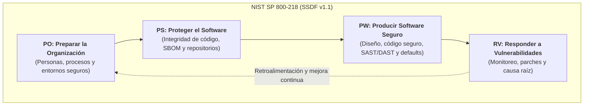

# Programación Segura — Resumen Clase 4: Ecosistema OWASP y Marco NIST SSDF (SP 800-218)

> **Resumen de clase:** Estudio del ecosistema de seguridad de aplicaciones (OWASP), las metodologías de protección proactiva (*Shift Left*) y la implementación práctica del marco de desarrollo seguro NIST SP 800-218 (SSDF v1.1).

---

## 📌 Índice Temático
1. [Ecosistema OWASP y Áreas de Seguridad](#1-ecosistema-owasp-y-áreas-de-seguridad)
2. [Protección Proactiva y Paradigma "Shift Left"](#2-protección-proactiva-y-paradigma-shift-left)
3. [Marco NIST SP 800-218 (SSDF v1.1)](#3-marco-nist-sp-800-218-ssdf-v11)
   - [Objetivos Fundamentales](#objetivos-fundamentales)
   - [Los 4 Pilares del SSDF](#los-4-pilares-del-ssdf)
     - [I. Preparar la Organización (PO)](#i-preparar-la-organización-po---prepare-the-organization)
     - [II. Proteger el Software (PS)](#ii-proteger-el-software-ps---protect-the-software)
     - [III. Producir Software Altamente Seguro (PW)](#iii-producir-software-altamente-seguro-pw---produce-well-secured-software)
     - [IV. Responder a las Vulnerabilidades (RV)](#iv-responder-a-las-vulnerabilidades-rv---respond-to-vulnerabilities)
4. [Contexto Normativo: Orden Ejecutiva 14028](#4-contexto-normativo-orden-ejecutiva-14028)
5. [Glosario Rápido para Estudio](#5-glosario-rápido-para-estudio)

---

## 1. Ecosistema OWASP y Áreas de Seguridad

El **Open Web Application Security Project (OWASP)** es una fundación abierta a nivel mundial dedicada a capacitar a las organizaciones para desarrollar, adquirir y mantener aplicaciones y APIs confiables.

Su ecosistema de proyectos se organiza en seis grandes áreas de seguridad:

### Tabla Resumen: Áreas, Proyectos y Riesgos Críticos

| Área Temática | Proyectos Clave | Riesgos Principales Explicados |
| :--- | :--- | :--- |
| **1. Seguridad Web y APIs** | • OWASP Top 10 (Web) • API Security Top 10 • ASVS (*Application Security Verification Standard*) | • **Inyecciones (SQL, NoSQL, Comandos):** Envío de datos no confiables a un intérprete que los ejecuta indebidamente. • **Falta de límites de tasa (*Unrestricted Rate Limiting*):** Ausencia de control de peticiones por IP o usuario, facilitando ataques de denegación de servicio (DoS) o fuerza bruta. • **Exposición excesiva de datos (*Excessive Data Exposure*):** Endpoints de API que retornan objetos de datos completos confiando erróneamente en que el frontend los filtrará. • **Fallos de autenticación:** Debilidades en la gestión de sesiones o validación de credenciales que posibilitan la suplantación de identidad. |
| **2. Entornos Móviles, IoT y Embebidos** | • Mobile Top 10 • MASVS (*Mobile ASVS*) • IoT Top 10 | • **Almacenamiento inseguro (*Insecure Data Storage*):** Datos sensibles guardados en memoria local del dispositivo sin cifrado adecuado. • **Ingeniería inversa (*Reverse Engineering*):** Descompilación de binarios (APK, IPA, firmware) para descubrir lógica de negocio, endpoints y credenciales. • **Canales no cifrados (*Insecure Communication*):** Tráfico en texto plano o con cifrado débil entre la app y el backend. • **Firmware vulnerable:** Hardware con software base desactualizado o sin capacidad de actualización remota segura. |
| **3. Inteligencia Artificial y LLMs** | • Top 10 for LLM Applications • OWASP AI Exchange | • **Inyección de Prompts (*Prompt Injection*):** Manipulación de entradas de texto para eludir directivas internas del modelo y forzar comportamientos no deseados. • **Envenenamiento de datos (*Data Poisoning*):** Alteración de datos de entrenamiento o *fine-tuning* para introducir vulnerabilidades, sesgos o puertas traseras. • **Exfiltración de modelos:** Acceso no autorizado para clonar pesos (*weights*), hiperparámetros o arquitectura propietaria. • **Ejecución de código no confiable:** Permitir que agentes de IA ejecuten comandos de forma autónoma sin entornos aislados (*sandboxes*). |
| **4. DevSecOps y Cadena de Suministro** | • OWASP Dependency-Check • CycloneDX (SBOM) • SCVS (*Component Verification*) • SAMM (*Software Assurance Maturity Model*) | • **Librerías de terceros con vulnerabilidades (CVEs):** Uso de paquetes de código abierto obsoletos con fallos públicos. • **Manipulación de pipelines CI/CD o repositorios:** Intrusiones en GitHub Actions, GitLab CI, Jenkins, etc., para inyectar código malicioso en la compilación. • **Falta de visibilidad sobre dependencias:** Desconocimiento de los módulos directos y transitivos que componen el software. |
| **5. Nube, Contenedores y Serverless** | • Kubernetes Top 10 • Serverless Top 10 • Cloud-Native Security | • **Configuraciones defectuosas (*Cloud Misconfigurations*):** Políticas IAM permisivas, recursos de almacenamiento públicos o puertos expuestos. • **Funciones Serverless con privilegios excesivos:** Roles asignados a funciones en la nube con permisos que superan sus necesidades operativas. • **Aislamiento deficiente en contenedores:** Escape de contenedor (*container breakout*) que compromete al nodo anfitrión o al clúster entero. |
| **6. Privacidad y Modelado de Amenazas** | • OWASP Privacy Risks Top 10 • Threat Modeling Project | • **Diseño inseguro (*Insecure Design*):** Fallos arquitectónicos introducidos antes de codificar por omitir el análisis y modelado de riesgos. • **Fallo en minimización de datos (*Data Minimization Failure*):** Recopilación, procesamiento y almacenamiento de más Datos de Identificación Personal (PII) de los necesarios. |

---

## 2. Protección Proactiva y Paradigma "Shift Left"

La **protección proactiva** consiste en integrar la seguridad desde la génesis del ciclo de vida del software, superando el modelo reactivo tradicional donde la seguridad era únicamente una auditoría tardía antes de producción.

### El Principio de "Shift Left" (Desplazar a la izquierda)

```mermaid
flowchart LR
    A["1. Requisitos<br><b>(Definir requisitos)</b>"] --> B["2. Diseño<br><b>(Modelado de amenazas)</b>"]
    B --> C["3. Codificación<br><b>(SAST / Buenas prácticas)</b>"]
    C --> D["4. Pruebas / CI<br><b>(DAST / SCA / SBOM)</b>"]
    D --> E["5. Despliegue<br><b>(Líneas base seguras)</b>"]
    E --> F["6. Mantenimiento<br><b>(VDP / Parches)</b>"]

    style A fill:#e1f5fe,stroke:#0288d1,stroke-width:2px
    style B fill:#e1f5fe,stroke:#0288d1,stroke-width:2px
    style C fill:#e8f5e9,stroke:#388e3c,stroke-width:2px
    style D fill:#fff3e0,stroke:#f57c00,stroke-width:2px
    style E fill:#f3e5f5,stroke:#7b1fa2,stroke-width:2px
    style F fill:#fbe9e7,stroke:#d84315,stroke-width:2px
```

> [!TIP] **¿Por qué "Shift Left"?**
> Detectar y solucionar un fallo de diseño o un error conceptual en las etapas tempranas del desarrollo requiere exponencialmente **menor costo y esfuerzo** que corregirlo en producción o tras un incidente de seguridad en vivo.

### Prácticas Clave de la Protección Proactiva:
1. **Modelado de Amenazas (*Threat Modeling*):** Identificación y análisis de vectores de ataque en la fase de arquitectura, antes de escribir código.
2. **Codificación Defensiva:** Estándares estructurados para evitar fallos comunes (inyecciones SQL, Cross-Site Scripting [XSS], desbordamientos de buffer).
3. **DevSecOps e Inspección Automatizada:** Integración en el pipeline CI/CD de:
   * **SAST (*Static Application Security Testing*):** Análisis estático del código fuente sin ejecutar.
   * **DAST (*Dynamic Application Security Testing*):** Pruebas dinámicas de caja negra sobre la aplicación en ejecución.
   * **SCA (*Software Composition Analysis*):** Escaneo de librerías de terceros para detectar vulnerabilidades conocidas (CVEs).
4. **Seguridad por Defecto (*Security by Default*) y Menor Privilegio:** Diseñar el sistema de modo que la configuración base sea la más restrictiva y segura posible.
5. **Marcos de Referencia y Madurez:** Uso de modelos formales como **OWASP SAMM** y **NIST SSDF**.

---

## 3. Marco NIST SP 800-218 (SSDF v1.1)

La publicación especial **NIST SP 800-218**, titulada *Secure Software Development Framework (SSDF) Version 1.1: Recommendations for Mitigating the Risk of Software Vulnerabilities*, fue desarrollada por el **Instituto Nacional de Estándares y Tecnología (NIST)** y publicada en febrero de 2022. Su propósito es definir un conjunto de prácticas de alto nivel aplicables a cualquier ciclo de vida de desarrollo de software (SDLC).

### Objetivos Fundamentales
1. **Reducir el número de vulnerabilidades** en el software publicado.
2. **Minimizar el impacto potencial** derivado de la explotación de fallos no detectados o no corregidos.
3. **Abordar las causas raíz de las vulnerabilidades** para prevenir su reaparición futura.

> [!NOTE] **Enfoque Flexible y Basado en Resultados:**
> El SSDF **no prescribe herramientas ni lenguajes específicos**. Se enfoca en *resultados (outcomes)* medibles, siendo adaptable a cualquier sector, tamaño de organización, lenguaje de programación, tecnología (IT, IoT, sistemas ciberfísicos) o metodología (Agile, DevOps, Cascada).

---

### Los 4 Pilares del SSDF

#### I. Preparar la Organización (PO — *Prepare the Organization*)
*Garantiza que la organización (personas, procesos y tecnología) esté capacitada a nivel institucional para ejecutar un desarrollo seguro.*

* **PO.1 — Definir requisitos de seguridad:** Identificar, documentar y mantener actualizados los requisitos de seguridad de la infraestructura, los procesos y el software propio o de terceros.
* **PO.2 — Roles y responsabilidades:** Asignar roles claros en el SDLC, brindar capacitación periódica orientada al perfil técnico y contar con el compromiso activo de la alta dirección.
* **PO.3 — Cadenas de herramientas de soporte:** Emplear automatización para reducir el error humano, fortificar las herramientas utilizadas y configurarlas para que generen registros y artefactos auditables.
* **PO.4 — Criterios de verificación de seguridad:** Definir indicadores (KPIs, KRIs, severidad de fallos) y recolectar métricas para evaluar si el software satisface las expectativas de seguridad.
* **PO.5 — Entornos de desarrollo seguros:** Proteger y aislar los entornos de desarrollo, pruebas, compilación y distribución mediante modelos de Confianza Cero (*Zero Trust*) y fortificación de terminales de trabajo (*endpoints*).

#### II. Proteger el Software (PS — *Protect the Software*)
*Previene modificaciones no autorizadas o accesos indebidos a todos los componentes del software.*

* **PS.1 — Proteger todas las formas de código:** Almacenar el código fuente, ejecutables y configuración como código bajo el principio de menor privilegio, utilizando firmas criptográficas de *commits* y de binarios.
* **PS.2 — Mecanismos de verificación de integridad:** Proporcionar a los clientes y adquirentes información de verificación de integridad (hashes criptográficos, certificados de firma de código).
* **PS.3 — Archivado y procedencia (SBOM):** Archivar de manera segura las versiones liberadas y mantener la procedencia de los componentes mediante una Lista de Materiales del Software (**SBOM** - *Software Bill of Materials*).

#### III. Producir Software Altamente Seguro (PW — *Produce Well-Secured Software*)
*Asegura la producción de entregas con el mínimo de vulnerabilidades de seguridad.*

* **PW.1 / PW.2 — Diseño orientado a seguridad y modelado de amenazas:** Evaluar riesgos mediante *Threat Modeling* y revisar el diseño con personal calificado o herramientas automatizadas antes de programar.
* **PW.4 — Reutilización de software seguro:** Adquirir y verificar componentes o librerías de terceros (comerciales o de código abierto) y reutilizar módulos internos previamente certificados.
* **PW.5 / PW.6 — Codificación y compilación segura:** Seguir prácticas de programación defensiva (validación de entradas, tratamiento de errores) y configurar compiladores para emitir advertencias tratadas como errores.
* **PW.7 / PW.8 — Revisión de código y pruebas:** Analizar el código mediante revisiones entre pares y análisis estático (SAST), así como ejecutar pruebas en binarios (DAST, *fuzzing* y *pentesting*).
* **PW.9 — Configuraciones predeterminadas seguras:** Definir e implementar líneas base donde los ajustes por defecto ofrezcan la mayor seguridad (*Secure by Default*).

#### IV. Responder a las Vulnerabilidades (RV — *Respond to Vulnerabilities*)
*Facilita la identificación continua y remediación oportuna de vulnerabilidades descubiertas tras el lanzamiento.*

* **RV.1 — Identificación continua:** Monitorear bases de datos de vulnerabilidades (como NVD/CVE), operar programas de divulgación responsable (**VDP**) y disponer de un equipo especializado de respuesta (**PSIRT**).
* **RV.2 — Evaluación y remediación de riesgos:** Priorizar y planificar la mitigación de fallos en función del riesgo, publicando avisos de seguridad (*Security Advisories*) y parches.
* **RV.3 — Análisis de causa raíz:** Determinar la causa origen de los fallos para erradicar categorías enteras de vulnerabilidades y actualizar las prácticas del SDLC, evitando su recurrencia.

---

## 4. Contexto Normativo: Orden Ejecutiva 14028

El SSDF v1.1 responde de forma directa a la **Sección 4 de la Orden Ejecutiva 14028** (*"Improving the Nation's Cybersecurity"*), emitida por el gobierno de EE.UU.:

* **Requisito para proveedores:** Toda empresa que provea software a organismos gubernamentales debe certificar formalmente el cumplimiento de las prácticas del NIST SSDF.
* **Transparencia en la cadena de suministro:** Fomenta de manera prioritaria la entrega del **SBOM** para identificar de inmediato si un software contiene componentes vulnerables conocidos (como ocurrió históricamente con incidentes tipo SolarWinds o Log4Shell).

---

## 5. Glosario Rápido para Estudio

| Término | Definición Clave |
| :--- | :--- |
| **SBOM (*Software Bill of Materials*)** | Inventario formal y estructurado de todos los componentes, módulos y librerías (directas y transitivas) que componen una aplicación. |
| **SAST (*Static Application Security Testing*)** | Análisis estático que examina el código fuente sin ejecutarlo para hallar vulnerabilidades en fases tempranas. |
| **DAST (*Dynamic Application Security Testing*)** | Análisis dinámico que interactúa con la aplicación en ejecución como atacante externo (caja negra). |
| **SCA (*Software Composition Analysis*)** | Herramienta automatizada que analiza dependencias de terceros para detectar componentes desactualizados o con CVEs publicadas. |
| **PSIRT (*Product Security Incident Response Team*)** | Equipo técnico dedicado a gestionar y remediar vulnerabilidades reportadas en los productos liberados por la organización. |
| **VDP (*Vulnerability Disclosure Program*)** | Marco y canal oficial para que investigadores externos puedan reportar fallos de seguridad de forma segura y ética. |
| **Zero Trust (*Confianza Cero*)** | Filosofía de seguridad fundamentada en *"nunca confiar, verificar siempre"*, aplicada a la protección de los entornos y cadenas de CI/CD. |